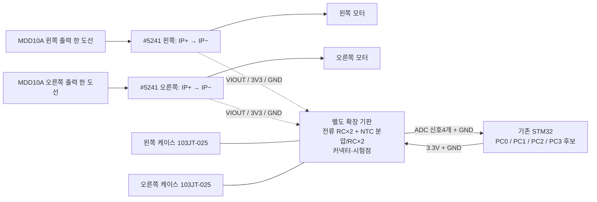

# 모터 전류·온도 4채널 확장 기판 연결안

기준일: **2026-10-22**. 상태: **회로 블록·인출/커넥터 설계 초안 / 제작·배선 미승인**.

## 이번 작업의 결정

기존 만능기판에 입력 회로를 분산 추가하지 않고, **전류2·온도2채널의 신호 회로를 별도 확장 기판에 모은다.** 이후 제작할 PCB에는 이 기능 블록을 옮길 수 있게 한다. 기존 STM/ESP·엔코더·E-stop 회로는 유지한다. 기존 [공간 검토](12_Dual_Rail_ADC_Space_Review_2026-09-30_ko.md)와 [하층 확장안](13_Two_Deck_Perfboard_Expansion_Feasibility_2026-09-30_ko.md)을 따른다.

확장 기판의 정확한 크기·고정 위치·스페이서와 부품 패키지는 아직 정하지 않는다.9/30의40×50mm는 당시 전압2채널 공간 예산이며 이번4채널 완성 크기로 재사용하지 않는다.150×100mm 하층 역시 가능성 제안이다. 지금 새 만능기판/커넥터/리드형 부속을 구매하거나 기존 회로를 철거할 단계는 아니다.

## 기능 블록과 배선

### 후속 제안: NUCLEO 상면 쉴드형 PCB

사용자가 STM 보드 위에서 꽂는 HAT/쉴드 형태를 제안했다. **4채널 신호 PCB의 우선 기구 검토안으로 적절하다.** 아직 형상·제작 방식 선택을 확정한 것은 아니며, 기존 하네스형/하층안과 비교한다. [UM1724 §7.14](https://www.st.com/resource/en/user_manual/um1724-stm32-nucleo64-boards-mb1136-stmicroelectronics.pdf)는 CN7/CN10 수 핀 헤더를 보드 양면에서 접근해 위/아래 확장 기판에 사용할 수 있다고 명시한다.

구상은 `기존 만능기판 → 현재 NUCLEO → 상면 모니터링 쉴드`다. NUCLEO 상면의 CN7/CN10에 맞춰 쉴드 밑면에 암 소켓을 두고, PC0~PC3 후보와3.3V/GND를 직접 접속한다. PC2/PC3 접근이 필요한 이번 구성에는 Arduino 헤더만 사용하는 범용 UNO 쉴드보다 ST morpho 기반 전용 PCB가 적절하다. PC0/PC1의 기존 solder bridge 조건은 쉴드에서도 그대로 확인한다.

장점은 STM까지의 아날로그 연결을 짧게 하고, 별도 ADC/전원 하네스를 줄이며, 기존 만능기판의 실장 공간을 쓰지 않고 신호 회로를 교체할 수 있다는 것이다. 현재 제시한 JMON_PWR/JMON_ADC 하네스는 쉴드 채택 시 morpho 접속으로 대체할 수 있다. 외부 NTC와 전류센서의 연결선은 여전히 필요하다.

형상 확정 전에는 다음을 확인한다.

- 현재 상면 핀에 꽂힌 점퍼/디버그 프로브와 간섭 여부. 쉴드로 덮는 필요한 신호에는 시험점 또는 통과 헤더를 마련한다. 기존 만능기판을 통한 연결은 유지하되 실제 상면 점유를 가정하지 않는다.
- 아래쪽 소켓과 맞물린 상태에서 위쪽 핀의 유효 체결 길이, 쉴드 밑면 부품/납땜과 NUCLEO 부품 사이 간격. 소켓 규격·간격은 도면/실물 확인 후 선정한다.
- RESET/USER 버튼·전원 점퍼·ST-LINK USB 접근. MCU 쪽 위주 윤곽과 필요한 절개/빈 구역을 검토하며 ST-LINK 쪽 전체를 덮는 큰 판을 먼저 확정하지 않는다.
- 탈착 시 기존 NUCLEO/만능기판 소켓에 가해지는 힘과 센서 케이블 당김. 가능한 지지점·스트레인 릴리프를 확인한다. 표준 장착홀이나 임의 스페이서가 이미 맞는다고 가정하지 않는다.

온도 분압·전류 RC·필요 보호/센서 커넥터는 쉴드에 배치할 수 있다. #5241 두 모듈의 주전류 경로와 굵은 모터선은 별도 전력 구역에 유지하는 초기 범위를 권장한다. 이번 제안만으로 주전류를 쉴드로 옮기거나 미래 CAN/전압 기능을 전부 실장하도록 확대하지 않는다. 실물 치수·접근이 확인되기 전 PCB outline/footprint·부품 주문이나 제작 승인은 없다.

그림의 모터 반대 도선은 해당 MDD 채널의 다른 출력으로 연결되는 기존 경로다. 모터 출력은 신호 GND가 아니다. #5241의 주전류 경로는 적합한 전력 선재·단자와 별도 기계 지지를 사용한다. 확장 기판에는 VIOUT·센서 전원·신호 GND만 들어온다. 모듈을 고정하는 구조와 주전류를 기판 패드로 운반하는 구조를 혼동하지 않는다.

## STM32 인출 후보와 확인 범위

NUCLEO 접점은 [ST UM1724 Rev17 표29](https://www.st.com/resource/en/user_manual/um1724-stm32-nucleo64-boards-mb1136-stmicroelectronics.pdf)를 대조했다. 기존 소켓의 component-side 표시 좌표는 CN7 even=R28, odd=R29, C6부터 핀 순서대로라는 기존 PDF/검토 기준을 따른다. 납땜면에서는 좌우가 반전되며 아래 표는 납땜 지시가 아니다.

| 신호 | MCU / ADC 후보 | NUCLEO 접점 | 기존 소켓 / component-side 좌표 | 저장 VRT 상태 |
| --- | --- | --- | --- | --- |
| I_LEFT | PC0 / IN10 | CN7-38 | H_NUC_LOW_R28 Pin19 / C24,R28 | Net0, 외부 배선 미배정 |
| I_RIGHT | PC1 / IN11 | CN7-36 | H_NUC_LOW_R28 Pin18 / C23,R28 | Net0, 외부 배선 미배정 |
| T_LEFT | PC2 / IN12 | CN7-35 | H_NUC_LOW_R29 Pin18 / C23,R29 | Net0, 외부 배선 미배정 |
| T_RIGHT | PC3 / IN13 | CN7-37 | H_NUC_LOW_R29 Pin19 / C24,R29 | Net0, 외부 배선 미배정 |
| 3V3 공급 | STM32 측3.3V | CN6-4 또는 CN7-16 | CN7은 H_NUC_LOW_R28 Pin8 / C13,R28 | Net11 기존 연결. 분기 가능 여부는 실물 확인 |
| GND | STM32 공통 기준 | CN6-6/7 등 기존 GND 후보 | 실제 접근 가능한 지점 선정 | 모터 전류의 귀환 경로로 쓰지 않음 |

**PC0/PC1은 조건부 후보**다. UM1724는 CN7-38/36에도 PC0/PB8·PC1/PB9의 solder bridge 선택을 명시한다. 기존 IMU PB8/PB9를 보존하고 실제 bridge와 접점이 PC0/PC1에 연결되는지 확인한 뒤 확정한다. Net0은 실물 여유나 올바른 MCU 연결을 보증하지 않는다. PC2/PC3도 접근성·인접 배선/부품 높이는 미확인이다.

인출은 먼저 NUCLEO 상면에서 접근할 수 있는 접점을 검토한다. 접근이 불가능하면 기존 소켓 접점에서 필요한 선만 인출하는 대안을 검토하되, 커넥터 몸체는 확장 기판 쪽에 두어 기존 보드 공간을 더 차지하지 않게 한다. 기존 소켓 전체 교체나 모든 MCU 핀의 복제는 요구하지 않는다.

이번 VRT 대조는 저장된 파일 SHA-256 `09c1546d04eeaf581bc55ea9717965a56fd6dac742b565f9796924bdf8fbef78`에서 두 소켓의 번호/Net 레코드만 읽었다. [읽기 스크립트/검토 산출물](../assets/logs/sensor_design/2026-10-22_monitor_expansion/review.py)을 보존한다. 기존 알려진Pin8=Net11,Pin14/15=Net21/22와대조했으며 전체 netlist·실물 도통을 검증한 것은 아니다.

## 분리형 커넥터의 전기적 초안

이름과 핀 번호는 **새 설계안**이다. 현재 VRT/KiCad에 생성된 부품이 아니며 특정 하우징/피치 구매 확정도 아니다. PCB부터 connector mating면·Pin1·극성 표기를 명시한다. 같은 핀 수의 기존 UART/전원 커넥터와 오접속되지 않도록 기구 키·형식도 함께 정한다.

| 커넥터 후보 | 핀 순서 초안 | 목적 |
| --- | --- | --- |
| JMON_PWR 2핀 | 1=STM_3V3,2=GND | STM 전원에서 확장 신호 회로·센서로 공급 |
| JMON_ADC 8핀 | 1=I_LEFT,2=GND,3=I_RIGHT,4=GND,5=T_LEFT,6=GND,7=T_RIGHT,8=GND | 아날로그 신호별 귀환선과 함께 STM으로 전달 |
| JCUR_L / JCUR_R 각3핀 | 1=3V3,2=GND,3=VIOUT | #5241의 신호 측만 접속. FAULT는 초기 미사용 |
| JNTC_L / JNTC_R 각2핀 | 1=TEMP_NODE,2=GND | 극성 없는 NTC 두 선 연결 |

GND 핀은 모두 같은 신호 기준이다. 가닥을 나눠도 절연 GND가 되는 것은 아니다. 전원·귀환 하네스는 같은 경로에 가깝게 묶고 모터/릴레이 전류를 이 선으로 돌리지 않는다. 길이는 실물 접근 후 정하고, 아날로그 신호를 PWM/전력선과 긴 구간 평행하게 배치하지 않는다.

## 신호 회로 블록과 부속 예산

온도 회로는 [NTC 입력 계산안](../docs/plans/2026-10-22_NTC_Temperature_Input_Design_ko.md)을 재사용한다.10kΩ±1%도 초기 대안이며0.1%만을 요구하지 않는다.초기 부품 형식은 리드형/THT로 선택했으며100nF는Vishay K104K15X7RF53H5 10개 구매 완료·수령 미확인이다.

전류의 초기 계산 후보는 **VIOUT → 12kΩ → ADC 노드, ADC 노드에서100nF → GND**다. 기존 NTC의1kΩ을 그대로 복사하지 않았다. [Allegro 전기 표](https://www.allegromicro.com/-/media/files/datasheets/acs71240-datasheet.pdf)의 직접 출력 용량 최대4.7nF·저항 부하 최소10kΩ 조건을 고려해,100nF는 직렬 저항 뒤에 두고12kΩ±1%의 최솟값11.88kΩ으로 부하 전류를 제한하는 후보를 잡았다.

명목 차단 주파수는 약132.6Hz, 시정수1.2ms,10~90% 응답 약2.64ms다.19kHz 성분의 이상적1차 감쇠는 약−43.1dB다. 이는 느린 전류 추세용 계산이며 완전한 anti-alias filter·순간 피크/RMS 관측·출력 안정성 검증이 아니다. 직렬 저항 앞의 케이블/기판 용량은 여전히 센서 직접 부하이므로 실제 길이/배치를 확인한다. 최종 보호 소자의 누설·ADC 입력 누설에 의한12kΩ 전압 오차·무전원 역급전과 단선 검출을 검토하기 전 제작 승인하지 않는다.

| 입력 부속 | 필요한 수량 | 상태 |
| --- | ---: | --- |
| 온도 기준10kΩ | 2 | 보유 허용오차 미확인,1% 대안 가능 |
| 온도 직렬1kΩ | 2 | 보유 수량 미확인 |
| 전류 직렬12kΩ | 2 | 계산 후보, 보유/최종 채택 미확인 |
| ADC 입력100nF | 4 | 온도2+전류 후보2. Vishay K104K15X7RF53H5 10개 구매 완료·수령 미확인 |
| 전원 디커플링·입력 보호 | 미확정 | 구매한 carrier의 실장 부품과 배선·보호 요구를 대조한 뒤 중복 없이 결정 |
| 커넥터·시험점·고정부속 | 미확정 | 위 pinout/실물 접근·PCB 방식을 바탕으로 결정 |

### 손납땜을 고려한 구매 형식

**최신 준비 상태:** Vishay `K104K15X7RF53H5` 10개 구매 완료(2026-10-22 사용자 보고). 규격은100nF(0.1µF)·50V·X7R·±10%·리드형·피치5mm다. 수령 여부·실제 판매처/결제액·도착일은 미확인이다. 10kΩ·1kΩ·12kΩ 저항은 보유로 확인돼 중복 구매에서 제외한다. 아래 구매 제안/미주문 표기는 이 확인 전의 논의 이력이다.100nF 필요 예산4개를 초과한6개는 예비분이며 보호/전원·기구/커넥터를 포함한 전체 BOM은 미확정이다.

**초기 제작 형식 선택 — 사용자 “쉬운거로 하자”: 축형 리드 저항과 리드형 세라믹 커패시터를 사용한다.** 조립·수리 편의를 우선하며 쉴드 PCB의 해당 부품은 관통홀(THT) footprint로 설계한다. 아래1206 SMD 논의는 비교 이력으로 보존하고 초기 구매/제작에서는 보류한다. 이는 부품 형식 선택이며 쉴드 치수·전체 회로/BOM·구매 완료를 뜻하지 않는다.

**이번 구매 안내 — 사용자 요청으로 입력 부속 정리:** 아래4종을 예비 포함 각10개씩 소량 준비하는 안을 제시한다. 보유품이 같은 규격이면 부족분만 산다.10kΩ·1kΩ은 온도 회로용 각2개,12kΩ은 전류 필터 후보용2개,100nF는 온도2+전류 후보2의4개가 설계 필요량이다.12kΩ은 최종 전류 회로값이 바뀔 수 있는 범용 준비품이며 제작값 확정은 아니다.

| 구매 검토 품목 | 형식/규격 | 추천 수량 |
| --- | --- | ---: |
| 10kΩ | 축형 리드 금속피막,±1%,1/4W; 온도계수50ppm/°C 이하 우선 검토 | 10 |
| 1kΩ | 축형 리드 금속피막,±1%,1/4W | 10 |
| 12kΩ | 축형 리드 금속피막,±1%,1/4W; 전류 필터 후보 | 10 |
| 100nF=0.1µF | 리드형 세라믹,X7R,50V,±10% | 10 |

PCB/만능기판,NUCLEO 결합용 암 소켓·센서 커넥터·스페이서와 입력 보호/전원 부속은 기구 치수·회로가 미확정이므로 이번4종과 구분해 후속 선정한다. 이미 구매한 센서/측정기·보유 선재를 중복 구매하도록 안내하지 않는다. 이번 목록은 입력 회로 준비용이며 모든 설치/전력 연결을 마치는 전체 BOM이 아니다. 새 주문·수령 보고는 없다.

사용자가 열풍기 미보유와 막대형 저항 사용을 문의했다. 초기 손납땜 쉴드에는 **축형 리드 저항과 리드형 세라믹 커패시터를 우선 권장**한다. 저항은 금속피막1%·1/4W, 커패시터는100nF(0.1µF)·X7R·50V·±10%를 구매 검토 규격으로 둔다.10kΩ0.1%는 필수가 아니다. 필요량은10kΩ/1kΩ 각2개·전류 후보12kΩ2개·100nF4개이며 예비를 포함해 값별5~10개 정도의 소량 포장을 검토할 수 있다.12kΩ은 여전히 전류 RC 후보이고, 이 목록은 미확정 보호/전원 부속을 포함한 전체 제작 BOM이 아니다. 새 주문은 보고되지 않았다.

열풍기가 없다고 SMD가 불가능한 것은 아니다. [삼성전기 칩 저항 자료의 Soldering Iron 절](https://www.samsungsem.com/resources/file/global/support/product_catalog/Chip_Resistor.pdf)은 인두 작업의 예열·온도/시간·열충격 조건을 제시한다. 선택한 부품의 조건을 따라야 하며 모든 칩에 같은 작업 조건을 적용하지 않는다. 리드형은 조립/교체 편의 대안이며 선택 시 실제 몸체·리드 간격에 맞는 관통홀 footprint를 사용한다. SMD 전용 패드에 리드 부품을 맞추는 것을 기본 제작안으로 삼지 않는다.

**후속 비교 후보:** 사용자가 전용 PCB의 칩 부품도 검토하자고 요청했다. 위 리드형은 조립 편의 대안으로 유지하고, 쉴드 PCB에는 저항/커패시터를 **1206 영미표기(3216 미터표기)**로 사용하는 안을 추가 비교한다. 커패시터 명목 몸체는 약3.2×1.6mm이며 실제 치수/높이와 패드는 선택한 제품 도면을 따른다. [KEMET 규격 예시](https://content.kemet.com/datasheets/CER_ENG_KIT_31.pdf)에100nF·50V·X7R·±10%의1206 제품이 있다. 저항은 같은 크기의1%·1/4W 제품을 검토하고, 온도 기준10kΩ은 온도계수도 함께 확인한다. 패키지 변경 자체가 입력 회로 검증/정밀도 향상을 보증하는 것은 아니다.

1206은 작은 패키지보다 인두·핀셋을 쓰기 쉬운 초기 SMD 후보라는 설계 판단이다. 충분한 패드 간격·손납땜용 land pattern·작업 접근을 확보하고 부품별 납땜 온도/시간·열충격 조건을 따른다. 리드형/SMD 최종 채택과 구매는 아직 미확정이며 두 종류 부품을 모두 사도록 요구하지 않는다. 전문성은 패키지 외관보다 회로 근거·전원/보호·접지/배치·시험점과 실제 측정 증거로 설명한다.

앞선 IMS 안내 인용은 재확인 결과 열풍 선호·일부 제품 인두 비권장 내용을 포함하므로 범용 칩 저항의 인두 조립 가능성을 뒷받침하는 자료로 쓰지 않는다. 현재 인두 조건 근거는 위 삼성전기 자료로 정정했다.

ADC는 현재 설정되지 않았다. NTC의14MHz/480cycles 조건은 계산 후보로 유지한다. 전류 수집 주파수/온도100sample/s 간격을 함께 만족하는 scan 또는 ADC 분리 구성을 후속 검토하며, 단순히4채널을 연속 최대 속도로 읽도록 정하지 않는다.

## 전원 예산과 유효성

전원은 STM 측3.3V에서 공급하는 안을 우선한다. #5241 두 IC의 무출력부하 최대 조건 합계24mA와 NTC 분압 합계 최대 약0.667mA(10kΩ±1%·단락 조건), RC 충전/추가 부하를 합쳐 센서 확장부는 약25mA에 추가 여유가 필요한 규모다. 이는 기존 STM32·IMU 부하를 뺀 가용 여유를 확인한 결과가 아니다. [UM1724의 U4 최대500mA](https://www.st.com/resource/en/user_manual/um1724-stm32-nucleo64-boards-mb1136-stmicroelectronics.pdf)를 그대로 추가 공급 가능량으로 쓰지 않는다. ESP32의3.3V 출력이나 별도 레귤레이터를 STM3.3V에 병렬로 연결하지 않는다.

온도는 단선/단락·표 밖/초기 정착/STALE을 구분한다. 전류 영점은 전류가 실제0인 조건에서 채널별 측정하고, 매 실행/모터 정지마다 자동으로0으로 덮어쓰지 않는다. 비례전원형이 아니므로VCC/2를 영점으로 고정하지 않는다. 단순 ADC중간값은 센서 연결/정상임을 증명하지 못하므로 전류센서 선 단절 시 처리·유효성은 별도로 설계한다. FAULT±30A를 모터9A 보호나 기존PC7 E-stop 입력으로 사용하지 않는다.

## 다음 구체적인 단계

배송 대기 중에는 이 pinout을 바탕으로 **독립 회로도 초안**을 작성하고 RC·전원/역급전·입력 단선 처리와 부품 패키지 후보를 검토한다. 부품/커넥터 몸체와 실제 STM 인출 높이·기판 장착 공간이 확보된 뒤 배치/치수·제작 BOM을 정한다. 수령 여부를 다시 묻거나 현재 보드 납땜을 먼저 요구하지 않는다.

이 확장 작업은 후속 연속 모니터링 준비다. GM-1312/UT210E의 기존 외부 계측을 기다리게 하는 선행 조건이 아니다. 이번에는 회로도/CubeMX/펌웨어·VRT·배선·기구물을 변경하거나 MCU 빌드/플래시·측정·Git 게시를 수행하지 않았다.
