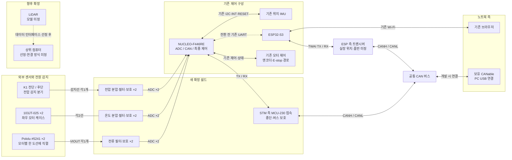
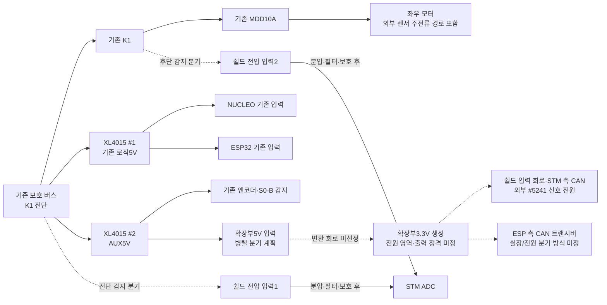

# 확장 PCB 전체 구성과 인터페이스 초안

기준일: 2026-10-23. **설계2단계의 첫 산출물인 블록도와 논리 인터페이스 검토본**이다. [요구조건1차안](15_Expansion_PCB_Requirements_2026-10-23_ko.md)을 바탕으로 작성했다. 커넥터 품번·실물 핀 순서·추가 전원 공급 능력은 후속 검토 항목이다.

## 채택한 목표 구성

2026-10-23 사용자가 **STM32 센서/구동 집중 + ESP32 무선 게이트웨이 + 두 MCU 사이 CAN + 개발용 CANable 관측** 구성을 채택했다. 별도 센서 MCU를 추가하지 않는다. 이는 후속 구현의 목표이며 현재 펌웨어의 UART 경로를 이미 CAN으로 전환했다는 뜻이 아니다. 측정 정확도·부품·전원 공급·핀·커넥터의 세부 후보는 계속 검토한다.

- STM32는 전류2·온도2·전압2채널, 기존 IMU·엔코더·모터 출력과 최종 안전 판단을 맡는다.
- ESP32는 브라우저/Wi-Fi와 CAN 사이에서 명령·상태를 전달한다. ESP용 CAN 트랜시버를 별도로 확보하고 핀·전원·배치를 검토한다.
- STM 측 트랜시버와 ESP 측 트랜시버는 **공통 CAN 버스 하나의 서로 다른 노드**다. CANable은 개발 시 같은 버스에 붙이는 PC 관측/시험 노드이며 평상시 무선 운용에는 분리 가능하다.
- 현재 UART를 기준 경로로 유지하며 CAN 상태 송수신 → 명령·타임아웃/오류·복구 검증 → 제어 입력 전환 순서로 도입한다. UART/CAN의 동시 제어권을 자동 허용하지 않는다. 기존 MVP 이후 후속 구현 경계를 유지한다.

같은2단계의 후속으로 [전원 예산](17_Expansion_Power_Budget_2026-10-23_ko.md)과 [공급 구조·조립 검토](18_Expansion_3V3_Supply_Structure_and_Assembly_2026-10-23_ko.md)를 작성했다. 단일 LDO·TO-220급은 제안이며 무전원 보호·측정 기준·최종 부품은 미확정이다. 다음은 ESP GPIO/커넥터 계약이다.

## 각 기판과 모듈의 역할

| 위치 | 역할과 포함 요소 |
| --- | --- |
| 기존 만능기판 | NUCLEO·기존 제어/엔코더/E-stop/UART 배선과 IMU 위치 유지. STM32가 ADC 수집·보정·유효성 처리·통신·최종 출력 판단 담당 |
| 새 상면 쉴드 | 전류 출력2채널 필터/보호, 온도2채널 분압/필터/보호, 전압2채널 분압/필터/보호, STM 측 CAN 트랜시버 접속·종단/보호, 전원 분배·점검 접근 |
| ESP 측 CAN 접속부 | ESP용 트랜시버1개와 논리 신호/전원/버스 연결. 새 쉴드에 함께 둘지 ESP 가까이에 둘지는 전원·배선·기구 검토 후 결정 |
| 외부 센서·전력 구역 | #5241 두 개의 주전류 단자와 모터 전력 배선, 모터에 부착할 NTC 두 개, 기존 MDD10A·K1·XL4015·퓨즈·버스바 |
| 노트북 | 기존 브라우저 제어/관측, 보유 CANable을 통한 CAN 시험. LiDAR/ROS 2 상위 연결은 해당 모델 선정 후 구체화 |

새 PCB는 MCU를 추가하지 않는 수동 아날로그 입력과 CAN 물리 연결의 확장안이다. 실제 센서 데이터 수집·환산·CAN 송수신 기능은 후속 STM32 펌웨어 작업으로 구현한다.

## 신호 흐름

실선은 목표 구성의 논리 신호 경로다. 점선은 전환 전의 기존 UART 또는 미정 확장 경로다. 모터 주전류와 전원 공급선은 다음 그림/설명에서 다룬다.

향후 확장의 점선은 LiDAR와 상위 컴퓨터 사이의 미정 데이터 경로다. LiDAR 데이터를 CAN으로 보내는 구성이 아니다. 상위 컴퓨터의 CAN/ROS 2 연계는 모델과 역할을 정한 뒤 별도로 연결한다.

CAN의 TX/RX 화살표는 양방향 논리 신호를 묶어서 표시했다. 실제로는 STM TX → 트랜시버 TXD, 트랜시버 RXD → STM RX의 독립된 두 선이다. NTC는 쉴드의 분압 회로와 조합해서 읽는 수동 센서다.

STM·ESP·CANable을 연결해도 종단은 **물리 버스 양 끝의 두 개**다. CANable 연결/분리 시 끝점 구성이 달라지는 상황을 커넥터·종단 선택 설계에서 다룬다. 각 트랜시버를 두는 실제 기판과 논리 CAN 노드의 구분도 유지한다.

## 전원과 전압 감지 흐름

**10/23 최신 전원 입력 방향:** 사용자 요청에 따라 **XL4015 #2 AUX5V에서 병렬 분기 → 확장부3.3V 생성**을 검토한다. 이전 #1 분기안을 대체한다. #2의 기존 엔코더/S0-B 감지 부하는 유지하며 감지 루프·릴레이 접점 뒤에서 전원을 가져오지 않는다. [전원 예산 계산](17_Expansion_Power_Budget_2026-10-23_ko.md)에서 추가 부하235mA·연속 설계300mA·500mA급 이상 레귤레이터 검토를 제안했다. 변환기 품번·하나/복수 전원 영역은 미정이며 실제 배선·출력 설정 변경은 없다.

K1에서 V2로 향하는 점선은 **K1 출력측 노드**의 감지 분기다. 모터 주전류가 쉴드를 거쳐 흐르는 경로가 아니다. 기존 E-stop 동작과 로직 전원 공급의 구체적인 경로는 기존 전원 계약을 따른다.

- 기준 GND는 기존 지정 공통 GND를 사용한다. 그림에서는 생략했으며 센서 신호 귀환으로 모터·릴레이 코일 전류를 흘리지 않는다.
- 추가 부하와 기존 엔코더2개·S0-B 감지 부하를 합쳐 XL4015 #2·분기선·커넥터의 공급 여유를 확인한다. NUCLEO/ESP/기존 IMU는 #1/기존 보드 공급에 남는다. 전압 감지 주분압의 부하는 감지 대상 전원에서 공급되어3.3V에 중복 가산하지 않는다. 엔코더 소비전류가 미정이므로 #2 전체 공급 여유는 아직 확정하지 않았다.
- 전류센서#5241은3.0~3.6V, 보유 SN65HVD230 계열은3.3V용이다. XL4015의5V를 해당 부품에 직접 공급하지 않는다. 별도3.3V 변환의 전압 오차·전류 정격·기동·발열·디커플링을 검토한다.
- 기존 STM_3V3·ESP_3V3와 새 확장3.3V는 출력 레일을 직접 합치지 않는다. 각 MCU가 USB 또는 전원 OFF 상태일 때 센서/CAN 신호로 역급전되지 않도록 전원 순서·입출력 한계를 검토한다. 하나의3.3V 출력으로 모든 확장부를 공급할지는 이 검토 뒤 결정한다.
- NTC 여기 전원을 별도3.3V에서 공급하면 STM ADC 기준 전압과 자동으로 같다고 가정할 수 없다. 기존 NTC 계산의 VEXC/VREF 비율과 전원 오차·드리프트를 다시 대조한다. IMU의 기존 전원/배선은 이번 선택으로 변경하지 않는다.
- #5241의 VCC/GND는 신호 전원측이다. 모터측 IP+/IP− 도선을 신호 GND에 연결하지 않는다.
- K1 전단 전압 입력은 STM 전원 OFF 상태에서도 살아 있을 수 있다. 전압 분압·보호와 전원 순서의 역급전 검토가 필요하다.
- USB 개발 전원으로 전환할 때는 기존 두 보드의 buck/USB 전환 절차를 유지한다. CANable의 PC USB 연결은 별도 포트이며 VBUS를 로봇 로직5V 공급으로 사용하지 않는다. CAN 접지/절연은 실제 PC·CANable·로봇 연결 경로를 확인한 뒤 정한다.
- 그림의 XL4015 #1·#2 출력은 서로 연결하지 않는다. LiDAR 전원은 이 그림에 공급 부하로 확정하지 않았다.

별도 분기를 추가하므로 개발용 USB 전환 시 확장부를 포함한 전원 ON/OFF 조합표도 작성한다. 아직 확장5V와 USB를 동시에 인가하는 배선/시험 절차를 확정한 상태는 아니다. 부품 전압 근거는 [Pololu#5241](https://www.pololu.com/product/5241), [TI SN65HVD230](https://www.ti.com/lit/ds/symlink/sn65hvd230.pdf)을 따른다.

## STM32와 새 쉴드 사이의 논리 인터페이스

아래 접점은 기존 핀 계약에 따른 후보이며 새 커넥터의 핀 번호가 아니다. 현재 상면 Morpho 소켓 접속안을 기준으로 읽는다.

| 기능 | 방향 | MCU 후보 | NUCLEO 접점 | 확인 조건 |
| --- | --- | --- | --- | --- |
| 왼쪽 전류 | 쉴드 → STM ADC | PC0 / IN10 | CN7-38 | PC0/PB8 solder bridge 선택 확인 |
| 오른쪽 전류 | 쉴드 → STM ADC | PC1 / IN11 | CN7-36 | PC1/PB9 solder bridge 선택 확인 |
| 왼쪽 온도 | 쉴드 → STM ADC | PC2 / IN12 | CN7-35 | 상면 접근·간섭 확인 |
| 오른쪽 온도 | 쉴드 → STM ADC | PC3 / IN13 | CN7-37 | 상면 접근·간섭 확인 |
| K1 전단 전압 | 쉴드 → STM ADC | PA4 / IN4 | CN7-32 | 기존 예약 유지, 무전원 입력 보호 검토 |
| K1 후단 전압 | 쉴드 → STM ADC | PB0 / IN8 | CN7-34 | 기존 예약 유지, 입력 보호 검토 |
| CAN TX | STM → 쉴드 트랜시버 | PA12 / CAN1_TX | CN10-12 | 모듈 TXD 및 RS 조건 대조 |
| CAN RX | 쉴드 트랜시버 → STM | PA11 / CAN1_RX | CN10-14 | 모듈 RXD 논리 조건 대조 |
| 확장 전원 | XL4015 #2 병렬 분기 → 쉴드 | AUX5V 입력 → 별도3.3V 생성안 | 별도 입력 커넥터 미정 | 보드3.3V 출력과 직결하지 않으며 전류 정격·전원 순서 검토 |
| 신호 기준 | 기존 공통 GND ↔ 쉴드 | GND | CN7-20 등 후보 | 실제 귀환 경로·접점 배치 확인 |

핵심 STM 신호는 **아날로그6개 + CAN 논리2개**다. 신호 전원·GND 접점 수와 추가 RS 제어선 필요성은 별도로 결정한다. PC0/PC1을 확보하려고 기존 IMU의 PB8/PB9 배선을 임의 변경하지 않는다.

ESP 측 TWAI TX/RX는 [CAN 핀·커넥터 초안](19_CAN_GPIO_and_Connector_Contract_2026-10-23_ko.md)에서 **GPIO4 TX / GPIO5 RX**를 신규 예약 후보로 제안했다. 공식 헤더 J1-4/5와 현재 UART17/18 소스를 대조했으며 HG 실물 접점/접근은 미확인이다. ESP 가까운 트랜시버·별도 확장3.3V 전원·3선 논리/버스 포트와 끝점 종단을 검토했다. 전원 OFF 보호·제품/키·소켓 실물은 미확정이고 기존 UART를 유지한다.

IMU PB8/PB9·PB1/PC4, UART PA9/PA10, 엔코더 PB4/PB5·PA0/PA1, PWM PB6/PB7·DIR PC8/PC9, PC7 E-stop, PA13/PA14 SWD와 RESET 접근을 보존한다. 기존 모듈을 새 PCB에 복제하거나 모든 기존 핀을 신규 커넥터로 인출할 필요는 없다.

## 외부 연결 묶음

이 표는 연결할 신호의 묶음이며 JST 등 특정 제품이나 제작용 핀 순서를 정한 표가 아니다.

| 연결 대상 | 필요한 묶음 | 현재 결정 범위 |
| --- | --- | --- |
| 왼쪽/오른쪽 #5241 | 각각 VCC·GND·VIOUT | 신호3선씩. FAULT는 기존 초기안대로 미사용 후보. 실물 패드 순서와 커넥터 순서 별도 대조 |
| 왼쪽/오른쪽 NTC | 각각 센서2선 | 모터에 부착한 외부 NTC와 쉴드 분압 노드/GND 연결 |
| K1 전단/후단 감지 | 감지2채널과 기준 귀환 | 1개 커넥터로 묶을지 독립 커넥터로 할지, 보호소자와 분기선 처리는 후속 결정 |
| CAN 버스 | CANH·CANL·기준 연결 | 접지/절연 결정에 따라 기준 연결 구체화, 모듈 내장 종단 확인 |
| MCU-230 실장 | VCC·GND·TXD·RXD·CANH·CANL 및 RS 조건 | 보유 모듈의 실제 핀·크기·종단·RS 구성 확인 후 소켓/인출 방식 선정 |
| ESP 측 트랜시버 | GPIO4 TX/GPIO5 RX 후보·확장3.3V/GND·공통 CANH/CANL·모드 설정 | ESP 가까운 배치/기능 포트 제안은19번 문서. 부품·기구/실물·보호·키 미확정. STM 측 논리 TX/RX와 공유하지 않음 |
| NUCLEO 결합 | 위 MCU 인터페이스와 기계 지지 | Morpho 상면 소켓 우선, 소켓 높이/접점 방향/지지점 미확정 |

동일 핀 수의 기존 UART·전원 커넥터와 오접속되지 않도록 형식·키·라벨을 정한다. 현재 CAD의 J1~J6 번호와 임시 풋프린트는 전체 확장 연결의 최종 계약이 아니다.

## 2단계 종합 검토본

[ADC6채널 포트·측정 기준과 종합 판정](20_Analog_6Ch_Contract_and_Stage2_Review_2026-10-23_ko.md)에 최신 상태를 모았다. 논리 연결/기능 포트 검토본을 작성했으며 최종 부품/보호/제작 승인은 아니다. 전류는 nonratiometric, NTC는 별도 여기/VDDA 비율 확인이 필요하다. 다음3단계의 첫 작업은 ADC 기준·NTC 여기·무전원 보호 방식 비교/계산이며 아래 순서는2단계 작성 당시 절차다.

## 다음 검토 순서

1. 이 블록도에서 각 기능의 위치와 신호/전력 경계를 검토한다.
2. 같은2단계에서 [#2 입력·300mA 연속 설계·약0.6W LDO 손실 계산](17_Expansion_Power_Budget_2026-10-23_ko.md)을 검토하고 전원 영역·방열·무전원/USB 조합·NTC 여기/VREF를 대조한다. 이후 CAN 접지/절연 조건과 각 핀의 충돌·접근 조건을 대조한다.
3. 그 결과로 커넥터별 핀 순서·오접속 방지·점검점을 정한다. 물리 치수 미확정 항목은 실물 대조 목록으로 남긴다.
4. 전원/핀/커넥터 계약이 정리된 뒤3단계 기능별 회로 계산으로 넘어간다.

현재는2단계 시작이며 전원 계약·커넥터 확정까지 완료한 상태가 아니다. 기존 KiCad 회로도·PCB·BOM과 MCU 펌웨어는 이 블록도 작성으로 변경하지 않았다.

## 근거

- [기능과 요구조건1차안](15_Expansion_PCB_Requirements_2026-10-23_ko.md)
- [기존 핀 배정](../01_System_Architecture/06_MCU_Pin_Allocation_Candidate_ko.md), [4채널 인출과 bridge 조건](14_Motor_Monitoring_Expansion_Interface_2026-10-22_ko.md)
- [CAN 통합 계획](../01_System_Architecture/14_CAN_Bus_Integration_Plan_ko.md)
- [전원 분배·USB 전환 계약](11_XL4015_1_Dual_Board_Power_Distribution_Plan_2026-09-08_ko.md)
- [전원/안전 아키텍처](../01_System_Architecture/12_Power_Distribution_and_Safety_Architecture_ko.md)
