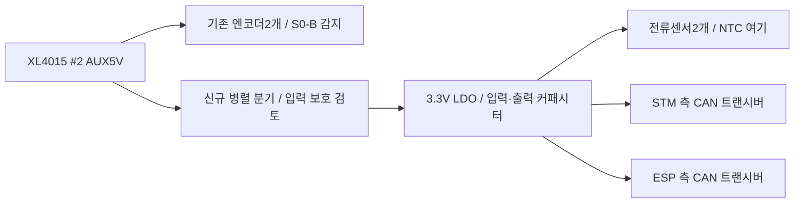

# 확장 3.3V 공급 구조와 조립 검토

2026-10-23. 설계2단계 검토안. [부하 예산](17_Expansion_Power_Budget_2026-10-23_ko.md)의 연속300mA를 공급할 구조를 제안한다. 부품 채택·제작 승인이나 실물 검증 결과는 아니다.

## 공급 구조 제안

**XL4015 #2 출력에서 병렬 분기하고, 확장부의 LDO 하나로3.3V를 만든 뒤 센서와 CAN으로 나누는 안**을 우선 비교한다. 레귤레이터를 여러 개 두는 안은 독립 전원 차단·잡음·배치 조건이 이를 요구할 때 다시 비교한다. 단일 LDO 사용은 아직 사용자 확정 전이다.

- #2에서 S0 접점/감지 LED 뒤가 아닌 출력 단자 쪽에 분기한다. 릴레이 코일은 별도 배터리/F2 경로다.
- #1/#2 OUT+ 및 확장3.3V/기존 MCU 보드3.3V 출력은 합치지 않는다. 신호 기준 GND는 유지한다.
- 아날로그와 CAN은 전원 배선과 부하 가까운 디커플링을 구분한다. 이것이 GND를 임의 분할하거나 별도 절연 전원을 만든다는 뜻은 아니다. 필터 소자 값은3단계에서 정한다.
- 센서 주전류 단자와 모터 전력선은 외부 유지. ESP 트랜시버의 물리 위치와3.3V 하네스 길이/전압 강하는 후속 인터페이스 계약에 포함한다.

## 손납땜과 방열 후보 대조

TO-220형 고정3.3V LDO를 조립 후보로 우선 검토한다. Microchip MCP1825S는 이 패키지의 가능성을 대조한 예이며 **최종 선정 부품이 아니다**. MCP1825의5핀형과 MCP1825S의3핀형은 핀/기능이 다르다.

| 항목 | MCP1825S 자료 확인 / 설계 판단 |
| --- | --- |
| 입력·출력 | 입력2.1~6.0V, 500mA 등급, 고정3.3V 옵션. 계획 입력4.75~5.25V와 연속300mA의 후보로 비교 가능 |
| 정밀도 | 고정 출력 전압 규정±2.5%. 전원 예산 문서의 초기±1%급 탐색 조건을 충족하지 않으므로 그대로 최종 채택하지 않음. 전류/NTC 기준 오차도 재검토 필요 |
| 커패시터 | 출력 최소1µF 필요. 보유100nF는 이를 대체하지 못함. 초기 검토는 입력/출력 각각4.7µF로 두되 실효 용량·ESR·분산 부하의 총 용량을 최종 대조 |
| 패키지 | TO-220-3의 손납땜·기계 높이/고정 공간 검토. 방열 탭은 GND이므로 인접 배선·금속물과 접촉 조건도 확인 |
| 보호 한계 | 내부 전류 제한은500mA 정밀 차단기가 아님. 단락 전류는 전형1.2A이므로 #2의 기존 S0-B/엔코더를 보호하는 분기 소자를 대신하지 못함 |

제조사 표의 TO-220-3 열저항29.4°C/W는 **4층 표준 시험 보드 조건**이다. 현재 제안2층 쉴드의 실제 열저항으로 복사하지 않는다. SOT-223 등 다른 패키지도 정격 전류만으로 방열 가능 여부를 결정하지 않는다.

### 출력 오차를 포함한 발열 예

입력5.25V, 출력3.3V의−2.5%인3.2175V, 출력300mA, 기존 IGND 예산1mA를 적용하면:

`PLOSS = (5.25 − 3.2175) × 0.300 + 5.25 × 0.001 = 0.615W`

이는 후보의 출력 오차를 넣은 설계 사례다. 부하/선간 변동·기동/단락까지 포함한 보증 최대 손실은 아니다.1mA는 후보의 모든 조건에서 보증된 IGND 최대값이 아니라 기존 예산이다.

| 열 검토 | 계산 결과와 해석 |
| --- | --- |
| 제조사4층 θJA29.4°C/W를 적용한 예 | 접합 온도 상승18.1°C. 우리 보드 예측/측정값으로 사용하지 않음 |
| θJA100°C/W를 가정한 예 | 상승61.5°C. 주위50°C 가정 시 접합111.5°C |
| 주위50°C·접합100°C 이하를 임시 설계 목표로 둘 경우 | 필요한 실효 θJA≤81.3°C/W. 두 온도는 설계 제안이며 사용 환경/사용자 확정값이 아님 |

정상 접합 온도 범위의 상한125°C와 절대 최대/보호 동작 온도를 혼동하지 않는다. 실제 부품·구리 면적·장착 방향·케이스 내 주위 온도로 다시 계산한 뒤 집에서 부하 측정한다. 방열판 불필요 또는 연속300mA 수용 PASS로 선언하지 않는다.

## 전원 상태별 연결 조건

레귤레이터 추가만으로 독립 전원 상태 문제가 해결되지는 않는다. 다음 조건을 핀/보호 회로 계약에 반영한다.

| 상태 | 필요한 처리 / 미결 항목 |
| --- | --- |
| STM·ESP·확장부 모두 ON | 정상 전압/전류 예산, ADC 기준 전압, CAN 송수신 조건 대조 |
| 확장 ON·STM OFF | 센서 출력→ADC, CAN RXD→STM의 역급전 가능성 검토. K1 전압 감지선도 살아 있을 수 있음 |
| 확장 ON·ESP OFF | CAN RXD→ESP 입력의 무전원 허용 조건과 차단 필요성 대조 |
| 확장 OFF·MCU ON | MCU TXD→무전원 트랜시버, CANH/L→무전원 노드 조건 대조. 측정 데이터는 유효로 취급하지 않음 |
| USB 개발 / 한쪽 보드만 연결 | 기존 buck/USB 전환 정책 유지. 확장 전원과 신호의 분리 또는 무전원 보호를 새 계약으로 명시 |

MCP1825의 SHDN/PWRGD가 있다는 사실만으로 역류 차단이나 신호 핀의 무전원 보호가 보장되지는 않는다. 단일/복수 LDO 중 어느 방식도 MCU OFF 문제를 자동 해결하지 못한다. 최종 회로에서는 실제 트랜시버의 무전원 사양과 ADC 보호, 필요 시 Ioff 보장 버퍼/스위치 등의 구현을 대조한다. 현재 표는 통전 절차가 아니다.

## 측정 기준과 기존 #2 부하

- 별도 LDO의 NTC 여기 전압은 STM32 ADC의 VDDA/VREF와 자동으로 같아지지 않는다. `ADC/VREF`만으로 NTC 비율이 정확히 상쇄된다고 가정하지 않는다. 여기 전압 측정/보정 또는 별도 기준 구조를3단계에서 결정하며, NTC를 임의로 기존 MCU 레일로 옮기지 않는다. AREF를 전원 출력처럼 사용하지 않는다.
- 전류센서 #5241은 nonratiometric 출력이므로 영점/감도를 공급 전압에 비례시켜 환산하지 않는다. 공급 전압의 잔여 영향과 ADC 기준 오차는 원문 조건에 따라 오차 예산에 포함한다. 후보의±2.5%를 온도/전류 측정의 최종 오차로 그대로 환산하지 않는다.
- #2 전체 전류 여유는 여전히 미정이다. 엔코더 소비전류·실제 CC 설정·분기 보호의 동작과 S0-B 영향이 남아 있다. LDO 내장 보호만으로 공유 전원 영향이 차단된다고 보지 않는다.

## 이번 단계 결과와 다음 순서

공급 구조는 단일 LDO+센서/CAN 분배안을, 조립은 TO-220급을 우선 제안한다. 출력 오차를 넣은0.615W 사례까지 계산했고, 정밀도/방열/독립 전원 조건을 최종 선정의 통과 조건으로 남겼다. **품번·부품 구매·CAD/BOM·펌웨어·실물 배선은 변경하지 않았다.**

후속 [CAN GPIO·커넥터 계약 초안](19_CAN_GPIO_and_Connector_Contract_2026-10-23_ko.md)에 GPIO4 TX/GPIO5 RX 후보와 전원 OFF 조건을 작성했다. 다음2단계 작업은 ADC6채널의 포트/기준 계약과 전체 구성 종합 검토다. 그 계약을 바탕으로3단계에서 레귤레이터/보호/기준 전압 회로와 실제 부품을 결정한다. 기존 UART/IMU 배치를 유지한다.

## 근거

- [Microchip MCP1825/MCP1825S DS20002056C](https://ww1.microchip.com/downloads/aemDocuments/documents/APID/ProductDocuments/DataSheets/MCP1825-Family-Data-Sheet-DS20002056.pdf): PDF2쪽 핀/패키지,7~10쪽 전기/열 사양,17~18쪽 커패시터·보호 조건. 전형값과 보증 한계·시험 조건을 구분했다.
- [전원 예산·계산 근거](17_Expansion_Power_Budget_2026-10-23_ko.md), [재현 스크립트](../assets/logs/sensor_design/2026-10-23_expansion_power_budget/calculate.py), [결과 JSON](../assets/logs/sensor_design/2026-10-23_expansion_power_budget/budget.json).
