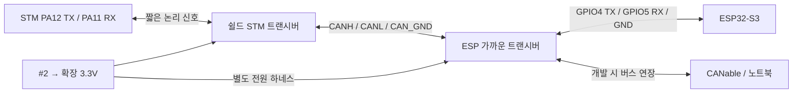

# CAN GPIO와 커넥터 계약 초안

2026-10-23. 설계2단계의 ESP CAN 핀·전원/신호 연결 검토안이다. 기존 UART를 유지하며 [전체 구성](16_Expansion_PCB_System_Blocks_and_Interfaces_2026-10-23_ko.md)과 [공급 구조](18_Expansion_3V3_Supply_Structure_and_Assembly_2026-10-23_ko.md)를 구체화한다. **아래 핀 순서는 설계 제안이며 보유 모듈의 핀 순서나 즉시 배선 지시가 아니다.**

## 핀 후보와 기존 기능 보존

| 기능 | MCU 접점 후보 | 연결 방향 | 상태 |
| --- | --- | --- | --- |
| ESP CAN TX | GPIO4 / 공식 DevKitC-1 J1-4 | ESP → ESP 트랜시버 D/TXD | 신규 예약 제안 |
| ESP CAN RX | GPIO5 / 공식 DevKitC-1 J1-5 | ESP 트랜시버 R/RXD → ESP | 신규 예약 제안 |
| STM CAN TX | PA12 / CN10-12 | STM → STM 트랜시버 D/TXD | 기존 예약 유지 |
| STM CAN RX | PA11 / CN10-14 | STM 트랜시버 R/RXD → STM | 기존 예약 유지 |

ESP TWAI는 GPIO Matrix를 통해 TX/RX를 배정할 수 있다. 현재 저장된 `esp32_wifi_link/main/wifi_link_main.c`는 GPIO17 TX/GPIO18 RX의 UART를 사용하며 해당 main 디렉터리에 GPIO4/5·TWAI 설정은 없다. `esp32_uart_bridge`도 GPIO17/18이다. GPIO4/5는 기존 UART와 분리되고 공식 헤더에서 인접한 I/O라 후보로 선택했다. 전용 CAN 핀이 원래 GPIO4/5로 고정되어 있다는 뜻은 아니다.

보유 보드는 **HG ESP32-S3 DevKitC-1**, RGB LED는 실습에서 GPIO38을 확인했다. 공식 v1.1 헤더 번호는 대조 기준이며 HG 보드와의 실물 동일성·남은 연결/납땜 접근은 미확인이다. 외출 중에는 실제 도통/배선을 주장하지 않는다. 현재 ESP는 USB 포트 간섭 때문에 만능기판 밖에 있고 UART3선이 연장된 상태라는 기록을 반영한다.

GPIO17/18 UART, GPIO19/20 USB, GPIO38 LED와 기존 디버그/부트·메모리 관련 접근을 보존한다. BUS_OFF/CLKOUT은 초기 필수 하네스에서 제외한다. RS/STB 제어 GPIO는 트랜시버/보유 모듈의 실제 모드 회로 확인 후 필요하면 추가하며 지금 임의 배정하지 않는다. STM 기존 IMU·구동·엔코더·E-stop·SWD 예약도 유지한다.

## 트랜시버 위치와 신호 경로 제안

**STM 트랜시버는 새 쉴드, ESP 트랜시버는 ESP 가까이** 두는 안을 우선한다. 후자는 보유/선정 모듈과 짧은 하네스로 구현할 수 있으며 별도 MCU나 새 제작 PCB를 자동 추가하지 않는다. 긴 구간은 CAN 차동 배선으로 연결한다. 실제 거리·고정 위치는 기구 검토에서 정한다.

MCU TX는 자기 트랜시버 TXD 입력으로, MCU RX는 자기 트랜시버 RXD 출력으로 연결한다. **STM TX와 ESP RX를 직접 잇는 방식은 기존 UART이며 CAN 연결이 아니다.** 두 MCU의 논리 TX/RX를 서로 공유하지 않는다. 트랜시버 R/T 표기는 모듈 자료와 대조해 방향으로 판정한다.

## 기능 커넥터와 핀 순서 제안

이름은 기능 식별자다. 현재 CAD의 J1~J6 및 기존 배선 커넥터 번호와 동일하지 않다. 제품·피치·압착 단자·락·PCB 풋프린트는 미선정이다. 번호는 최종 **기판 측 커넥터 핀 번호** 기준으로 문서화하며 케이블 쪽 정면 사진을 보고 좌우를 추정하지 않는다.

| 기능 식별자 / 위치 | 핀 순서 제안 | 연결 상대·주의 |
| --- | --- | --- |
| EXP_5V_IN / 쉴드 | 1=GND, 2=AUX5V | XL4015 #2 출력 병렬 분기. #1 또는 S0 감지 루프 뒤와 연결하지 않음 |
| ESP_CAN_PWR / 쉴드 출력·ESP 트랜시버 입력 | 1=GND, 2=EXP_3V3 | ESP 트랜시버만 공급. ESP 보드3V3 출력과 합치지 않음. 양 끝 동일 넷끼리 연결 |
| ESP_TWAI / ESP↔ESP 트랜시버 | 1=GND, 2=ESP_CAN_TX, 3=ESP_CAN_RX | GPIO4→D, R→GPIO5. MCU 전원 공급용 핀 없음 |
| CAN_BUS / STM·ESP 측 | 1=CAN_GND, 2=CANL, 3=CANH | 모든 노드 H끼리/L끼리/기준끼리 연결. 버스 포트에5V/3.3V를 싣지 않음 |
| CAN_EXT / ESP 측 버스 연장 | CAN_BUS와 동일 | CANable까지 선형 버스 연장용. IN/OUT은 같은 버스 넷이며 방향성 없음 |

CAN_EXT는 작은 어댑터나 인라인 하네스로 구현할 수 있다. ESP 모듈에 이미 두 포트가 있다고 가정하지 않는다. 보유 MCU-230 소켓의 실제 핀 배열은 위 계약과 별개로 대조하고 풋프린트를 정한다. CANable의 단자 번호·기준 GND/절연 여부도 실물 자료 확인 전 확정하지 않는다.

- CANH/CANL은 같은 차동 쌍으로 배선하고, 기준 GND는 별도 도체로 함께 관리한다. CAN_GND는 모터 전류의 귀환 경로가 아니다. 초기 공통 기준 연결안은 절연 완료를 뜻하지 않는다. PC USB의 접지 귀환도 후속 대조한다.
- 두2P 전원 포트는 서로 맞물리지 않는 하우징/키를 요구한다. ESP_TWAI·CAN_BUS·기존 UART 등 같은3P 포트도 상호 오접속을 막을 형식/키 구분이 필요하다. 색/라벨만으로 방지 완료라고 하지 않는다.
- 실크에는 핀1·전압·입출력 방향을 표시한다. 전원 도체/접점 정격은300mA 정상 예산 외에도 분기 고장 보호 조건과 맞춘다. 실제 AWG·길이·커넥터 정격은3단계/기구 검토에서 정한다.

## 버스 끝점과 종단 선택

모든 노드마다120Ω을 넣지 않고 실제 버스 양 끝에만 둔다. 아래는 **선형 배선 제안**이며 보유 모듈 내장 종단을 확인한 뒤 적용한다.

| 운용 구성 | STM 종단 | ESP 종단 | CANable 종단 |
| --- | --- | --- | --- |
| STM — ESP, 일반 무선 운용 | ON | ON | 분리 |
| STM — ESP — CANable, 개발 시 연장 | ON | OFF | ON |
| STM — CANable, ESP 노드/하네스 제외 시험 | ON | 분리 | ON |

3노드 개발 배선에서 CANable을 빼면 ESP가 끝점이 되므로 ESP 종단을 ON으로 전환한다. 긴 Y자 분기 대신 위 직렬 경로를 우선하며, 모듈까지의 짧은 분기 길이는 실제 배치에서 결정한다.120Ω 두 개의 병렬값 약60Ω은 후속 무전원 검사 기대값일 뿐 이번 측정 결과가 아니다.

## 부팅·리셋·독립 전원 OFF 계약

| 조건 | 하드웨어/논리 요구사항 |
| --- | --- |
| MCU 리셋 또는 TXD 미구동 | 버스가 recessive를 유지하도록 트랜시버 입력/모드 기본 상태 설계. 저항 값과 RS 회로는3단계에서 대조 |
| 확장3.3V ON·ESP/STM OFF | 해당 RXD 출력이 무전원 MCU를 역급전하지 않도록 차단/Ioff 경로 검토. 단순 직렬 저항이나 RS standby만으로 해결됐다고 하지 않음 |
| 확장3.3V OFF·MCU ON | MCU TXD와 모드 제어 핀의 무전원 허용 조건·버스 핀 비부하 조건 대조 |
| 버스 단절·bus-off·부팅 중 | STM 최종 안전 판단과 timeout 유지, 자동 ARM/동작 재개 금지. 기존 UART/CAN 동시 명령 권한 금지 |

SN65HVD230의 RS HIGH는 송신만 끄고 수신기는 동작하므로 MCU OFF의 RXD 역급전 차단책으로 쓰지 않는다. IC 자료의 무전원 버스 고임피던스 특성과 MCU측 RXD/D의 허용 조건은 별개다. MCU-230의 RS가 이미 GND에 고정되어 있을 수 있으므로 보유품을 보지 않고 GPIO 제어 가능하다고 전제하지 않는다.

## 단계 결과와 다음 작업

이번 결과는 GPIO4 TX/GPIO5 RX 예약 후보, ESP 가까운 트랜시버 배치안, 기능 커넥터 핀 순서·종단/전원 상태 계약이다. 사용자 검토 전 제안이며 MCU/CAD/BOM·실물 배선·빌드/플래시는 변경하지 않았다.

2단계 세부 미결은 HG 헤더/MCU-230 실물, 전원 OFF 보호와 기준 전압, 전체 #2 여유, 센서/감지 포트의 최종 계약이다. 후속 [ADC6채널 계약·2단계 종합 검토본](20_Analog_6Ch_Contract_and_Stage2_Review_2026-10-23_ko.md)을 작성했다. 다음3단계 첫 작업은 ADC 기준·NTC 여기·무전원 보호 방식 비교/계산이다. 그 뒤3단계에서 실제 보호/전원 회로 계산·부품 선정으로 진행한다. 현재 단계에서 모르는 실물 값은 집에서 확인할 목록으로 남긴다.

## 근거

- [Espressif 공식 DevKitC-1 v1.1 헤더 표](https://documentation.espressif.com/esp-dev-kits/en/latest/esp32s3/esp32-s3-devkitc-1/user_guide_v1.1.html): J1-4/5와 USB/LED 참고. HG 보드 실물 동일성 증거와 구분.
- [ESP-IDF v5.4.4 TWAI 문서](https://docs.espressif.com/projects/esp-idf/en/v5.4.4/esp32s3/api-reference/peripherals/twai.html): 현재 프로젝트 도구 버전과 맞춰 GPIO Matrix·외부 트랜시버 확인. 최신v6 API를 현재 코드에 적용하지 않음.
- [TI SN65HVD230 RevO](https://www.ti.com/lit/ds/symlink/sn65hvd230.pdf): D/R 방향, RS 모드·무전원 버스 특성, 종단 구조 참고. 모듈 실물 배선 보증이 아님.
- [현재 Wi-Fi main](../03_Firmware/esp32_wifi_link/main/wifi_link_main.c), [UART bridge](../03_Firmware/esp32_uart_bridge/main/uart_bridge_main.c), [보유 ESP 기록](../01_System_Architecture/07_ESP32S3_Features_and_Project_Role_ko.md), [보드 배치 이력](VeroRoute/README.md), [정식 CAN 계획](../01_System_Architecture/14_CAN_Bus_Integration_Plan_ko.md).
