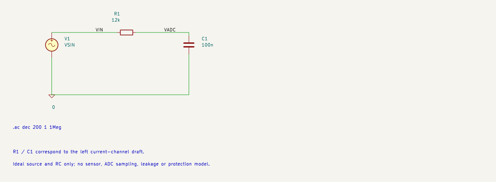
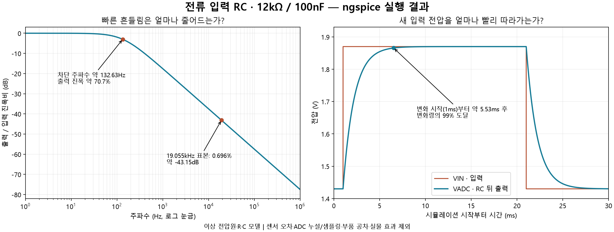

# 전류 RC 한 채널 — KiCad 시뮬레이션

**사용자 GUI 추가 결과:** 약133Hz/−3.01dB·19kHz/−43.1dB, 상승2.20000ms/1.70807V·하강22.2010ms/1.59193V와변화량99%잔차를직접확인했다. [AC PNG](Current_RC_AC.png) · [AC CSV](Current_RC_AC.csv) · [계단 PNG](Current_RC_Step.png) · [계단 CSV](Current_RC_Step.csv) · [전체 실습과 현재 다음 작업](../README.md). 아래직접DLL실행/GUI NOT_RUN문구는추가실습이전실행의이력이다. 사용자회로를prepare.py로재생성하지않는다.

작성: 2026-10-28 · 마감: 2026-10-29. **사용자 KiCad GUI AC/TRAN 실습·PNG/CSV/워크북 저장 완료 / 실물 NOT_RUN.**

## 기존 계획과 이번 작업의 관계

기존 목표는 전류·온도·전압을 MCU에서 읽는 모니터링 입력 회로를 구체화하는 것이다. 사용자의 시뮬레이션 제안으로 **전류 RC·NTC 계산 확인을 기존 전원/보호 결정 앞에 추가**했다. 목표는 유지하지만 당일 작업 순서는 조정했다. 아래 작업 전체를 오늘 완료한다는 일정 약속은 아니다.

| 순서 | 작업 | 다음 단계로 넘어갈 때 남길 결과 |
| --- | --- | --- |
| 1 — 이번 완료 범위 | 전류 한 채널의 이상적인 12kΩ·100nF RC | 주파수 응답·계단 응답을 계산과 비교한 그래프와 수치. 부품 최종 선정은 아님 |
| 2 | NTC 분압 저항과 직렬 R·C를 함께 모델링 | 제조사 RT 표의 선택 온도점에서 DC 전압과 응답 비교. R4+(R3∥RNTC)를 포함 |
| 3 — 기존 계획 복귀 | NTC 여기 전원/ADC 기준, MCU 무전원 입력 보호 | 공급 방식·입력 경로·제조사 보장 범위와 남은 미결의 결정표 |
| 4 — 기존 계획 | 전압 2채널 분압·보호·ADC 연결 | 입력 범위/오차 계산 → 필요한 시뮬레이션 → 회로도 반영·검토 |
| 후속 | 기구 적합성·전체 배치·배선, 실물 검증 | 해당 단계의 준비 조건이 갖춰진 뒤 별도 수행 |

전류 RC와 NTC의 계산/그래프가 맞는지 확인하면 3번으로 돌아간다. 모터 전체·브라우저·EMI를 재현하는 모델로 범위를 넓히지 않는다. 모델이 제조사 보장을 대신하지 않으므로 MCU 무전원 보호 결론을 임의의 다이오드 시뮬레이션만으로 확정하지 않는다. AI는 기존 후속 문서 상태를 유지한다.

## 이 회로로 확인하려는 것

실제 [쉴드 초안](../../TMR_Monitor_Shield_RevA/README.md)의 왼쪽 전류 채널 R1=12kΩ, C1=100nF를 사용한다. **100nF는 0.1µF이며 0.1nF와는 1,000배 다르다.**

센서가 내보내는 전압을 이상 전압원 V1로 대신했다. `VIN`은 R1 앞의 입력, `VADC`는 R1 뒤·C1 위의 ADC 연결 예정 노드다. 이 파일에는 MCU가 없으며 VADC라는 이름이 실제 ADC 동작까지 모델링한다는 뜻은 아니다.

확인할 질문은 두 가지다.

1. 입력 전압에 빠른 흔들림이 들어오면 VADC에서 진폭이 얼마나 작아지는가?
2. 읽어야 할 입력 전압 자체가 변하면 VADC가 새 전압을 따라가는 데 얼마나 걸리는가?

이 둘을 함께 봐야 잡음 억제와 응답 지연의 관계를 판단할 수 있다. 현재 12kΩ을 최종 채택하려면 누설 전류·ADC 획득·센서 출력 부하 등 기존 미결도 검토해야 한다.

## 파일과 입력 조건

| 파일 | 목적 | 설정 |
| --- | --- | --- |
| [Current_RC_AC.kicad_sch](Current_RC_AC.kicad_sch) | 주파수별 출력/입력 진폭비 | `.ac dec 200 1 1Meg`: 1Hz~1MHz, 주파수 10배 구간마다 200점, 소신호 입력 AC=1V |
| [Current_RC_Step.kicad_sch](Current_RC_Step.kicad_sch) | 갑자기 변한 전압을 따라가는 과정 | 1.43→1.87V, 첫 변화 1ms, 상승/하강 1µs, 높은 값 유지 20ms, 반복 40ms. 총 30ms 관측, 최대 시간 간격 2µs |
| [prepare.py](prepare.py) | 설치 라이브러리로 파일 재생성·SPICE 연결 점검 | KiCad 10.0.5의 CLI 사용. ngspice 실행은 하지 않음 |
| [preparation.json](reports/preparation.json) | 파일 해시·변환된 소자/노드·검사 상태 | 연결 검사 결과와 시뮬레이션/실물 실행 상태를 분리 |

`preparation.json`의 NOT_RUN은 파일 준비 단계의 기록이다. 이후 실제 실행 상태는 [simulation.json](reports/simulation.json)을 따른다.

AC=1V는 입력 대비 출력의 비율을 쉽게 읽기 위한 정규화다. 실제 센서에 1V 잡음이 있다는 뜻이 아니다. 전압원의 별도 SIN 설정(중심 1.65V, 진폭 100mV, 19kHz)은 이후 시간 파형 예시용이며 위 AC 분석에서 쓰는 진폭과 구분한다. 19kHz의 사인파도 실제 잡음 파형을 측정한 결과가 아니다.

계단 입력의 0.44V 변화는 명목 감도 44mV/A에 대입하면 10A 변화에 해당하는 설명용 전압이다. 실제 모터에 전류를 흘리는 시험이 아니다.

## 이번 실행 결과

KiCad 10.0.5가 내보낸 두 SPICE 파일을 설치된 **ngspice-46 DLL**로 직접 실행했다. KiCad GUI에서 실행한 기록과 구분한다. [실행 스크립트](run_simulation.py), [엔진 로그](reports/ngspice.log), [계산 비교 JSON](reports/simulation.json), [AC 원시 CSV](reports/ac.csv), [과도 응답 원시 CSV](reports/step.csv)를 보존했다.

| 확인 항목 | 시뮬레이션 | 같은 조건의 이론값 |
| --- | --- | --- |
| 차단 주파수 | 132.6269Hz — AC 표본 사이 로그 보간 | 132.6291Hz |
| 19kHz 근처 진폭비 | **19,054.61Hz** 표본에서 0.0069603, 약 −43.147dB | 같은 표본 주파수에서 동일. 정확히 19,000Hz 계산값은 0.0069803 |
| 상승 시작부터 변화량 99% 도달 | 5.526698ms — 시간 표본 사이 선형 보간 | 1µs 상승시간 포함 모델에서 5.526704ms |

AC는 1,201점 전체에서 복소 전달함수와 비교했고 최대 절대차가 약 2.49×10⁻¹⁶이었다. 과도 응답 15,023점 중 하강 전 상승 구간(t<20ms)은 1µs 선형 상승 입력의 해석해와 비교해 최대 약 1.84µV 차이였다. 이 차이는 모델/수치해석 대조 결과이며 실제 센서의 오차가 아니다.

실행 전 비교 기준은 AC 전달함수 절대차 <10⁻¹⁰, 상승 전압 절대차 <10µV, 99% 도달 시각 차이 <2µs였으며 모두 통과했다. 이는 수치해석 확인 기준이며 기존 입력계 정확도 합격 기준을 대체하지 않는다. 결과가 보여주는 것은 **기존 RC 필터 계산의 일관성**이다. 누설·센서 부하·ADC 획득을 포함한 부품 선정은 남았다.

로그의 `can't find ... spinit`는 DLL을 독립 호출해 초기화 파일을 찾지 못한 경고다. 이 회로는 기본 내장 R/C/전압원만 사용했고 두 해석이 끝나 원시 벡터·계산 비교를 확인했다. 외부 소자 모델이나 GUI 초기화 설정이 같은 조건이라고 확대하지 않는다.

## 실행 전에 예상하는 값 — 계산값이며 시뮬레이션 결과 아님

이 모델은 이상 전압원, 이상 R·C, 출력 부하 없음이다. 시간상수는 `τ = R×C = 12,000Ω×100×10⁻⁹F = 1.2ms`다. 주파수 f에서 진폭비는 `1/√(1+(2πfRC)²)`로 계산한다.

| 항목 | 예상값 | 뜻 |
| --- | --- | --- |
| 차단 주파수 `1/(2πRC)` | 약 132.63Hz | 이 주파수에서 출력 진폭이 입력의 약 70.7%, 약 −3.01dB |
| 19kHz 진폭비 | 약 0.00698, 약 −43.12dB | 입력의 0.698%가 출력에 남음. 입력 흔들림이 100mV peak라면 약 0.698mV peak |
| 계단 변화 후 1τ | 1.2ms, 전체 변화량의 약 63.2% 도달 | 시작 전압에서 목표 전압까지의 차이 중 63.2%를 따라감. 목표 전압 자체의 63.2%가 아님 |
| 계단 변화 후 잔차 1% | 약 5.53ms | 남은 전압 차이가 최초 변화량의 1% 이하. 0.44V 변화라면 약 4.4mV |

시간은 시뮬레이션 시작 시각이 아니라 **입력이 변하기 시작한 시각부터** 센다. 계단 파일의 상승은 약 1ms에 시작하므로 약 6.53ms에서 상승 변화량 기준 잔차가 1%에 이른다. 유한 상승시간 1µs 때문에 이상 계단식과 작은 차이가 있다. 4.4mV가 기존 입력계 예산과 수치상 같더라도 이것만으로 전체 정확도 목표를 충족했다고 판단하지 않는다.

## KiCad에서 첫 그래프 보기

1. `Current_RC_AC.kicad_sch`를 KiCad 회로도 편집기로 연다.
2. **검사(Inspect) → 시뮬레이터(Simulator)**를 연다.
3. 새 분석 탭에서 AC를 선택하고 로그 Decade, 200 points/decade, 시작 `1`, 끝 `1Meg`로 설정한다. 회로도에도 같은 지시문이 있으나 GUI 분석 설정이 다르면 GUI 설정을 확인한다.
4. 실행한 뒤 신호 목록에서 `V(/VIN)`, `V(/VADC)`에 해당하는 두 전압을 선택한다. GUI에서 슬래시 없는 이름으로 보이면 VIN/VADC를 선택한다. 입력 AC가 1V이므로 VADC 진폭의 숫자가 출력/입력 진폭비와 같다.
5. 약 133Hz의 −3dB 부근과 19kHz의 약 −43dB를 확인한다. 정확한 비교값은 그래프 표본/커서의 실제 주파수와 함께 기록한다.
6. 다음으로 `Current_RC_Step.kicad_sch`에서 Transient를 선택한다. 출력 시간 간격 `2u`, 종료 `30m`, 시작 `0`, 최대 시간 간격 `2u`로 설정하고 VIN과 VADC를 함께 본다.

위 절차는 이번 DLL 실행 결과를 GUI에서 직접 확인하는 방법이다. 불일치하면 단위·소스 종류·접지·선택한 출력 노드·GUI 분석 설정을 먼저 확인한다. 동일 계산을 무조건 재실행하는 것이 다음 필수 작업은 아니며, 다음 설계 검토는 NTC 분압 전체 모델이다.

KiCad 분석 유형·실행·파형 선택 절차: [KiCad 10 공식 회로도 편집기 매뉴얼 — Simulator](https://docs.kicad.org/10.0/en/eeschema/eeschema.html#simulator).

## 검증 범위와 재생성

SPICE 내보내기에서 `R1 /VIN /VADC 12k`, `C1 /VADC 0 100n`, 전압원 `V1 /VIN 0 …`를 확인했다. SPICE의 기준 노드 `0`에는 `Simulation_SPICE:0` 심볼을 사용한다. 일반 GND 문자열만 내보내면 기준 노드가 빠질 수 있어 직접 점검했다. 생성된 SVG도 확인했다.

기존 쉴드 회로도/PCB는 수정하지 않았다. 이 모델에는 센서 정확도·출력 임피던스·R/C 공차·ADC 샘플링/누설·배선 기생성분·무전원 보호·실제 PWM 잡음이 없다. 결과는 모델 안의 RC 계산 확인이며 실제 성능 보증이 아니다.

재생성은 이 폴더에서 `python prepare.py`로 수행한다. 설치 위치는 `%LOCALAPPDATA%/Programs/KiCad/10.0`를 사용한다. 재생성하면 두 모델 회로도와 내보내기 파일을 덮어쓰므로 수동 변경은 먼저 보존한다. 프로그램은 시뮬레이션 실행 완료를 기록하지 않는다.

실행은 `python run_simulation.py`, 저장된 CSV의 그래프 생성은 `python plot_results.py`다. 그래프 도구는 Matplotlib이며 이번에는 사용자 캐시 `.cache/tmr-simulation-plot/python`에 별도 설치해 사용했다. 그래프는 원시 CSV에서 그리며 이론식으로 시뮬레이션 데이터를 대신 만들지 않는다. DLL 호출 방식은 [ngspice 공식 매뉴얼](https://ngspice.sourceforge.io/docs/ngspice-manual.pdf)의 shared library API를 따른다.
