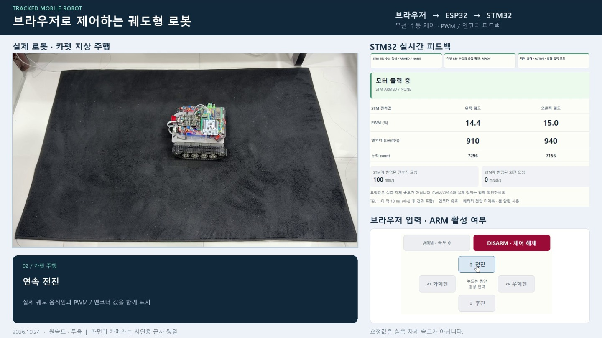
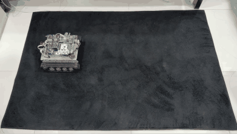
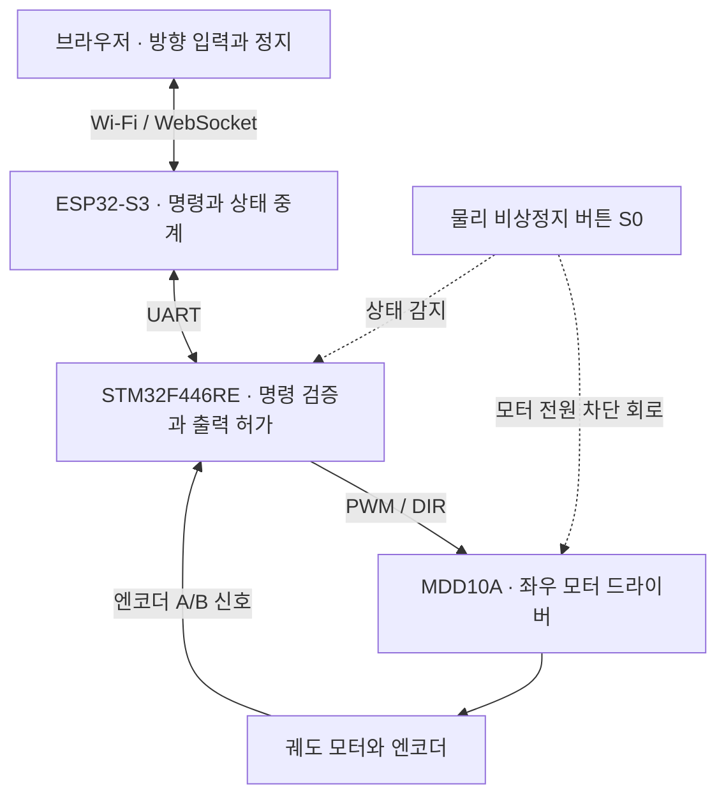
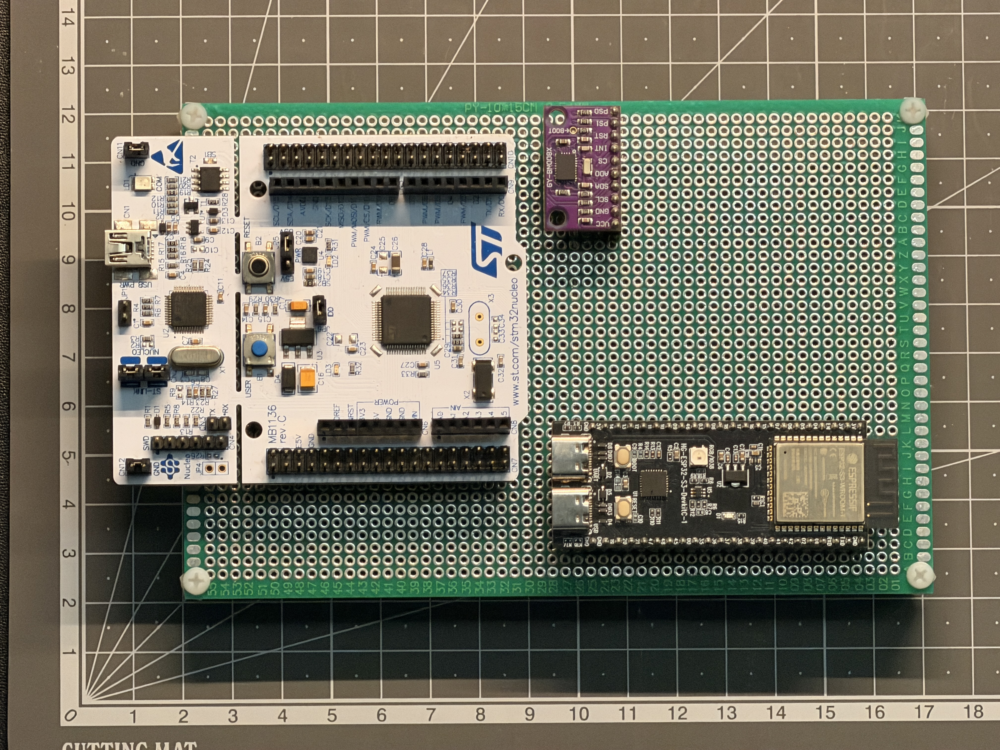
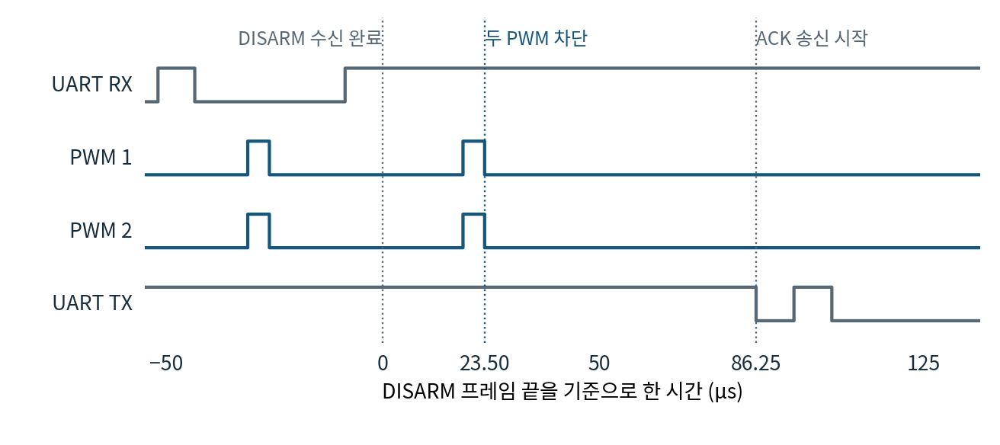
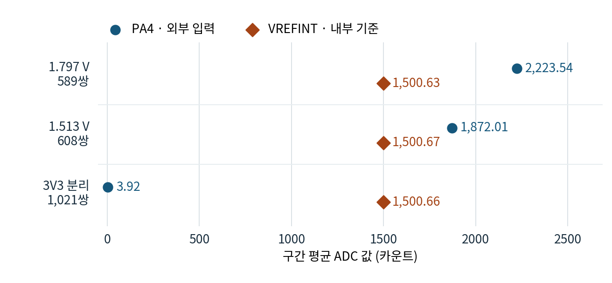
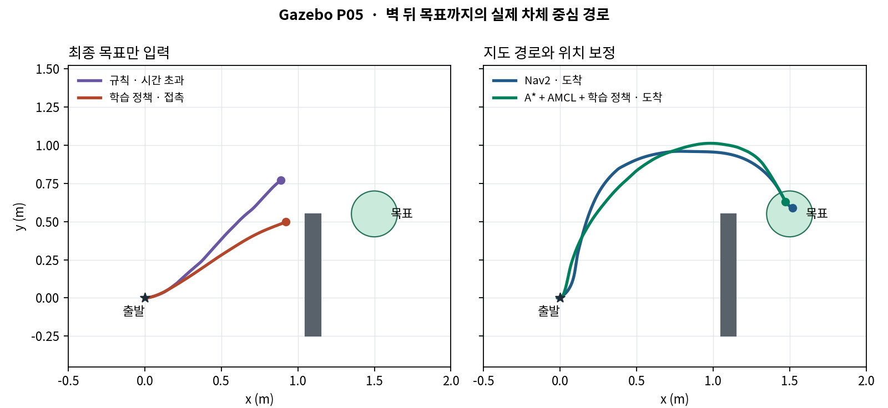

# Tracked Mobile Robot

브라우저에서 전진을 누르면 ESP32-S3가 명령을 보내고, STM32F446RE가 명령과 로봇 상태를 확인한 뒤 좌우 궤도를 구동합니다. **무선 명령이 끊겼을 때 누가 모터 출력을 끌 것인가**를 설계의 출발점으로 삼았습니다.

[](assets/videos/wifi_mvp/2026-10-24/final/TMR_MVP_Final_2026-10-24.mp4?raw=1)

**[실물 시연 MP4 · 2분 29초](assets/videos/wifi_mvp/2026-10-24/final/TMR_MVP_Final_2026-10-24.mp4?raw=1)**　위 장면은 1분 20초의 연속 전진입니다. 영상 후반에는 물리 비상정지 버튼을 누른 뒤 다시 주행하기까지의 조작이 담겨 있습니다. [촬영·편집 기록](assets/logs/wifi_link/2026-10-24_carpet_s0_demo_run01/README.md)

<details>
<summary>이 페이지에서 카펫 전진 8초 보기</summary>



시연 영상의 1분 14초~1분 22초에서 차체 쪽 화면만 잘라낸 실시간 재생 구간입니다.

</details>

[정지 명령과 PWM 파형](#정지-명령을-받으면-pwm은-언제-꺼지는가) · [ADC 두 채널 비교](#adc가-외부-입력과-내부-기준을-구별하는가) · [Gazebo 주행 경로](#gazebo에서-벽-뒤-목표까지-어떻게-가는가) · [구현 코드](#구현-코드)

## 1. 프로젝트 목표와 범위

첫 목표는 저속으로 전후진·회전하는 실물 로봇에서 명령 유실, 출력 차단, 재출발 조건을 검증하는 것이었습니다. 상위 자율주행은 같은 플랫폼을 모델링한 ROS 2 Jazzy·Gazebo 환경에서 시험했습니다.

**담당 · 이영현**　요구사항과 인터페이스 설계, STM32·ESP32 펌웨어 구현, 전장·기구 배치, 배선·납땜, 보드 빌드·플래시와 실측을 맡았습니다. 설계·코드 검토, Python 검증 코드, 로그 해석과 문서 정리에는 Codex를 활용했습니다. [요구사항과 검증표](docs/verification/05_Final_MVP_Requirements_and_Verification_Matrix_ko.md)

## 2. 하드웨어와 시스템 구조



<details>
<summary>실제 보드에서 NUCLEO와 ESP32-S3의 배치 보기</summary>



2026년 8월 14일 배치 확인 단계의 사진입니다. NUCLEO와 ESP32-S3가 한 기판에서 어떻게 배치됐는지 볼 수 있습니다. 비상정지와 측정 헤더 배선은 이후 개정했습니다.

</details>

### 핵심 설계 판단

**STM32가 최종 출력을 결정합니다.** 주행 명령이 500 ms 동안 갱신되지 않으면 출력과 저장 명령을 0으로 만들고 `DISARMED`로 전환합니다. 통신이 돌아와도 새 `ARM`으로 구동을 허용하고 새 `CMD`로 방향과 속도를 지정해야 다시 움직입니다. 물리 비상정지 버튼 S0은 별도 회로로 모터 전원을 끊고 STM32에도 상태를 알립니다. [상태 머신](01_System_Architecture/16_Control_Loop_and_State_Machine_ko.md) · [명령 유실·복구 시험](docs/verification/21_REQ_SAFE_004_500ms_Command_Timeout_and_Recovery_Target_Runtime_Test_Report_2026-08-28_ko.md) · [비상정지 회로](01_System_Architecture/21_Physical_EStop_Architecture_ko.md)

## 3. 대표 구현과 검증 성과

### 정지 명령을 받으면 PWM은 언제 꺼지는가?

**두 출력 모두 23.50 µs 후에 꺼졌습니다.** ESP32의 정지 명령과 STM32의 두 PWM, 응답 신호를 같은 로직 분석기로 4 MHz에서 캡처했습니다. 가로축의 0은 STM32가 명령의 마지막 비트를 다 받은 시점입니다.



STM32는 출력을 끈 뒤 62.75 µs가 지나서 응답을 보내기 시작했습니다. 이 시험의 측정점은 MCU 핀이며, 차체의 실제 제동 시간·거리는 별도 측정 항목입니다. [측정 기준과 원본 캡처](docs/verification/10_STM32_Active_DISARM_Shutdown_Latency_Test_Report_2026-08-04_ko.md) · [모터 출력 코드](03_Firmware/stm32_uart_mvp/Core/Src/motor_output.c)

### ADC가 외부 입력과 내부 기준을 구별하는가?

NUCLEO 보드에서 분압 입력 PA4와 내부 기준 VREFINT를 차례로 읽었습니다. 입력 조건을 바꾼 세 구간의 **유효 표본 2,218쌍**에서 PA4 평균은 약 2,224 → 1,872 → 4카운트로 변했고, VREFINT 평균은 약 1,501카운트에 머물렀습니다.



1.797 V와 1.513 V는 멀티미터로 읽은 분압 전압입니다. 마지막 구간에서는 3V3 공급 점퍼를 빼고 PA4와 GND 사이의 저항을 유지했습니다. 두 비영 입력 모두 칩의 기준값으로 환산했을 때 멀티미터와의 차이가 줄었습니다. [배선·프로브 위치와 UART 원본](docs/verification/49_PA4_VREFINT_Bench_2026-11-25_ko.md) · [그래프 재생성 코드](docs/portfolio/figures/plot_bench_evidence.py)

### Gazebo에서 벽 뒤 목표까지 어떻게 가는가?

같은 방의 같은 위치에서 출발해 벽 뒤의 목표 P05로 이동했습니다. 왼쪽은 최종 목표만 준 주행, 오른쪽은 지도로 우회 경로를 계획한 주행입니다.



**기본 구성인 Nav2**는 목표에서 **4.30 cm** 떨어진 곳에 도착했고, 접촉 0회와 2초 이상 정지를 확인했습니다. A*로 경로를 주고 AMCL로 위치를 보정한 PPO 속도 제어는 두 회차에서 8.49 cm와 8.10 cm를 기록했습니다. 실물 자율주행은 후속 검증입니다. [회차별 원본·판정·재현 방법](docs/verification/48_Simulation_Gate02_2026-11-24_ko.md) · [Nav2 실행 파일](05_ROS2_Integration/src/tmr_sim/launch/navigation.launch.py)

<details>
<summary>펌웨어와 구동계의 단계별 실측 5건 · 파형, 배선, 엔코더 보정</summary>

아래 항목은 각 시험을 수행한 당시의 조건과 판정입니다.

### 3.1 DISARM 명령에 따른 PWM 출력 차단

- **검증 문제:** 상태 로그만으로 알기 어려운 실제 PWM 차단 시점을 확인한다.
- **방법:** 유효한 `DISARM` 프레임 수신 완료와 두 PWM의 마지막 active edge를 같은 4 MHz 로직 캡처에서 비교했다.
- **결과:** 두 PWM 출력이 비활성화되기까지 **23.50 μs**를 측정했다.
- **범위:** STM32 MCU 로직 핀 계측 결과다. 실제 모터 정지 시간은 측정하지 않았으며,
  당시 전원·모터 분리 상태의 증거 보완은 보고서에 남아 있다.

[시험 조건·파형·원본 캡처](docs/verification/10_STM32_Active_DISARM_Shutdown_Latency_Test_Report_2026-08-04_ko.md)

### 3.2 영구 배선을 통한 PWM/DIR 전달

- **검증 문제:** 만능기판의 pull-down과 하네스를 거쳐도 제어 신호가 드라이버 입력에 전달되는지 확인한다.
- **방법:** 모터를 분리하고 MDD10A 입력에서 두 채널의 PWM과 방향 전환 구간을 계측했다.
- **결과:** PWM **19.049 / 19.058 kHz**, 약 **10% 듀티**, DIR 전환 전후 약 **2 ms의 PWM 0 구간**을 확인했다.
  시험 설정 복구 후 5초 동안 모든 제어 신호가 LOW인 상태도 확인했다.
- **범위:** 이 시험은 MDD10A 로직 입력까지의 결과다. 이후 실제 회전·방향 관측은 아래 3.5에서 구분해 기록한다.

[시험 보고서와 원본 자료](docs/verification/17_Final_Perfboard_Active_DIR_PWM_and_Safe_Restore_Test_Report_2026-08-18_ko.md)

### 3.3 명령 유실 후 정지와 명시적 복구

- **검증 문제:** 명령이 끊긴 뒤 과거 명령이나 `ARM`만으로 출력이 되살아나는 것을 막는다.
- **방법:** 모터·LiPo 분리 조건에서 `timeout_ms=500`인 명령을 사용하고 UART와 PWM/DIR을 같은 캡처로 비교했다.
- **결과:** timeout 뒤 출력·저장 명령 0과 `DISARMED` 전환, `CMD` 단독 거부,
  `ARM`만으로 이전 출력이 복원되지 않음, **새 `ARM` + 새 `CMD`에 의한 복구**를 확인했다.
- **범위:** 보드의 UART·제어 신호·상태 복구 검증이며, 실제 모터나 물리 비상정지 시험은 포함하지 않는다.

[500 ms timeout·복구 시험](docs/verification/21_REQ_SAFE_004_500ms_Command_Timeout_and_Recovery_Target_Runtime_Test_Report_2026-08-28_ko.md)

### 3.4 수동 회전 기반 엔코더 환산 검증

- **검증 문제:** 모터 출력축 회전량과 펌웨어의 카운트·속도 환산을 연결한다.
- **방법:** 두 모터의 출력축을 방향별 50회전시킨 관찰 기록과 별도의 수동 회전 로그를 사용했다.
- **결과:** 출력축 기준 **1,560 counts/rev**로 보정했다.
  별도 로그의 **610개 채널 샘플**에서 카운트/초(CPS) → 0.001 rpm 단위(mRPM) 환산 불일치는 0건이었다.
- **범위:** 수동 회전 기반 기능 검증이다. 전동 구동 중 노이즈, 외부 회전계 비교와 실제 주행 거리 검증은 남아 있다.

[50회전 관찰 기록·환산 검증·로그](assets/logs/encoder/2026-07-30_encoder_output_shaft_calibration_and_millirpm_verification.md)

### 3.5 실제 단일 모터 구동과 방향 보정

- **검증 문제:** 명령 부호와 실제 모터 방향·엔코더 피드백이 일치하는지 확인한다.
- **방법·결과:** 보정 전 B/M2의 양수 명령에서 실제 역회전과 음수 CPS가 함께 관측됐다.
  두 모터를 교차 연결해 회전을 확인한 뒤, 손회전으로 확인한 엔코더 부호를 유지하고 오른쪽 DIR을 HIGH=전진/LOW=후진으로 보정했다.
  B/M2는 정방향·역방향 각각 **10%·300 ms 단발 명령**에서 회전·CPS 부호·timeout 후 0 복귀를 로그와 육안으로 확인했다.
- **범위:** 섀시 분리 단일 모터 시험이다. A/M1 양수 실제 전진은9/30 추가 확인했으며 부하·주행 검증은 남아 있다.

[시험 결과·관측 한계·원본 로그](docs/verification/31_Single_Motor_Pulse_Cross_Test_and_Right_DIR_Correction_2026-09-29_ko.md)

</details>

## 4. 현재 검증 범위와 남은 작업

| 확인한 범위 | 다음에 확인할 내용 |
| --- | --- |
| **실물 주행**　카펫에서 무선 전후진·회전·정지와 재출발을 관측했습니다. 1 m 시험 두 회차에서 실측은 각각 1,002 mm, 엔코더 추정은 1,002.64 mm와 1,000.95 mm였습니다. | 정밀 직진성과 기계적 제동 거리, 엔코더 전기적 여유와 전체 보호 회로의 수용 근거가 남아 있습니다. [MVP 잔여 항목](docs/verification/46_MVP_Nonphysical_Closeout_2026-11-20_ko.md) |
| **보드 계측**　PA4·VREFINT 두 채널을 폴링하고 UART로 수집했습니다. | 집에서는 타이머 트리거·DMA 버퍼의 채널 순서와 누락·오류 판정 기준을 설계합니다. 노트북에서는 ADC 입력 보호와 분기 퓨즈를 검토합니다. [현재 작업 현황](docs/handoff/CURRENT_SESSION_CONTEXT.md) |
| **시뮬레이션**　고정 지도와 LiDAR로 위치를 추정하고 Nav2로 벽을 우회했습니다. | 실물 센서 연동과 실차에서의 자율주행은 후속입니다. [ROS 2 실습과 실행 방법](05_ROS2_Integration/README.md) |

<details>
<summary>이전 검증 기준점과 지상 1 m 기록을 재현하는 방법</summary>

**11/22 기준.** 실물 주행·정지의 판정 범위는 [MVP 검증표](docs/verification/05_Final_MVP_Requirements_and_Verification_Matrix_ko.md)에, 시뮬레이션의 위치 비교 결과는 [11/22 진행 기록](docs/progress/2026-11-22_progress.md)에 있다.

### 저장된 지상1m 결과 재현

[run03](assets/logs/wifi_link/2026-10-23_ground_1m_run03/), [run04](assets/logs/wifi_link/2026-10-23_ground_1m_run04/)의 `browser_report.json`은 원본, `source_manifest.json`은 출처/해시, `observations.json`은 사용자 실측·해석, `encoder_analysis.json`은 계산 결과다. 저장소 루트에서 아래 명령으로 새 출력 파일에 계산을 재현할 수 있다. 보드 연결/송신·빌드/플래시를 수행하지 않는다.

```powershell
python Projects/Tracked_Mobile_Robot/03_Firmware/tests/analyze_encoder_distance.py Projects/Tracked_Mobile_Robot/assets/logs/wifi_link/2026-10-23_ground_1m_run04/browser_report.json --output ground_run04_recheck.json --actual-distance-mm 1002 --boot-id 1339414435 --arm-seq 2670355801 --measurement-note "10/23 사용자 보고1002mm; 측정 불확도 미제공"
```

기대 결과는 유효 구간1개·거부0개, 평균1000.953333mm·부호 있는 오차−1.046667mm다. 분석 성공은 실측 정확도 보증이나 전체 MVP 자동 PASS가 아니다. run02의 누락 구간은 같은 정책에서 거부된 원본 그대로 보존한다. [측정 방법/해석 양식](docs/plans/templates/distance_1m_session_template_ko.md)과 [관찰기 PC검사](assets/logs/wifi_link/2026-10-23_ground_distance_preparation/observer_reconnect_check.json)를 함께 볼 수 있다.

</details>

## 5. 코드와 문서 안내

### 구현 코드

| 경로 | 먼저 볼 파일 |
| --- | --- |
| 브라우저 → ESP32 | [Wi-Fi 앱과 WebSocket 명령 처리](03_Firmware/esp32_wifi_link/main/wifi_link_main.c) |
| STM32 명령 → 모터 | [명령과 상태 전이](03_Firmware/stm32_uart_mvp/Core/Src/uart_mvp_protocol.c) · [좌우 명령 변환](03_Firmware/stm32_uart_mvp/Core/Src/drive_command_mapper.c) · [PWM과 방향](03_Firmware/stm32_uart_mvp/Core/Src/motor_output.c) |
| 모터·센서 → STM32 | [엔코더 속도](03_Firmware/stm32_uart_mvp/Core/Src/encoder_speed.c) · [ADC 설정](03_Firmware/stm32_uart_mvp/Core/Src/adc.c) · [벤치 수집 루프](03_Firmware/stm32_uart_mvp/Core/Src/main.c) |
| Gazebo → ROS 2 | [차체와 센서 모델](05_ROS2_Integration/src/tmr_description/urdf/tmr.urdf.xacro) · [Nav2 실행](05_ROS2_Integration/src/tmr_sim/launch/navigation.launch.py) |

### 빌드·검사 시작점

현재 STM32 소스는 `TMR_ADC_BENCH_ENABLED=1U`로, 부팅하면 모터 초기화 전에 ADC 전용 루프로 진입합니다. 실물 영상은 주행용 펌웨어로 촬영했습니다.

- **STM32** · STM32CubeIDE에서 [프로젝트](03_Firmware/stm32_uart_mvp/)를 가져옵니다. [CubeMX 설정](03_Firmware/stm32_uart_mvp/stm32_uart_mvp.ioc) · [주행 시연 당시 설정과 운용 절차](docs/handoff/CURRENT_MVP_OPERATION_RUNBOOK_ko.md)
- **ESP32** · ESP-IDF에서 [현재 Wi-Fi 앱 빌드 안내](03_Firmware/esp32_wifi_link/README.md)를 따릅니다. [별도 UART 브리지](03_Firmware/esp32_uart_bridge/README.md)는 유선 시험용입니다.
- **보드 없이 재현** · [PC 펌웨어 검사 안내](03_Firmware/tests/README.md) 또는 [Gazebo 시험 원본과 재판정 명령](docs/verification/48_Simulation_Gate02_2026-11-24_ko.md)에서 시작할 수 있습니다.

### 설계·검증·학습 자료

| 읽는 목적 | 문서 |
| --- | --- |
| 전체 구조와 설계 결정 | [시스템 인터페이스 맵](01_System_Architecture/11_System_Block_Diagram_and_Interface_Map_ko.md) · [설계 결정 기록](01_System_Architecture/19_Architecture_Decision_Record_ko.md) |
| 전기·기구 설계 확인 | [VeroRoute](09_Electrical_Design/VeroRoute/README.md) · [KiCad](09_Electrical_Design/KiCAD/Tracked_Mobile_Robot_Wiring_RevB/README.md) · [기구 설계](08_Mechanical_Design/README.md) |
| 요구사항과 근거 추적 | [검증 문서](docs/verification/README.md) · [하드웨어 검증 절차](02_Hardware_Validation/README.md) |
| PC 시험 도구와 초기 UART MVP | [PC Serial 도구](04_PC_Serial_Control/README.md) · [Web Serial 대시보드](04_PC_Serial_Control/web_serial_dashboard/README.md) |
| ROS 2 시뮬레이션 | [모델·주행·센서 실행](05_ROS2_Integration/README.md) · [고정 지도와 AMCL 재현](assets/logs/ros2/2026-11-22_tmr_lidar_amcl/README.md) |
| 학습 과정과 전체 자료 탐색 | [임베디드 학습 노트](07_Embedded_Learning_Notes/README.md) · [분야별 전체 문서 색인](docs/README.md) |

## 6. MVP 이후 확장 계획

하위 제어에서는 CAN 명령 인터페이스와 STM32 FreeRTOS 전환을 계획하고 있습니다. 상위 주행에서는 Gazebo의 고정 지도 시험을 기준으로 실물 LiDAR·IMU와 오도메트리를 연결할 예정입니다. [프로젝트 마스터 플랜](docs/plans/00_Project_Master_Plan_To_Final_MVP_ko.md) · [전체 진행 기록](docs/progress/README.md) · [자료 보관 위치](docs/handoff/PROJECT_FILE_MANAGEMENT_ko.md)
