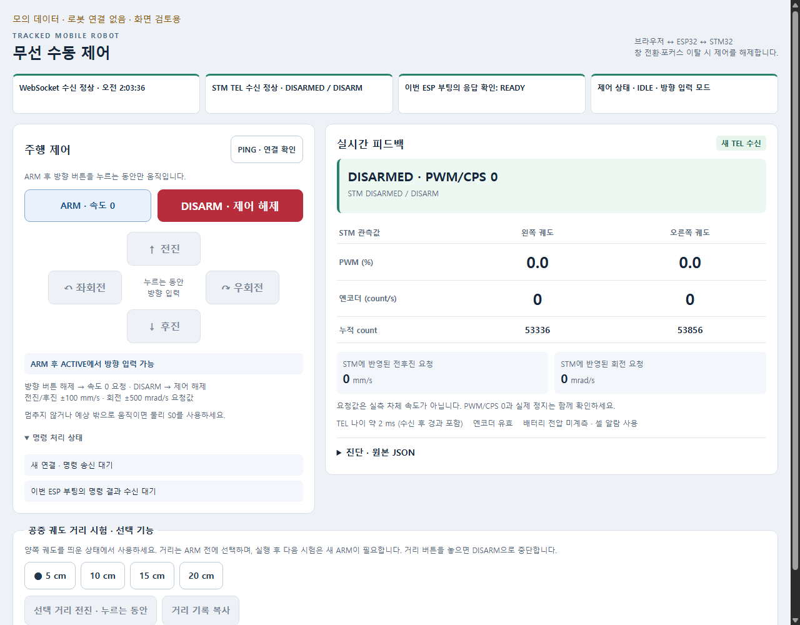

# 브라우저 구성 재점검·보완 — 2026-10-24

**후속 실물 확인:** 사용자 ESP 플래시 성공·새 UI ARM0→DISARM 정상·배터리 단독 보고 후 [새 영상 판독](../2026-10-24_demo_run01/README.md)을 완료했다. 아래 “적용 대기”와 validation JSON은 PC 검증 당시 경계이며 새 UI의 실시간 비용 계측은 아직 없다.

사용자의 “지금 브라우저 구성은 괜찮아? 재점검해보고 보완해” 요청으로 [실제 ESP PAGE](../../../../03_Firmware/esp32_wifi_link/main/wifi_link_main.c)의 표시 부분을 수정했다. **로컬 소스·PC 검사 완료, ESP 빌드/플래시·새 화면의 로봇 운용은 미실시**다.

## 변경과 판단

- 기존 화면은 원본 JSON이 넓은 영역을 차지해 PWM·엔코더와 정지 상태를 촬영 중 읽기 어려웠다. 좌측 조작/우측 측정 요약으로 나누고 원본 JSON은 펼쳐 보는 진단 영역에 보존했다.
- 방향 버튼을 십자 배치하고 DISARM을 큰 빨간 버튼으로 표시했다. 공중 거리 기능은 아래 별도 영역에 두고 기존 hold-to-run 조건을 유지했다.
- 좌우 PWM은 기존 permille를10으로 나눈 **%**, CPS는 **count/s**다. 누적 count는 signed64 문자열을 유지해 정밀도 손실을 막는다. vx/w는 STM에 반영된 요청값이며 실측 차체 속도가 아니다.
- 새 STM TEL이 없거나 나이가250ms 이상이면 요약 수치를 `—`로 바꾼다. `encoder_valid=false`면 CPS/count만 표시하지 않는다. PWM0이어도 CPS가 남으면 “엔코더 변화 중”, FAULT/BLOCKED/종료 응답 대기·출력 불일치는 별도로 표시한다. 화면으로 물리 정지를 보증하지 않는다.
- 표시 갱신은 기존 상태 처리 끝과250ms 표시 전용 타이머에서 수행한다. 타이머가 늦으면 화면 변경도 늦을 수 있다. 이 타이머는 송신·제어 판단을 하지 않으며 예외는 제어 경로 밖에서 처리한다.
- ARM의 기존200ms control offer 조건, 방향 입력의 TEL250ms·STM300ms 조건, ticket/ACK·80ms 목표 주기, 포커스 이탈·pointer 해제/DISARM은 유지했다. ARM 버튼 활성만으로 최신 TEL/실물 정지를 확인했다고 해석하지 않는다.

## 검증

| 검사 | 결과 / 경계 |
| --- | --- |
| 실제 PAGE의 Node VM 검사 | 공통 제어46 + 거리28 + 방향21 + 새 표시10 = **중복 제외105 PASS**. 모의 DOM/시계/WebSocket |
| 실제 Chrome 렌더링 | 1280/900/390/320px, 가로 넘침 없음, DISARM 초기 화면 내 표시,44px 이상 버튼, 십자 배치, JSON 기본 접힘 |
| 오류·오래된 값 | 새 표시10검사에 지연/무효 엔코더/FAULT/BLOCKED·DISARMED 출력 불일치·표시 예외 중 DISARM 포함. Chrome에서도 stale 값 숨김·control200ms 후 ARM 비활성 확인 |
| 네트워크 | 모의 WebSocket 설치·외부 URL 차단. Chrome 네트워크 요청0, JS 예외0. 실물 연결 없음 |
| 변경 범위 | PAGE 밖 원본 바이트 SHA 동일. 새 표시 helper와 두 호출을 제거하면 기존 제어 JS와 동일 |
| 크기 | 디코딩한 PAGE 34,270 → 43,408 bytes. C 매크로 배너 제외. 실제 firmware 크기·빌드 적합성은 사용자 빌드로 확인 |

[기계 판정](validation.json), [Chrome 판정](browser_validation.json), [변경 전 기준](baseline.json), [변경 전 PAGE](page_before.txt).
검사 출력: [dashboard](test_dashboard.log), [distance](test_distance.log), [nonzero](test_nonzero.log). 공통46은 각 runner에서 실행되지만 합계에서 한 번만 센다.

[휴대 화면](dashboard_390.png) · [TEL 지연 화면](dashboard_stale.png) · [오프라인 미리보기](preview.html).
미리보기에는 **모의 데이터·로봇 연결 없음**을 표시했다. 실제 앱은 이 문구/모의 입력을 포함하지 않는다. 미리보기의 버튼은 모의 송신만 기록하고 보드를 제어하지 않는다.

## 재현·다음 단계

저장소 루트에서 Node로 `03_Firmware/tests/test_wifi_dashboard_page.js`, `test_wifi_distance_page.js`, `test_wifi_nonzero_page.js`에 실제 `wifi_link_main.c` 경로를 전달한다. 이 디렉터리의 `check_scope.py`는 기존 영수증과 범위를 대조하고, `check_browser.js`는 Chrome과 Node 내장 CDP/WebSocket으로 화면을 생성한다. 별도 임시 Chrome 프로필을 사용한다.

다음 한 단계는 사용자가 `03_Firmware/esp32_wifi_link`에서 **ESP32-S3 빌드**를 실행해 성공/오류를 확인하는 것이다. USB·전원 변경과 플래시는 아직 지시하지 않는다. 새 화면의 보드 적용/동작 확인 뒤 새 대표 영상 촬영을 이어간다. STM 재빌드나 완료 시험 전체 반복을 요구하지 않는다.

이전 v5.2 앱 처리 최대0.6/0.6/0.8ms는 **이 UI 수정 전 보드/화면**의 관측이다. 새 UI의 실시간 처리 비용·Wi-Fi 신뢰성·물리 정지 성능 근거로 재사용하지 않는다. 기존 인수 판정과 원인OPEN은 유지한다.
