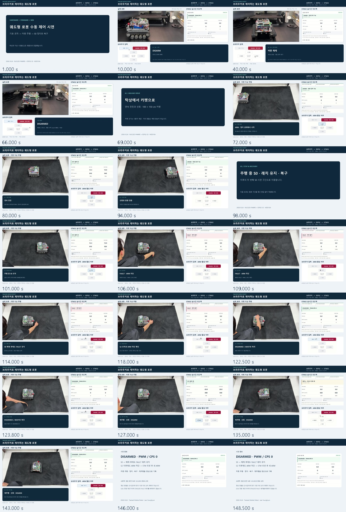

# 수동 제어와 카펫 주행 통합 시연

[동기 수정 완성본 MP4](../../../videos/wifi_mvp/2026-10-24/final/TMR_MVP_Final_2026-10-24.mp4) · **2분 29초 / 1920×1080 / 30fps / H.264 / 무음 / 30.71MB**

기존 65초 탁상 편집본을 앞부분에 보존하고 카펫 주행과 S0 정지·복구 장면을 이어 붙였다. 같은 남색·청록색, 맑은 고딕, 실제 로봇·브라우저 입력·STM 피드백 구성을 사용한다. 최종본은 `assets/videos/wifi_mvp/2026-10-24/final/`로 이동했다. 바탕화면 중복 사본2개는 해시를 확인한 뒤 통합했다. [영상 폴더와 이동 기록](../../../videos/wifi_mvp/2026-10-24/README.md)을 따른다.

사용자의 화면 선행 지적을 재검토해 **카펫 화면을 기존 편집 대비 약1.27초 상대 지연**하도록 수정했다. 초반과 리셋 후 주행9구간의 시작/종료18개를 비교했다. 기존+0.5초 정렬은 폐기하며 아래 수정값이 현재 기준이다.

| 완성본 시각 | 내용 | 원본 구간 |
| --- | --- | --- |
| 00:00–00:03 | 제목 | 편집 카드 |
| 00:03–01:08 | DISARM·ARM·전후진·짧고 긴 좌우회전·종료 | 이전 65초 편집본 전체, 24→30fps 프레임 변환·속도 유지 |
| 01:08–01:10 | 카펫 주행 전환 | 편집 카드 |
| 01:10–01:37 | 카펫 연속 전진·선회 | 새 화면 녹화 4–31초 |
| 01:37–01:39 | 두 번째 S0 구간으로 이동 안내 | 편집 카드 |
| 01:39–02:23.2 | S0·래치/ARM 차단·S2·STM 리셋·새 ARM·재주행 | 새 화면 녹화 99–143.2초, 원속도·구간 내 삭제 없음 |
| 02:23.2–02:29 | 종료 요약 | 새 화면 녹화 145.6초 정지 화면 |

## 원본과 해석

카메라 `mvp_cam_long_01.mp4` 약144.03초, 화면 `mvp_long_01.mp4` 약145.77초는 `assets/videos/wifi_mvp/2026-10-24/raw/`에 바이트 변경 없이 이동했다. [해시·추출 기록](manifest.json), [화면/물리 관측과 사용자 설명](observations.json), [초기 탁상 편집](../2026-10-24_demo_run01/README.md)을 보존한다.

새 영상의 수정값은 **화면 시각=카메라 시각−23/30초(약−0.7667초)**다. 기존+0.5초와 비교하면 화면을1.2667초 늦춘 상대 배치다. 처음의 성긴 스위치/리셋 표본으로는 출발·정지의 어긋남을 잡지 못했다.

이번에는15fps로 화면 방향 버튼 강조와 카메라 프레임 간 움직임을 추출했다. 초반 카메라3–51초와 후반125–141초를 따로 대조해 같은 고정 오프셋으로 맞췄다. 예를 들어 첫 전진 시작은 화면5.867초/카메라6.600초, 리셋 후 좌회전 시작은 화면125.933초/카메라126.667초다.9구간18개 시작/종료의 수정 후 표본 잔차 최대약0.167초이며, 실제 출력 영상에 포함된5구간10개 전이는 최대약0.133초였다. [추출·선정 근거](edit/alignment_recheck.json), [수정 전후 비교](edit/alignment_comparison.png), [출력 파일 전이 검사](edit/render_alignment_validation.json)를 보존한다.

이는 움직임에 맞춘 **편집 정렬**이다. 공통 시계가 없고 표본 간격·움직임 판정 문턱·실제 모터 반응·UI 지연이 포함되므로 잔차를 정밀 동기 오차나 물리 정지 지연으로 해석하지 않는다. 속도 보정이나 구간별 오프셋 변경은 없다. 이전 탁상 영상의 공통 버튼 전이12개 정렬값은 그대로 유지한다. 화면 오디오는 사실상 무음이어서 음성 동기화에 사용하지 않았다.

새 카메라 사용 구간은4.7667–31.7667초와99.7667–143.9667초다. 원본 끝을 넘지 않도록 복구 구간 마지막0.8초를 줄이고 종료 카드를0.8초 늘렸다. 화면143.0초의 DISARMED·PWM/CPS0가 남으며 카메라 끝 프레임을 얼려 연속 장면처럼 보이게 하지 않았다.

S0 해제와 S2 뒤에도 ESTOP_LATCHED·ARM 비활성이 유지되고 STM 리셋 뒤 DISARMED/BOOT·ARM 재허용, 새 ARM 뒤 재주행하는 장면을 보여준다. FAULT 중 READY/IDLE도 유지되므로 READY만으로 운전 허가를 설명하지 않는다. 영상의 S2→리셋 순서는 사용자 시연 기록이며 [표준 운용 절차](../../../../docs/handoff/CURRENT_MVP_OPERATION_RUNBOOK_ko.md)를 변경하지 않는다.

100×150cm와1m 이상 이동은 사용자 보고다. 이 영상으로 거리 정밀도·자동1m 정지·물리 정지 지연이나 전체 MVP 수용을 새로 판정하지 않는다. 원시 TEL JSON이 없고 리셋 전후 count는 합산하지 않는다. 최종 전원 분리/셀 전압은 미보고다.

## 제작과 검증

- [재현 코드](edit/render_final.py), [편집 명세](edit/edit_manifest.json), [검증 코드](edit/validate_final.py), [검증 결과](edit/validation.json), [원본 전이 분석 코드](edit/review_alignment.py), [출력 전이 검사 코드](edit/verify_render_alignment.py).
- 수정본 전체4,470프레임 디코딩 오류0, 영상1/오디오0,149초·1080p30 확인. 출력21개 표본으로 배치/자막/상태 확인, 실제 인코딩된 화면의 버튼/움직임10개 전이 재검사. 전진·정지·좌회전과 리셋 후 재주행 자막도 해당 버튼 구간에 맞췄다.
- 새 원본2개와 이전 편집본의 SHA-256 보존, 바탕화면 사본 동일성 확인. 전체 육안 연속 재생·원본 음성 청취를 수행했다는 뜻은 아니다.
- 수정본 SHA-256: `5df27a8829a6afc1803eeaa924fa4891d8b3805a5336c900de513f2768daedef`. 이전 정렬본은 Git 커밋 `9bc2499`의 이력으로 남아 있다.
- 개별 프레임과 중간 MP4는 로컬 재생성 자료로 두고, 완성본·contact sheet·명세·코드·검증 로그를 게시한다. 원본4개는 새 영상 폴더의 `raw/`에 로컬 보관하며 Git에서 제외한다.

다음은 완성본 사용자의 재생 확인 또는 보류한 PCB 상세 검토 재개다. 편집을 위한 추가 촬영·완료 시험 반복은 필요하지 않다.
