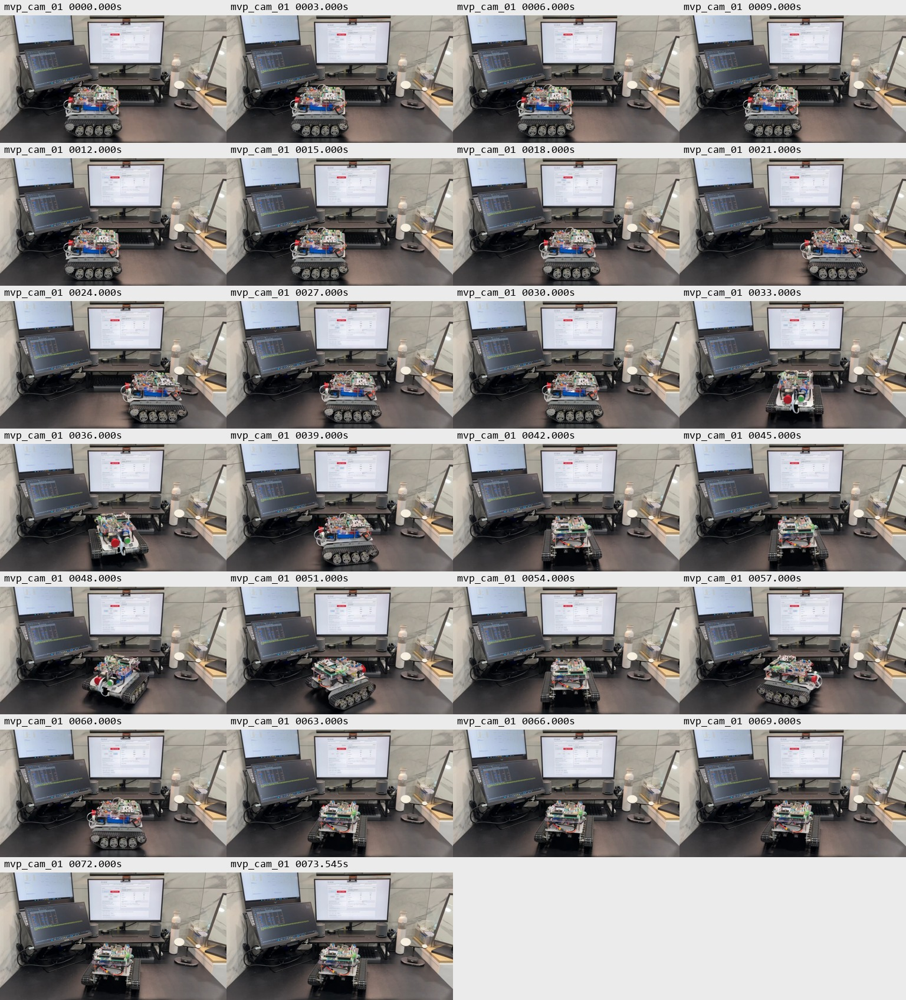
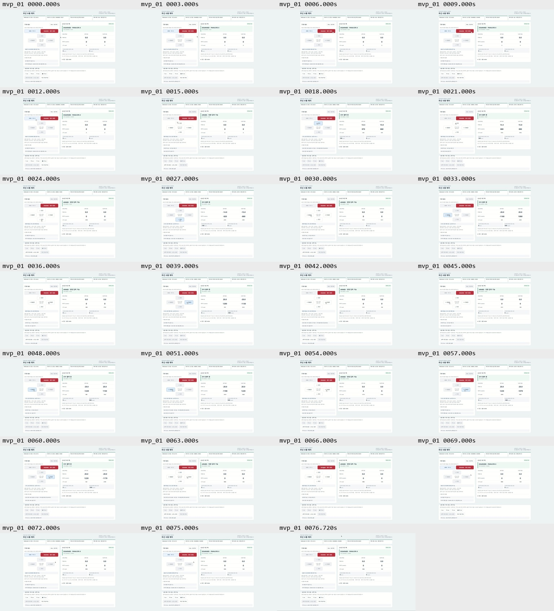

# 새 UI 적용 후 대표 구동 영상 판독 — 2026-10-24

사용자가 제출한 `mvp_cam_01.mp4`(카메라)와 `mvp_01.mp4`(화면 녹화)를 실제 디코딩한 표본 프레임으로 확인했다. **새 UI의 기본 조작·전후진·양방향 회전·최종 DISARM 표시와 실제 차체 움직임을 보여주는 대표 자료로 사용 가능**하다. 전체 MVP 인수나 모든 프레임/명령의 무오류 판정은 아니다.

## 원본과 방법

### 무음 검토용 편집본 — 제작 완료

- [MP4 열기](edit/TMR_MVP_Demo_2026-10-24_review.mp4): **65초 · 1920×1080 · 24fps · H.264 · 무음 · 약11MB**. 바탕화면에도 같은 이름의 동일 해시 사본을 저장했다.
- 실제 로봇, 브라우저 조작 버튼, STM32 피드백을 함께 배치했다. 사용자 순서8개와 마지막 DISARM, 사이의 버튼 해제를 자막으로 연결했다. 원본의 시작/끝 대기만 잘랐고 구간 내 삭제·배속·중간 정지 화면 삽입은 없다.
- 화면 원본6~71초에 카메라5.458333~70.458333초를 대응시켰다. 같은 모니터의6개 방향 버튼 강조 시작/해제12개를 대조해 **화면 원본 시각 = 카메라 원본 시각 + 0.541667초**를 사용했다. 잔차 최대0.041667초는24fps 시각 표본 기준이며 디스플레이 지연까지 제거한 정밀 동기나 물리 정지시간 측정이 아니다. [정렬 근거](edit/alignment.json).
- 카메라의 위쪽 모니터를 crop으로 제외하고 남은 왼쪽 모니터 부분을 다각형 blur로 가렸다. 오디오는 포함하지 않았다. 화면 녹화의 디코딩된 오디오는 무음이어서 오디오 상관 정렬에 사용하지 않았다. 원본 음성을 청취/전사한 것은 아니다.
- 출력 전체 **1,560프레임 디코딩 오류0**, 영상 스트림1개/오디오0개, 입력 SHA-256은 앞선 판독 시점과 동일하다.19개 출력 표본과 최종/전진 확대 화면에서 배치·자막·주요 표시를 확인했다. 전체 프레임 육안 연속 재생이나 실물 인수 검증을 뜻하지 않는다. [검증](edit/validation.json) · [미리보기](edit/preview.png) · [출력 표본](edit/output_contact_sheet.jpg).
- [재현 편집 스크립트](edit/render_demo.py), [필터](edit/filtergraph.txt), [자막](edit/captions.ass), [입출력 해시·편집 설정](edit/edit_manifest.json)을 저장했다. 출력 SHA-256: `aa6f87968a8bec79b74affbd162ec0a37eed0c1dd964cdb7c46701fbc4f951fa`.
- 다음은 사용자의 편집본 재생 확인이다. 추가 촬영/시험은 필수가 아니며 원격 공개·Git commit/push·Calendar/Notion 반영은 하지 않았다. 아래 원본 판독 당시의 “편집 미완료”는 이 절로 대체한다. 기존 인수 판정은 유지한다.

| 원본 위치 | 길이 | 해상도 | 크기 |
| --- | --- | --- | --- |
| `C:/Users/eyh12/Desktop/mvp_cam_01.mp4` | 73.625초 | 1280×720 | 9,767,004 bytes |
| `C:/Users/eyh12/Desktop/mvp_01.mp4` | 76.8초 | 1920×1080 | 85,385,080 bytes |

[원본 해시·디코더 기록](video_manifest.json), [재현 스크립트](decode_video.js). 원본은 제공된 Desktop 경로에 보존하며 이동·재인코딩·원격 게시하지 않았다. 재현 스크립트는 두 파일만 loopback HTTP로 제공해 별도 Chrome 프로필에서 디코딩한다. 로봇/인터넷 연결은 하지 않는다.

- 기본1초 간격과 마지막 프레임, 종료67.1~67.9초의0.1초 간격 표본을 추출했다. 모든 프레임을 연속 재생하거나 음성을 청취한 검토가 아니다.
- 아래 시각은 전부 **화면 녹화 `mvp_01.mp4` 내부 시각**이다. 버튼 강조가 보이는 표본 범위이며 정확한 pointerdown/up 시각이나 실제 동작시간이 아니다.
- 카메라는 탁상에서 차체 전후 이동·양방향 방향 변화와 사이사이 정지 자세를 보여준다. 바닥1m 거리 시험 또는 정밀 제자리회전 자료로 분류하지 않는다.
- 두 파일의 길이 차이3.175초를 곧바로 시작 시각 차이로 쓰지 않는다. 원본 판독 단계에서는 오프셋을 산출하지 않았고, 후속 편집에서 공통 화면으로 얻은 값은 위 편집본 절에 분리했다. 정지 지연은 산출하지 않았다.

## 사용자 조작 순서와 화면 대조

| 순서 | 사용자 보고 | 화면에서 확인한 표본 | 좌/우 PWM (%) | 좌/우 CPS (count/s), 한 표본 |
| --- | --- | --- | --- | --- |
| 1 | DISARM | 6초에는 기존 결과1000, 9초에는 새 DISARM1001 OK·DISARMED/DISARM | 0 / 0 | 0 / 0 |
| 2 | ARM | 14초 DISARMED → 15초 ARMED·방향 입력 가능, 속도0 | 0 / 0 | 0 / 0 |
| 3 | 전진 짧게 | 버튼 강조17~20초 표본; 18초 측정값 판독 | +14.4 / +15.0 | +870 / +860 |
| 4 | 후진 짧게 | 버튼 강조26~27초 표본; 27초 판독 | −14.0 / −15.0 | −820 / −860 |
| 5 | 좌회전 짧게 | 버튼 강조32~33초 표본; 33초 판독 | −20.0 / +20.0 | −1160 / +1080 |
| 6 | 우회전 짧게 | 버튼 강조38~41초 표본; 39초 판독 | +20.0 / −20.0 | +1200 / −1130 |
| 7 | 좌회전 길게 | 버튼 강조46~52초 표본; 51초 판독 | −20.0 / +20.0 | −1190 / +1220 |
| 8 | 우회전 길게 | 버튼 강조56~62초 표본; 60초 판독 | +20.0 / −20.0 | +1220 / −1170 |
| 추가 | 마지막 DISARM | 사용자 목록에는 없지만67.1초 커서가 DISARM 위,67.2초 요청1512/확인 중,67.3초 OK·DISARMED 표시 | 0 / 0 | 0 / 0 |

CPS는 구간 평균/최대가 아닌 지정한 프레임의 표시값이다. PWM% 부호는 방향을 포함하며 절대값은 기존 cap/gain과 일치한다. 전후진 요청±100mm/s·회전 요청±500mrad/s도 표시되지만 실측 차체 속도/각속도는 아니다.

[값 비교 표본](values_detail.jpg) · [시작 상태 표본](start_detail.jpg) · [구동 뒤0 표본](stop_samples.jpg) · [종료 상세](end_transition.jpg).

## 정지와 종료

- 각 방향 입력 뒤23/29/35/42/54/63초 표본에서 PWM/CPS0과 ARMED 복귀를 확인했다. 해제 뒤 ARM을 유지하는 기존 동작과 맞는다.
- 마지막 우회전 뒤63초에서 누적 count **3886 / −564**. 64~67초 표본도 같고 PWM/CPS0이다.
- 67.2초 DISARM1512 확인 중 → 67.3초 OK·DISARMED, 이후68~76초 및76.720초 표본에서 IDLE·DISARMED/DISARM·요청/PWM/CPS0·count3886/−564를 확인했다.0.1초 간격 표본을 ACK 지연/물리 정지시간 측정값으로 바꾸지 않는다.
- 영상상 마지막 DISARM 버튼 위 커서와 상태 전환은 수동 클릭 설명과 일치한다. trusted event/blur 로그는 없으므로 콘솔 이벤트 추적과 같은 증거 수준은 아니다.
- 카메라 마지막 표본에서도 정지 자세가 보인다. **촬영 후 전원 분리와 종료 셀 전압은 미보고**다.

## 증거 범위·다음 작업

- 앞선 사용자 보고: ESP 플래시 성공, 새 UI ARM 속도0→DISARM 정상, 두 보드 USB 분리·배터리 단독. 이 보고와 새 화면 실제 캡처를 이번 자료에 연결한다. 빌드 로그/보드 이미지 해시 readback은 확보하지 않았다.
- 이번 두 영상에 대응하는 원본 TEL/observer JSON은 없다. 명령 전수OK·최대 수신 공백·새 UI JS 처리 시간·과거 간헐 현상 해결을 주장하지 않는다. 이전0.6/0.6/0.8ms 관측은 이전 화면의 독립 회차다.
- 화면의20cm 선택은 실제 거리 실행 증거가 아니다. 이번 사용자 동작과 버튼 표본은 방향 입력이며20cm 거리 시험 PASS로 바꾸지 않는다.
- 기존 T005A PARTIAL/T007 BLOCKED·기타 인수 판정은 유지한다. 이 영상은 정밀 속도/직진성/회전각·열/전력·전체 안전성의 추가 인수 시험이 아니다.
- 판독 당시 후보는 화면 약9~71초였고 후속 편집에서 시작 DISARM 조작 전 대기를 포함하도록6~71초로 확정했다. 실제 제작/정렬·무음/배경 가림 처리는 위 편집본 절에 기록했다. 새 촬영을 필수로 요구하지 않는다.
- 편집본 사용자 재생 확인과 공개 여부 결정이 남았다. Git commit/push·Calendar·Notion 추가 게시 없음.

