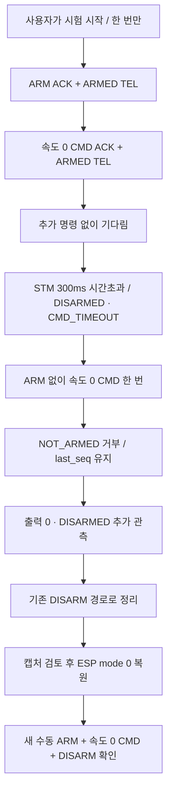

# UR-03 / AC-S06 — STM 명령 시간초과와 재무장 조건

## 지금 할 일

**ESP `wifi_link_main.c`의 아래 세 범위를 한 묶음으로 교체하고 저장한다.**
`WIFI_UART_PARTIAL_TEST_MODE`는 우선 **`0U`**로 둔다. 저장본 검토 후 시험값 `3U`, ESP 빌드·플래시를 진행한다.
STM은 정상 모드로 복원한 현재 코드를 그대로 사용한다. 이 문서의 현재 단계는 코드 입력이며 보드 조작 단계가 아니다.

대상: [wifi_link_main.c](../../03_Firmware/esp32_wifi_link/main/wifi_link_main.c)

## 이번 시험에서 확인할 것

**명령이 끊겨 STM이 정지한 뒤, CMD만 보내도 다시 ARMED가 되지 않아야 한다.**



## 왜 별도 시험 모드인가

정상 ESP 제어는 입력이 끊기면 약 200ms 제한으로 DISARM을 요청한다. 따라서 브라우저 CMD를 멈추기만 하면
STM의 300ms `CMD_TIMEOUT`보다 먼저 ESP의 정지 경로가 실행될 수 있다.

기존 시험 모드 `0/1/2`에 **`3`**을 추가하여 같은 UART 태스크에서 정해진 세 프레임만 보낸다.
정상 제어 FSM은 IDLE로 두고, 시험 순서는 별도 상태로 관리한다. 기존 안전 제한값은 변경하지 않는다.
mode 3에서는 일반 PING/ARM/CMD와 ticket 발급이 부팅 내내 차단된다. 수동 DISARM은 계속 사용할 수 있다.

> 시험 중 웹의 `제어 상태 IDLE`은 정상 제어 FSM 상태다. 시험용 ARM/CMD가 없다는 뜻이 아니다.
> 상단 `AC-S06 시간초과 시험 이미지` 배너와 ESP의 `AC-S06:` 로그, STM TEL을 함께 본다.

## 코드 역할과 실패 경로

| 구성 | 책임 |
|---|---|
| `wifi_uart_test_post` | 현재 boot_id를 확인하여 한 번만 예약. HTTP에서 UART를 쓰지 않음 |
| 기존 `s_uart_test_phase` | 미사용 → 예약 → 실행 → 정리 → 종료. 재시도 없음 |
| `s_watchdog` | ARM, zero CMD, 시간초과, CMD 거부, 추가 관측 단계와 seq·기준 카운터 보관 |
| `wifi_watchdog_reply_locked` | 현재 단계의 seq/type과 ACK 또는 `NOT_ARMED`를 150ms 이내에 확인 |
| `wifi_watchdog_step` | fresh TEL·상태·출력·카운터를 검사하고 다음 고정 프레임 하나만 결정 |
| 기존 `wifi_control_step` | 정상과 동일한 CAN+LF/DISARM, ACK 및 fresh TEL로 정리 완료 판정 |

전제는 fresh DISARMED와 속도/PWM/CPS 0이다. ARM 후 zero CMD의 수락 증거를 확보한 다음 STM의
`DISARMED / CMD_TIMEOUT`, 같은 last_seq, command_age ≥300ms를 기다린다.
이후 CMD를 딱 한 번 보내고 **NOT_ARMED 응답 + last_seq 유지 + err 정확히 1 증가**를 확인한다.
거부 후 200ms 이상과 새 TEL 두 개 이상을 관측한 뒤 DISARM으로 마친다.
300ms는 TEL의 `command_age_ms`로 판정한다. ACK 기록 시각은 명령 수락보다 한 tick 늦을 수 있으므로
ACK 시각을 빼서 300ms 경계를 판정하지 않는다.

ACK 누락·시간초과, 잘못된 응답, 오래된 TEL, FAULT, 출력/CPS 발생, 예상 밖 seq·카운터 변경은 실패로 처리한다.
수동 DISARM 또는 Wi-Fi 전송 경로 상실도 시험을 취소하고 기존 정지 경로를 사용한다.
이미 UART 송신을 결정한 한 프레임은 취소할 수 없으므로 뒤에 CAN+LF/DISARM을 보낸다.
어떤 실패에서도 ARM/CMD를 재시도하거나 시험을 자동 재시작하지 않는다.

시험 실행 제한은 2초이며 정리 시간은 기존 정지 FSM이 관리한다. TCP 페이지 종료 자체는 이 HTTP 시험의 취소 신호가 아니다.
중단이 필요하면 수동 DISARM을 사용한다. STM E-stop과 watchdog은 계속 작동한다.
STM 시각 wrap 근처 또는 err 최댓값에서는 이번 짧은 시험을 시작하지 않는다.

이 방식은 정상 ESP 제어를 우회하는 **시험 이미지**다. STM watchdog 검증에 필요한 범위만 한정하며,
시험 후 mode 0 복원과 새 수동 재무장을 별도로 확인해야 AC-S06의 이번 범위가 끝난다.
속도 0 시험이므로 회전 중인 모터의 실제 정지시간을 입증하지 않는다.

## 입력할 세 범위

다른 파일에 넣지 않는다. 각 범위는 아래 코드 전체로 교체한다. `...` 생략 부분은 없다.

### 1. 시험 설정

기존 `/* 0: normal image; 1: partial CMD; 2: ARM without LF.` 주석부터
`static void wifi_uart_test_cancel_locked(void);`까지 교체한다.
바로 다음 `#define WS_MAX_CLIENTS`는 남겨 둔다.

```c
/* 0: normal image; 1: partial CMD; 2: ARM without LF; 3: CMD_TIMEOUT / NOT_ARMED.
 * Test images reject normal PING/ARM/CMD for the entire boot.
 * One manual POST per boot; never inject automatically at startup. */
#define WIFI_UART_PARTIAL_TEST_MODE 0U
#if WIFI_UART_PARTIAL_TEST_MODE > 3U
#error "WIFI_UART_PARTIAL_TEST_MODE must be 0, 1, 2 or 3"
#endif
#if WIFI_UART_PARTIAL_TEST_MODE == 3U
#define WIFI_UART_PARTIAL_TEST_BANNER \
    "<p><strong>AC-S06 시간초과 시험 이미지</strong> · 제어 IDLE과 별도로 시험 UART 동작 · 일반 PING/ARM/CMD 비활성 · 수동 DISARM 가능</p>"
#elif WIFI_UART_PARTIAL_TEST_MODE != 0U
#define WIFI_UART_PARTIAL_TEST_BANNER \
    "<p><strong>UART 부분 명령 시험 이미지</strong> · 일반 PING/ARM/CMD 비활성 · 수동 DISARM 가능</p>"
#else
#define WIFI_UART_PARTIAL_TEST_BANNER ""
#endif

static esp_err_t wifi_uart_test_post(httpd_req_t *req);
static void wifi_uart_test_cancel_locked(void);
```

### 2. 연결된 시험 함수 전체

`/* UART_PARTIAL_TEST_BEGIN: all state is protected by s_stm_lock. */`부터
`/* UART_PARTIAL_TEST_END */`까지 **두 표시 줄을 포함하여** 아래 전체로 교체한다.
뒤에 있는 정상 `wifi_control_step()` 함수는 남겨 둔다.
기존 부분 명령 시험 mode 1/2도 이 블록 안에 보존되어 있다.

```c
/* UART_PARTIAL_TEST_BEGIN: all state is protected by s_stm_lock. */
typedef enum {
    UART_TEST_UNUSED, UART_TEST_QUEUED, UART_TEST_HOLD,
    UART_TEST_STOPPING, UART_TEST_DONE, UART_TEST_ABORTED
} uart_partial_test_phase_t;

static uart_partial_test_phase_t s_uart_test_phase;
static uint64_t s_uart_test_at_ms;
static bool s_uart_test_prefix_full;

/* Inserted inside UART_PARTIAL_TEST_BEGIN. Native tests compile these exact functions. */
typedef enum { WD_ARM, WD_ZERO, WD_TIMEOUT, WD_PROBE, WD_OBSERVE } uart_watchdog_phase_t;
static struct {
    uart_watchdog_phase_t phase;
    uint32_t seq[3], baseline_seq, drop, err, last_t_ms, ack_t_ms, cmd_t_ms, tel_floor;
    uint64_t started_ms, sent_ms, observed_ms;
    bool replied, proof, stop_confirmed;
    const char *problem;
} s_watchdog;

static bool wifi_watchdog_zero_locked(uint64_t now)
{
    const stm_telemetry_t *t = &s_stm_telemetry;
    return t->valid && now >= t->rx_ms && now - t->rx_ms < WIFI_CONTROL_TEL_MS &&
        (strcmp(t->state, "DISARMED") == 0 || strcmp(t->state, "ARMED") == 0) &&
        t->vx_mmps == 0 && t->w_mradps == 0 && t->left_pwm == 0 && t->right_pwm == 0 &&
        t->left_cps == 0 && t->right_cps == 0;
}

static bool wifi_uart_test_ready_locked(uint64_t now)
{
    const wifi_control_state_t *s = &s_control.state;
    return wifi_control_ready_locked() && s->phase == WIFI_CONTROL_IDLE &&
        !s_manual_stop_pending && s_wifi_command_owner_session_id == 0U &&
        !s_control.queued && !s_control.waiting && !s_control.prepared &&
        !s_control.have_result && s->have_tel && now >= s->tel_received_ms &&
        now - s->tel_received_ms < WIFI_CONTROL_TEL_MS &&
        s->tel.state == WIFI_CONTROL_STM_DISARMED &&
        s->tel.vx_mmps == 0 && s->tel.w_mradps == 0 &&
        s->tel.left_pwm == 0 && s->tel.right_pwm == 0 &&
        (WIFI_UART_PARTIAL_TEST_MODE != 3U || wifi_watchdog_zero_locked(now));
}

/* Reserve the prefix identity and ensure the next allocator call can still
 * provide a DISARM identity, including skipped startup-reserved values. */
static bool wifi_uart_test_sequence_locked(uint32_t *seq)
{
    if (!wifi_uart_allocate_seq(seq)) return false;
    while (s_wifi_uart_next_seq <= UINT32_MAX &&
        (s_wifi_uart_next_seq == s_stm_startup.disarm_seq ||
         s_wifi_uart_next_seq == s_stm_startup.ping_seq)) {
        ++s_wifi_uart_next_seq;
    }
    return s_wifi_uart_next_seq <= UINT32_MAX;
}

/* Manual stop / transport loss cancels a queued injection. A committed prefix
 * cannot be recalled; request the existing priority DISARM immediately. */
static void wifi_uart_test_cancel_locked(void)
{
    if (s_uart_test_phase == UART_TEST_QUEUED) {
        s_uart_test_phase = UART_TEST_ABORTED;
    } else if (s_uart_test_phase == UART_TEST_HOLD) {
        if (WIFI_UART_PARTIAL_TEST_MODE == 3U && s_watchdog.problem == NULL)
            s_watchdog.problem = "CANCELLED";
        s_uart_test_phase = UART_TEST_STOPPING;
        wifi_control_executor_stop(&s_control, WIFI_CONTROL_REASON_MANUAL_STOP,
                                   wifi_control_now());
        wifi_control_cleanup_locked();
    }
}

/* Body: decimal current boot_id only. HTTP queues; it never writes UART.
 * The 202 response means accepted, not prefix delivery or test success. */
static esp_err_t wifi_uart_test_post(httpd_req_t *req)
{
    if (WIFI_UART_PARTIAL_TEST_MODE == 0U) {
        httpd_resp_set_status(req, "404 Not Found");
        return httpd_resp_sendstr(req, "DISABLED");
    }
    char body[11];
    if (req->content_len <= 0 || req->content_len >= sizeof(body)) {
        httpd_resp_set_status(req, "400 Bad Request");
        return httpd_resp_sendstr(req, "BAD_INPUT");
    }
    size_t used = 0U;
    while (used < req->content_len) {
        const int got = httpd_req_recv(req, body + used, req->content_len - used);
        if (got <= 0) return ESP_FAIL; /* No retry, no queued side effect. */
        used += (size_t)got;
    }
    body[used] = '\0';
    uint32_t boot = 0U;
    const char *cursor = body;
    if (memchr(body, '\0', used) != NULL ||
        !wifi_command_parse_u32(&cursor, &boot) || *cursor != '\0') {
        httpd_resp_set_status(req, "400 Bad Request");
        return httpd_resp_sendstr(req, "BAD_INPUT");
    }
    const char *error = NULL;
    xSemaphoreTake(s_stm_lock, portMAX_DELAY);
    const uint64_t now = wifi_control_now();
    wifi_control_executor_poll(&s_control, wifi_control_ready_locked(), now);
    wifi_control_cleanup_locked();
    if (boot != s_boot_id) error = "BOOT_MISMATCH";
    else if (s_uart_test_phase != UART_TEST_UNUSED) error = "ALREADY_USED";
    else if (!wifi_uart_test_ready_locked(now)) error = "NOT_READY";
    else {
        s_uart_test_phase = UART_TEST_QUEUED;
        s_uart_test_at_ms = now;
    }
    xSemaphoreGive(s_stm_lock);
    httpd_resp_set_status(req, error != NULL ? "409 Conflict" : "202 Accepted");
    return httpd_resp_sendstr(req, error != NULL ? error : "QUEUED; check UART log and capture");
}

static void wifi_watchdog_stop_locked(const char *problem, uint64_t now)
{
    if (problem != NULL && s_watchdog.problem == NULL) s_watchdog.problem = problem;
    s_uart_test_phase = UART_TEST_STOPPING;
    wifi_control_executor_stop(&s_control, WIFI_CONTROL_REASON_MANUAL_STOP, now);
    wifi_control_cleanup_locked();
    ESP_LOGI(TAG, "AC-S06: cleanup proof=%u problem=%s", s_watchdog.proof ? 1U : 0U,
             s_watchdog.problem != NULL ? s_watchdog.problem : "NONE");
}

static bool wifi_watchdog_reply_locked(wifi_control_op_t op, uint32_t seq,
    bool ack, const char *code, uint32_t t_ms, uint64_t now)
{
    if (WIFI_UART_PARTIAL_TEST_MODE != 3U || s_uart_test_phase != UART_TEST_HOLD ||
        (s_watchdog.phase != WD_ARM && s_watchdog.phase != WD_ZERO &&
         s_watchdog.phase != WD_PROBE)) return false;
    const unsigned index = s_watchdog.phase == WD_ARM ? 0U :
                           s_watchdog.phase == WD_ZERO ? 1U : 2U;
    if (seq != s_watchdog.seq[index]) return false;
    const bool expected = op == (index == 0U ? WIFI_CONTROL_OP_ARM : WIFI_CONTROL_OP_CMD) &&
        (index < 2U ? ack : (!ack && code != NULL && strcmp(code, "NOT_ARMED") == 0));
    if (!expected || s_watchdog.replied || now < s_watchdog.sent_ms ||
        now - s_watchdog.sent_ms >= WIFI_CONTROL_ACK_MS || t_ms < s_watchdog.last_t_ms) {
        wifi_watchdog_stop_locked("BAD_OR_LATE_REPLY", now);
    } else {
        s_watchdog.replied = true;
        s_watchdog.ack_t_ms = t_ms;
        if (index == 1U) s_watchdog.cmd_t_ms = t_ms;
        ESP_LOGI(TAG, "AC-S06: reply step=%u seq=%" PRIu32 " %s t_ms=%" PRIu32,
                 index, seq, ack ? "ACK" : "NOT_ARMED", t_ms);
    }
    return true;
}

/* Same UART task as production, fixed zero frames only, no retries or auto re-arm.
 * The production owner remains IDLE: its early source-loss DISARM would otherwise
 * preempt the STM's 300 ms watchdog. Normal ingress/tickets stay disabled in mode 3. */
static void wifi_watchdog_step(void)
{
    char frame[WIFI_CONTROL_UART_FRAME_SIZE];
    int length = 0, index = -1;
    xSemaphoreTake(s_stm_lock, portMAX_DELAY);
    const uint64_t now = wifi_control_now();
    const stm_telemetry_t *t = &s_stm_telemetry;
    wifi_control_executor_poll(&s_control, wifi_control_ready_locked(), now);
    wifi_control_cleanup_locked();
    if (s_uart_test_phase == UART_TEST_QUEUED) {
        if (now < s_uart_test_at_ms || now - s_uart_test_at_ms >= WIFI_CONTROL_QUEUE_MS ||
            !wifi_uart_test_ready_locked(now) || strcmp(t->state, "DISARMED") != 0 ||
            t->err == UINT32_MAX || t->t_ms > UINT32_MAX - 2000U) {
            s_uart_test_phase = UART_TEST_ABORTED;
            ESP_LOGW(TAG, "AC-S06: not sent (expired/not ready/counter boundary)");
        } else {
            memset(&s_watchdog, 0, sizeof(s_watchdog));
            bool allocated = true;
            for (unsigned i = 0U; i < 3U && allocated; ++i)
                allocated = wifi_uart_test_sequence_locked(&s_watchdog.seq[i]);
            if (!allocated) {
                s_uart_test_phase = UART_TEST_ABORTED;
                ESP_LOGW(TAG, "AC-S06: not sent (sequence exhausted)");
            } else {
                s_watchdog.started_ms = now;
                s_watchdog.baseline_seq = t->last_seq;
                s_watchdog.drop = t->drop; s_watchdog.err = t->err;
                s_watchdog.last_t_ms = t->t_ms;
                s_uart_test_phase = UART_TEST_HOLD;
                index = 0;
            }
        }
    } else if (s_uart_test_phase == UART_TEST_HOLD) {
        const bool armed = strcmp(t->state, "ARMED") == 0;
        const bool timed_out = strcmp(t->state, "DISARMED") == 0 &&
            strcmp(t->reason, "CMD_TIMEOUT") == 0 && t->last_seq == s_watchdog.seq[1] &&
            t->t_ms >= s_watchdog.cmd_t_ms &&
            t->command_age_ms >= 300U && t->command_age_ms != UINT32_MAX;
        /* command_age_ms is measured from CMD acceptance. ACK t_ms can be a
         * later HAL tick; subtracting it would falsely reject the 300 ms edge. */
        const bool probing = s_watchdog.phase == WD_PROBE || s_watchdog.phase == WD_OBSERVE;
        if (!wifi_control_ready_locked() || s_control.state.phase != WIFI_CONTROL_IDLE ||
            s_manual_stop_pending || s_wifi_command_owner_session_id != 0U ||
            s_control.queued || s_control.waiting || s_control.prepared || s_control.have_result ||
            !wifi_watchdog_zero_locked(now) || now < s_watchdog.started_ms ||
            now - s_watchdog.started_ms >= 2000U || t->t_ms < s_watchdog.last_t_ms ||
            t->drop != s_watchdog.drop ||
            (t->err != s_watchdog.err && (!probing || t->err != s_watchdog.err + 1U))) {
            wifi_watchdog_stop_locked("STATE_FRESHNESS_OUTPUT_OR_COUNTER", now);
        } else {
            s_watchdog.last_t_ms = t->t_ms;
            const bool tel_after_tx = s_stm_tel_count != s_watchdog.tel_floor &&
                t->rx_ms >= s_watchdog.sent_ms && t->t_ms >= s_watchdog.ack_t_ms;
            if ((s_watchdog.phase == WD_ARM || s_watchdog.phase == WD_ZERO ||
                 s_watchdog.phase == WD_PROBE) && !s_watchdog.replied &&
                now - s_watchdog.sent_ms >= WIFI_CONTROL_ACK_MS) {
                wifi_watchdog_stop_locked("REPLY_TIMEOUT", now);
            } else if (s_watchdog.phase == WD_ARM) {
                if ((armed && (t->last_seq != s_watchdog.seq[0] || strcmp(t->reason, "NONE") != 0)) ||
                    (!armed && t->last_seq != s_watchdog.baseline_seq))
                    wifi_watchdog_stop_locked("ARM_STATE_MISMATCH", now);
                else if (s_watchdog.replied && tel_after_tx && armed) index = 1;
                else if (now - s_watchdog.sent_ms >= 250U)
                    wifi_watchdog_stop_locked("ARM_TEL_TIMEOUT", now);
            } else if (s_watchdog.phase == WD_ZERO) {
                if (!armed || strcmp(t->reason, "NONE") != 0 ||
                    (t->last_seq != s_watchdog.seq[0] && t->last_seq != s_watchdog.seq[1]))
                    wifi_watchdog_stop_locked("ZERO_STATE_MISMATCH", now);
                else if (s_watchdog.replied && tel_after_tx && t->last_seq == s_watchdog.seq[1] &&
                         t->command_age_ms < 300U) {
                    s_watchdog.phase = WD_TIMEOUT;
                    ESP_LOGI(TAG, "AC-S06: zero accepted; waiting CMD_TIMEOUT seq=%" PRIu32, t->last_seq);
                } else if (now - s_watchdog.sent_ms >= 250U)
                    wifi_watchdog_stop_locked("ZERO_TEL_TIMEOUT", now);
            } else if (s_watchdog.phase == WD_TIMEOUT) {
                if (timed_out) {
                    ESP_LOGI(TAG, "AC-S06: CMD_TIMEOUT seq=%" PRIu32 " age=%" PRIu32,
                             t->last_seq, t->command_age_ms);
                    index = 2;
                } else if (!armed || t->last_seq != s_watchdog.seq[1] ||
                           strcmp(t->reason, "NONE") != 0 || t->command_age_ms >= 300U ||
                           now - s_watchdog.sent_ms >= 700U)
                    wifi_watchdog_stop_locked("EXPECTED_CMD_TIMEOUT_MISSING", now);
            } else if (probing) {
                if (!timed_out) wifi_watchdog_stop_locked("CMD_REARMED_OR_STATE_CHANGED", now);
                else if (s_watchdog.phase == WD_PROBE && s_watchdog.replied && tel_after_tx &&
                         t->err == s_watchdog.err + 1U) {
                    s_watchdog.phase = WD_OBSERVE;
                    s_watchdog.observed_ms = now;
                    s_watchdog.tel_floor = s_stm_tel_count;
                } else if (s_watchdog.phase == WD_PROBE && now - s_watchdog.sent_ms >= 250U)
                    wifi_watchdog_stop_locked("REJECTION_TEL_TIMEOUT", now);
                else if (s_watchdog.phase == WD_OBSERVE && t->err != s_watchdog.err + 1U)
                    wifi_watchdog_stop_locked("ERROR_COUNTER_CHANGED", now);
                else if (s_watchdog.phase == WD_OBSERVE && now - s_watchdog.observed_ms >= 200U &&
                         s_stm_tel_count - s_watchdog.tel_floor >= 2U) {
                    s_watchdog.proof = true;
                    wifi_watchdog_stop_locked(NULL, now);
                }
            }
        }
    } else if (s_uart_test_phase == UART_TEST_STOPPING &&
               (s_control.state.phase == WIFI_CONTROL_IDLE || s_control.state.phase == WIFI_CONTROL_BLOCKED)) {
        const bool stopped = s_control.state.phase == WIFI_CONTROL_IDLE &&
            wifi_watchdog_zero_locked(now) && strcmp(t->state, "DISARMED") == 0 &&
            strcmp(t->reason, "DISARM") == 0 && t->last_seq == s_control.state.confirm_seq &&
            t->t_ms >= s_watchdog.last_t_ms && t->drop == s_watchdog.drop &&
            t->err == s_watchdog.err + 1U;
        s_watchdog.stop_confirmed = stopped;
        if (!stopped && s_watchdog.problem == NULL) s_watchdog.problem = "CLEANUP_UNCONFIRMED";
        s_uart_test_phase = UART_TEST_DONE;
        ESP_LOGI(TAG, "AC-S06: end checks_ok=%u stop_confirmed=%u problem=%s; capture and manual re-arm review required",
            s_watchdog.proof && s_watchdog.problem == NULL && stopped ? 1U : 0U,
            stopped ? 1U : 0U, s_watchdog.problem != NULL ? s_watchdog.problem : "NONE");
    }
    if (index >= 0 && s_uart_test_phase == UART_TEST_HOLD) {
        s_watchdog.phase = index == 0 ? WD_ARM : index == 1 ? WD_ZERO : WD_PROBE;
        s_watchdog.replied = false; s_watchdog.ack_t_ms = 0U;
        s_watchdog.sent_ms = now; s_watchdog.tel_floor = s_stm_tel_count;
        length = index == 0 ? snprintf(frame, sizeof(frame), "ARM,seq=%" PRIu32 "\n", s_watchdog.seq[index]) :
            snprintf(frame, sizeof(frame), "CMD,seq=%" PRIu32 ",vx_mmps=0,w_mradps=0,timeout_ms=300\n", s_watchdog.seq[index]);
        if (length <= 0 || (size_t)length >= sizeof(frame)) {
            length = 0; wifi_watchdog_stop_locked("FORMAT_FAILED", now);
        }
    }
    xSemaphoreGive(s_stm_lock);
    if (length <= 0) return;
    /* A concurrent manual stop cannot retract this committed frame. The existing
     * priority CAN+LF/DISARM follows; no subsequent test frame is committed. */
    const int written = uart_write_bytes(STM_UART_PORT, frame, (size_t)length);
    xSemaphoreTake(s_stm_lock, portMAX_DELAY);
    if (written != length && s_uart_test_phase == UART_TEST_HOLD)
        wifi_watchdog_stop_locked("SHORT_WRITE", wifi_control_now());
    xSemaphoreGive(s_stm_lock);
    ESP_LOGI(TAG, "AC-S06: TX step=%d seq=%" PRIu32 " written=%d/%d", index,
             s_watchdog.seq[index], written, length);
}

/* Called only by stm_uart_rx_task, before normal control/command dispatch.
 * Fixed prefix -> 100 ms receive/poll interval -> existing CAN+LF DISARM.
 * No raw input, no LF-only flush, no retry, no new UART writer task. */
static void wifi_uart_test_step(void)
{
    if (WIFI_UART_PARTIAL_TEST_MODE == 0U) return;
    if (WIFI_UART_PARTIAL_TEST_MODE == 3U) { wifi_watchdog_step(); return; }
    char prefix[32];
    int length = 0;
    uint32_t seq = 0U;
    xSemaphoreTake(s_stm_lock, portMAX_DELAY);
    const uint64_t now = wifi_control_now();
    wifi_control_executor_poll(&s_control, wifi_control_ready_locked(), now);
    wifi_control_cleanup_locked();
    if (s_uart_test_phase == UART_TEST_QUEUED) {
        if (now < s_uart_test_at_ms || now - s_uart_test_at_ms >= WIFI_CONTROL_QUEUE_MS ||
            !wifi_uart_test_ready_locked(now) || !wifi_uart_test_sequence_locked(&seq)) {
            s_uart_test_phase = UART_TEST_ABORTED;
            ESP_LOGW(TAG, "UART TEST: not sent (expired/not ready/sequence exhausted)");
        } else {
            length = WIFI_UART_PARTIAL_TEST_MODE == 1U ?
                snprintf(prefix, sizeof(prefix), "CMD,seq=") :
                snprintf(prefix, sizeof(prefix), "ARM,seq=%" PRIu32, seq);
            /* The fixed strings plus uint32_t always fit prefix[32]. */
            s_uart_test_phase = UART_TEST_HOLD;
            s_uart_test_at_ms = now;
        }
    } else if (s_uart_test_phase == UART_TEST_HOLD) {
        if (!wifi_uart_test_ready_locked(now) || now < s_uart_test_at_ms ||
            now - s_uart_test_at_ms >= 100U) {
            s_uart_test_phase = UART_TEST_STOPPING;
            wifi_control_executor_stop(&s_control, WIFI_CONTROL_REASON_MANUAL_STOP, now);
            wifi_control_cleanup_locked();
        }
    } else if (s_uart_test_phase == UART_TEST_STOPPING) {
        if (s_control.state.phase == WIFI_CONTROL_IDLE ||
            s_control.state.phase == WIFI_CONTROL_BLOCKED) {
            s_uart_test_phase = UART_TEST_DONE;
            ESP_LOGI(TAG, "UART TEST: end prefix_full=%u stop_confirmed=%u; capture review required",
                     s_uart_test_prefix_full ? 1U : 0U,
                     s_control.state.phase == WIFI_CONTROL_IDLE ? 1U : 0U);
        }
    }
    xSemaphoreGive(s_stm_lock);
    if (length <= 0) return;

    /* Commit point is above, under the lock, just like executor take_tx.
     * A concurrent DISARM may cancel the hold, but cannot retract these bytes. */
    const int written = uart_write_bytes(STM_UART_PORT, prefix, (size_t)length);
    xSemaphoreTake(s_stm_lock, portMAX_DELAY);
    s_uart_test_prefix_full = written == length;
    if (s_uart_test_phase == UART_TEST_HOLD) {
        s_uart_test_at_ms = wifi_control_now();
        if (!s_uart_test_prefix_full) wifi_uart_test_cancel_locked();
    }
    xSemaphoreGive(s_stm_lock);
    ESP_LOGI(TAG, "UART TEST: mode=%u reserved_seq=%" PRIu32 " prefix=%s written=%d/%d NO_LF",
             (unsigned)WIFI_UART_PARTIAL_TEST_MODE, seq, prefix, written, length);
}
/* UART_PARTIAL_TEST_END */
```

### 3. 응답 분기

`wifi_control_handle_response()` 안의 아래 한 줄을 교체한다.

```c
    const bool matched = wifi_control_executor_reply(&s_control, op, seq, ack, t_ms, wifi_control_now());
```

교체 코드:

```c
    const bool test_matched = wifi_watchdog_reply_locked(op, seq, ack,
        ack ? NULL : code, t_ms, wifi_control_now());
    const bool matched = test_matched ||
        wifi_control_executor_reply(&s_control, op, seq, ack, t_ms, wifi_control_now());
```

앞의 `xSemaphoreTake`와 뒤의 `wifi_control_results_locked`, `xSemaphoreGive`는 유지한다.
시험 프레임의 응답을 먼저 처리하고, 해당하지 않으면 정상 응답 처리로 넘긴다.

## PC 검증 범위

- [PC 결과](../../assets/logs/wifi_link/2026-10-16_ur03_acs06_cmd_timeout_preparation/pc_results.txt)
- [검토한 전체 후보](../../assets/logs/wifi_link/2026-10-16_ur03_acs06_cmd_timeout_preparation/wifi_link_main.c.candidate.txt)
- [입력 파일 해시와 상태](../../assets/logs/wifi_link/2026-10-16_ur03_acs06_cmd_timeout_preparation/source_manifest.json)

후보의 실제 ESP 함수와 저장된 STM parser·protocol·watchdog, 정상 정지 executor를 PC에서 연결했다.
mode 0의 기존 42개 검사, mode 1/2 시험, 실제 PAGE C initializer, mode 3 정상·실패 경로를 검사했다.
HAL 시간·UART·RTOS·GPIO·모터 입출력은 모의 환경이다. **ESP 빌드, 플래시, 실제 UART/PWM 측정은 아직 하지 않았다.**

저장 후 검토 명령은 `python 03_Firmware/tests/test_uart_watchdog.py --saved`이며
native C compiler 설정이 필요하다. 이 PC 검사는 Codex가 수행한다. MCU 빌드는 사용자가 한다.

## 저장본 검토 후 진행할 보드 순서

아래는 다음 단계의 전체 흐름이다. **현재는 위 세 블록을 mode 0으로 저장하는 단계까지만 진행한다.**

1. 저장본 검토 통과 후 ESP mode **3**으로 변경 → 사용자가 ESP 빌드·플래시.
2. STM 시험 플래그 전부 0, 모터 전원 경로 분리 유지, S1 ON/S0 해제, fresh DISARMED·출력 0 확인.
3. LA D0=PA9, D1=PA10, D4=PB6, D6=PC7, D7=PB7, 4MHz/115200 8N1로 캡처 시작.
4. [console_start.js](../../assets/logs/wifi_link/2026-10-16_ur03_acs06_cmd_timeout_preparation/console_start.js)를 Console에서 한 번 실행.
   페이지 ARM 버튼은 사용하지 않는다. POST 202는 예약이며 성공 판정이 아니다.
5. `AC-S06: end checks_ok=1 stop_confirmed=1 problem=NONE`와 DISARMED/출력 0 확인 후 캡처 저장.
   이름: `2026-10-16_UR03_ACS06_CMD_TIMEOUT_PWM_run01.sr`. ESP 로그도 함께 보관.
6. UART/PWM 원본 검토 후 ESP mode **0** 복원 → 사용자 빌드·플래시 → 새 수동 ARM/zero CMD/DISARM 캡처.

출력/CPS가 0에서 벗어나거나 FAULT·BLOCKED·checks_ok=0이면 다음 동작을 진행하지 않는다.
수동 DISARM 결과와 로그를 먼저 확인한다. 실패 회차를 성공 회차로 덮어쓰지 않는다.

## 보드 PASS 기준

| 관측 | 필요한 증거 |
|---|---|
| 초기 수락 | ARM ACK, zero CMD ACK, 대응 seq의 ARMED/NONE TEL |
| STM 시간초과 | 다음 명령 없이 300ms 이상 경과, DISARMED/CMD_TIMEOUT, 마지막 수락 CMD seq 유지 |
| CMD 단독 거부 | 그 후 zero CMD 1개, 같은 seq의 `ERR ... type=CMD,code=NOT_ARMED`, 대응 CMD ACK 없음 |
| 거부 후 상태 | ARMED 재진입 없음, last_seq 유지, err만 기준 대비 정확히 +1, drop 유지 |
| 정리 | CAN+LF/DISARM, 일치 ACK와 fresh DISARMED TEL, checks_ok=1/stop_confirmed=1 |
| 출력 | 관측 전 구간 PWM/CPS 0, LA D4/D6/D7 LOW |
| 정상 복원 | mode 0 새 이미지, 새 수동 ARM과 zero CMD 수락, 수동 DISARM ACK·IDLE/DISARMED |

`err=1`은 이 시험에서 의도적으로 보낸 NOT_ARMED 요청 1개 때문일 수 있다. 기준값과 증가량으로 판정한다.
마지막 DISARM 성공만으로 앞의 시간초과/재무장 거부를 통과 처리하지 않는다.
