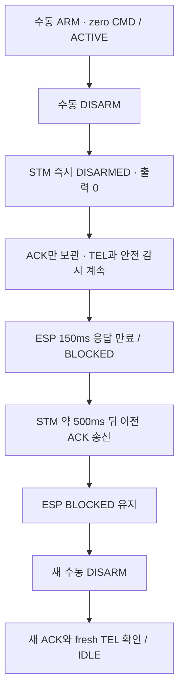

# UR-03 / AC-S08 — 늦은 DISARM ACK 시험 코드

## 지금 할 일

**STM `uart_mvp_protocol.c`에 아래 8개 교체 블록을 한 묶음으로 입력하고 저장한다.**
새 설정값은 우선 `0U`로 둔다. 저장본 검토 후 시험값 `1U`와 STM 빌드·플래시를 안내한다.
ESP는 현재 정상 이미지(mode 0)를 사용한다. 이번 문서는 입력 단계이며 보드 조작 지시가 아니다.

대상: [uart_mvp_protocol.c](../../03_Firmware/stm32_uart_mvp/Core/Src/uart_mvp_protocol.c)

## 왜 필요한가

기존 BLOCKED·수동 복구 시험에 이어, **기한이 지난 정지 ACK가 도착해도 잠금이 풀리지 않는지** 확인한다.
UART 선을 빼면 ACK와 TEL이 함께 사라지므로 이번에는 STM의 정지는 즉시 처리하고 ACK 한 개만 500ms 늦춘다.
ESP의 기존 ACK 제한 150ms와 안전 판정은 유지한다.



500ms는 **응답 주입 지연**이다. 출력 0 시험이므로 실제 회전 모터의 정지시간을 증명하지 않는다.

## 설계와 책임

| 요소 | 역할 |
|---|---|
| `used` | STM 부팅당 성공적으로 예약한 한 번만 소비 |
| `pending`, `seq`, `processed_ms` | 보낼 응답과 원래 처리 시각 보관 |
| `zero_cmd_seen` | 현재 ARM 이후 zero CMD 수락 여부. 새 ARM마다 초기화 |
| `eligible()` | ARMED·zero CMD·속도/PWM/CPS 0·E-stop 미작동/미래치 검사 |
| `schedule()` | 기존 정지와 last_seq 갱신 후 응답 예약, TEST_ACK_DELAY 진단 줄 기록 |
| `poll()` | 수신·안전 처리 후 경과시간 검사. 응답만 한 번 송신 |

`HAL_Delay(500)`는 수신·안전 감시까지 멈추므로 사용하지 않는다. 기존 UART 송신 함수의 blocking 동작은 유지한다.
unsigned 경과시간 계산으로 tick wrap을 처리한다. 늦은 ACK의 `t_ms`는 **원래 DISARM 처리 시각**이다.

부팅 중 DISARM, 현재 ARM에서 zero CMD 미수신, nonzero 조건, E-stop 조건에서는 즉시 ACK하며 `used`를 소비하지 않는다.
예약 뒤 새 DISARM도 즉시 처리한다. 늦은 ACK는 상태·출력·last_seq를 다시 바꾸지 않는다.
STM 초기화는 예약을 버린다. 대기 중 E-stop·watchdog·수신 처리는 계속 동작한다.

이 hook 자체가 nonzero 명령을 차단하는 것은 아니다. 실물 시험은 기존 zero-only ESP와 모터 전원 분리 조건에서만 한다.
다른 출력/응답 주입 hook을 함께 켜면 컴파일 오류로 막는다.

## 코드 입력 — 위에서 아래로 한 번씩 교체

각 `기존 범위`를 찾아 `교체 코드` 전체로 바꾼다. 범위 밖의 코드는 유지한다.
4번은 helper 함수 + 기존 handle_line의 시작 부분이다. 기존 함수 본문·닫는 중괄호를 추가로 복제하지 않는다.
5번 뒤에 이어지는 기존 malformed ACK 시험 분기들도 유지한다.

### 1. 시험 설정과 중복 주입 방지

기존 시험 매크로들 바로 뒤에 기본값 0U와 혼합 금지 검사를 추가한다.

기존 범위:

```c
#define UART_MVP_SUPPRESS_PONG_TEST_ENABLED             0U
```

교체 코드:

```c
#define UART_MVP_SUPPRESS_PONG_TEST_ENABLED             0U

/* Bench only: stop immediately; delay one eligible DISARM ACK. */
#define UART_MVP_DELAY_DISARM_ACK_ONCE_TEST_ENABLED 0U
#define UART_MVP_DELAY_DISARM_ACK_MS             500U

#if UART_MVP_DELAY_DISARM_ACK_ONCE_TEST_ENABLED > 1U
#error "Delayed DISARM ACK test mode must be 0 or 1"
#endif
#if UART_MVP_DELAY_DISARM_ACK_ONCE_TEST_ENABLED && ( \
    UART_MVP_OUTPUT_TEST_ENABLED || \
    UART_MVP_STALE_DISARM_ACK_ONCE_TEST_ENABLED || \
    UART_MVP_WRONG_DISARM_ACK_TYPE_ONCE_TEST_ENABLED || \
    UART_MVP_DUPLICATE_DISARM_ACK_SEQ_ONCE_TEST_ENABLED || \
    UART_MVP_TRAILING_COMMA_DISARM_ACK_ONCE_TEST_ENABLED || \
    UART_MVP_OVERFLOW_DISARM_ACK_SEQ_ONCE_TEST_ENABLED || \
    UART_MVP_PARTIAL_FRAME_NAME_DISARM_ACK_ONCE_TEST_ENABLED || \
    UART_MVP_EMBEDDED_CR_DISARM_ACK_ONCE_TEST_ENABLED || \
    UART_MVP_CONTROL_BYTE_DISARM_ACK_ONCE_TEST_ENABLED || \
    UART_MVP_OVERLONG_DISARM_ACK_ONCE_TEST_ENABLED || \
    UART_MVP_STALE_PONG_ONCE_TEST_ENABLED || UART_MVP_SUPPRESS_PONG_TEST_ENABLED)
#error "Do not combine delayed ACK with another bench fault/output mode"
#endif
```

### 2. 지연 응답 저장 공간

전역 CPS 선언 뒤에 시험 전용 상태를 둔다. 모드 0에서는 컴파일에서 제외된다.

기존 범위:

```c
static int32_t s_right_cps;
```

교체 코드:

```c
static int32_t s_right_cps;

#if UART_MVP_DELAY_DISARM_ACK_ONCE_TEST_ENABLED
typedef struct {
    uint8_t used;
    uint8_t pending;
    uint8_t zero_cmd_seen;
    uint32_t seq;
    uint32_t processed_ms;
} delayed_disarm_ack_t;

static delayed_disarm_ack_t s_delayed_disarm_ack;
#endif
```

### 3. 이번 ARM 이후 수락한 zero CMD 표시

handle_cmd 마지막 정상 ACK 직전이다. 오류로 return한 CMD는 이 표시를 만들지 않는다.

기존 범위:

```c
    send_ack(frame->seq, "CMD");
```

교체 코드:

```c
#if UART_MVP_DELAY_DISARM_ACK_ONCE_TEST_ENABLED
    s_delayed_disarm_ack.zero_cmd_seen =
        (uint8_t)(s_vx_mmps == 0 && s_w_mradps == 0);
#endif
    send_ack(frame->seq, "CMD");
```

### 4. 지연 응답 함수와 handle_line 지역 변수

handle_line의 시그니처와 두 지역 변수 선언까지를 교체한다. 아래 parse_result 대입부터 기존 본문이 이어진다.

기존 범위:

```c
static void handle_line(const char *line, size_t line_len){
    uart_frame_t frame;
    uart_frame_parse_result_t parse_result;
```

교체 코드:

```c
#if UART_MVP_DELAY_DISARM_ACK_ONCE_TEST_ENABLED
static uint8_t delayed_disarm_ack_eligible(void)
{
    const motor_output_applied_t applied = motor_output_get_applied();
    return (uint8_t)(s_delayed_disarm_ack.used == 0U &&
        s_delayed_disarm_ack.zero_cmd_seen != 0U &&
        s_state == ROBOT_ARMED && s_estop_latched == 0U &&
        estop_input_active() == 0U && s_vx_mmps == 0 && s_w_mradps == 0 &&
        applied.left_signed_permille == 0 && applied.right_signed_permille == 0 &&
        s_left_cps == 0 && s_right_cps == 0);
}

static void delayed_disarm_ack_schedule(uint32_t seq)
{
    s_delayed_disarm_ack.used = 1U;
    s_delayed_disarm_ack.pending = 1U;
    s_delayed_disarm_ack.seq = seq;
    s_delayed_disarm_ack.processed_ms = HAL_GetTick();
    uart_sendf("TEST_ACK_DELAY,seq=%lu,t_ms=%lu,delay_ms=%lu\n",
        (unsigned long)seq,
        (unsigned long)s_delayed_disarm_ack.processed_ms,
        (unsigned long)UART_MVP_DELAY_DISARM_ACK_MS);
}

static void delayed_disarm_ack_poll(void)
{
    if (s_delayed_disarm_ack.pending == 0U ||
        (uint32_t)(HAL_GetTick() - s_delayed_disarm_ack.processed_ms) <
            UART_MVP_DELAY_DISARM_ACK_MS) {
        return;
    }
    s_delayed_disarm_ack.pending = 0U;
    /* Original processing time: this is an old response, not a new stop. */
    uart_sendf("ACK,seq=%lu,type=DISARM,t_ms=%lu\n",
        (unsigned long)s_delayed_disarm_ack.seq,
        (unsigned long)s_delayed_disarm_ack.processed_ms);
}
#endif

static void handle_line(const char *line, size_t line_len){
    uart_frame_t frame;
    uart_frame_parse_result_t parse_result;
#if UART_MVP_DELAY_DISARM_ACK_ONCE_TEST_ENABLED
    uint8_t delay_disarm_ack;
#endif
```

### 5. DISARM 처리 앞부분 전체

case DISARM부터 s_last_seq 갱신까지 교체한다. 정지 처리 후에만 ACK를 예약한다.

기존 범위:

```c
        case UART_FRAME_TYPE_DISARM:
            motor_output_stop_all();
            s_vx_mmps = 0;
            s_w_mradps = 0;
            if (estop_enforce_latch() == 0U) {
                s_state = ROBOT_DISARMED;
                s_reason = ROBOT_REASON_DISARM;
            }
            s_last_seq = frame.seq;
```

교체 코드:

```c
        case UART_FRAME_TYPE_DISARM:
#if UART_MVP_DELAY_DISARM_ACK_ONCE_TEST_ENABLED
            delay_disarm_ack = delayed_disarm_ack_eligible();
            s_delayed_disarm_ack.zero_cmd_seen = 0U;
#endif
            motor_output_stop_all();
            s_vx_mmps = 0;
            s_w_mradps = 0;
            if (estop_enforce_latch() == 0U) {
                s_state = ROBOT_DISARMED;
                s_reason = ROBOT_REASON_DISARM;
            }
            s_last_seq = frame.seq;
#if UART_MVP_DELAY_DISARM_ACK_ONCE_TEST_ENABLED
            if (delay_disarm_ack != 0U && s_state == ROBOT_DISARMED) {
                delayed_disarm_ack_schedule(frame.seq);
                return;
            }
#endif
```

### 6. ARM마다 zero CMD 관측 초기화

case ARM의 시작 두 줄을 교체한다. 기존 ARM 본문은 계속 이어진다.

기존 범위:

```c
        case UART_FRAME_TYPE_ARM:
            motor_output_stop_all();
```

교체 코드:

```c
        case UART_FRAME_TYPE_ARM:
#if UART_MVP_DELAY_DISARM_ACK_ONCE_TEST_ENABLED
            s_delayed_disarm_ack.zero_cmd_seen = 0U;
#endif
            motor_output_stop_all();
```

### 7. 부팅/초기화 시 지연 응답 폐기

uart_mvp_init의 기존 초기화 줄을 교체한다.

기존 범위:

```c
    s_stale_pong_sent = 0u;
```

교체 코드:

```c
    s_stale_pong_sent = 0u;
#if UART_MVP_DELAY_DISARM_ACK_ONCE_TEST_ENABLED
    s_delayed_disarm_ack = (delayed_disarm_ack_t){0};
#endif
```

### 8. 수신/안전 처리 후 ACK 송신 시각 검사

uart_mvp_process 끝의 TEL 주기 if 시작 줄을 교체한다. 아래 TEL 본문은 유지한다.

기존 범위:

```c
    if((HAL_GetTick() - s_last_tel_ms) >= TEL_PERIOD_MS){
```

교체 코드:

```c
#if UART_MVP_DELAY_DISARM_ACK_ONCE_TEST_ENABLED
    delayed_disarm_ack_poll();
#endif

    if((HAL_GetTick() - s_last_tel_ms) >= TEL_PERIOD_MS){
```

## 검증 결과와 범위

2026-10-16, 실제 STM parser/stream/mapper 및 ESP executor/state를 PC에서 실행했다.
HAL·시계·GPIO·모터는 모의 구현이다. 후보는 임시 사본에만 적용했고 운영 소스는 변경하지 않았다.

| 검사 | 결과 |
|---|---|
| mode 0: 부팅 ACK, CAN 취소/timeout, 정상 DISARM 즉시 ACK | 3개 case group PASS |
| mode 1: 공통 동작 + 499/500ms·한 번만 송신·주입 조건·E-stop·watchdog·새 명령 보존·초기화·tick wrap·ESP 복구 | 8개 case group PASS |
| 잘못된 mode 2 | 컴파일 거부 확인 |
| 다른 12개 출력/응답 시험 모드와 각각 동시 활성화 | 12개 조합 컴파일 거부 확인 |

통합 검사는 `ACTIVE → DISARM → 150ms 만료/BLOCKED → 500ms 늦은 ACK 무시 → 새 ARM 거부 → 새 수동 DISARM ACK + TEL → IDLE`를 확인했다.
**STM 대상 빌드·실제 UART 시각·PWM 파형·브라우저 BLOCKED 유지의 실물 판정은 미완료**다.

- [PC 검사 실행기](../../03_Firmware/tests/test_uart_late_ack.py)
- [C 검증 fixture](../../03_Firmware/tests/uart_late_ack_host_fixture.c)
- [후보 전체 비교본](../../assets/logs/wifi_link/2026-10-16_ur03_acs08_late_disarm_ack_preparation/uart_mvp_protocol.c.candidate.txt)
- [준비 상태와 입력 해시](../../assets/logs/wifi_link/2026-10-16_ur03_acs08_late_disarm_ack_preparation/manifest.json)

저장본 검사 명령(Codex 수행, 보드 빌드 아님):

```powershell
$env:WIFI_CONTROL_HOST_CC='C:/Users/eyh12/.codex/tmp/w5_host_tools/tcc-0.9.27-win64-bin/tcc/tcc.exe'
python Projects/Tracked_Mobile_Robot/03_Firmware/tests/test_uart_late_ack.py --saved
```

## 이후 실물 판정 기준 — 지금 실행하지 않음

입력·저장본 검사 후 STM 시험값 1U 빌드·플래시, ESP 정상 이미지와 READY/IDLE을 확인하고 별도 안내로 진행한다.
D0=STM TX, D1=STM RX, D4=PB6, D6=PC7, D7=PB7와 공통 GND는 기존 배치를 사용한다.
시험 직전 #1 보드용 2핀 두 개와 MDD10A B+의 분리·절연 유지 여부를 확인한다.

1. 수동 ARM으로 ACTIVE/ARMED/zero를 확인한 뒤 수동 DISARM 한 번으로 주입한다.
2. `TEST_ACK_DELAY`와 같은 seq의 지연 ACK가 캡처에 있어야 한다. 주입 표식이 없으면 이 시험으로 판정하지 않는다.
3. 지연 중 STM TEL은 DISARMED/zero, 두 PWM은 LOW여야 한다. ESP는 응답 기한 이후 BLOCKED여야 한다.
4. **늦은 ACK를 받은 뒤에도** BLOCKED가 최소 1초 유지되고 ARM/CMD 자동 송신이 없어야 한다. 최종 화면 한 장으로 대신하지 않는다.
5. 새 수동 DISARM의 다른 seq와 정상 ACK·TEL을 확인해야 IDLE 복구 PASS다.
6. 주입 전 ACTIVE 이탈, 출력 변화, FAULT, TEL 끊김, 예상치 못한 재부팅이면 중단하고 DISARM/로그를 확인한다.

시험 뒤 0U 복원·STM 재빌드/플래시·정상 응답 확인까지 해야 닫힌다.
선택적 DISARM ACK 지연/늦은 ACK 미해제 하위 조건에만 해당하며 전체 AC-S04/AC-S08 완료로 확대하지 않는다.
