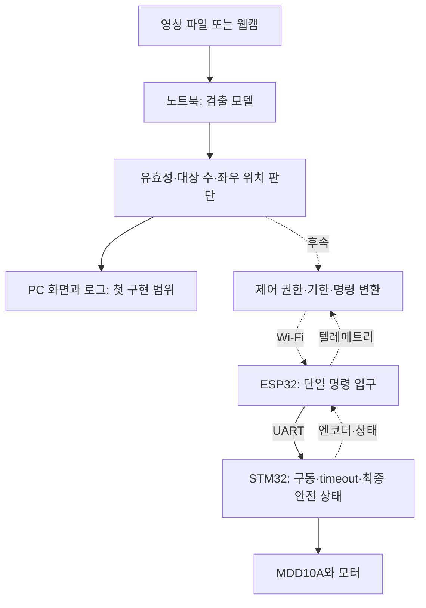

# 노트북 기반 AI 확장 계획과 기존 PCB 작업 재개점

작성일: 2026-10-27 · 상태: **계획 문서 작성 완료 / 구현·추론·시험 NOT_RUN**

사용자의 최종 목표는 이 로봇에 AI를 접목하는 것이다. 이번 요청은 AI 계획을 Codex가 판단해 **문서화만** 하고, AI 논의 전 계획의 재개점을 설명하는 것이다. 아래 선택은 후속 구현을 위한 계획 기준이며 실제 설치·실행·하드웨어 변경을 뜻하지 않는다. 현재 진행 순서는 PCB 모니터링 입력 설계로 유지한다.

## 1. 이번에 정한 방향

**기존 노트북에서 영상 인식과 행동 판단을 먼저 검증하고, 필요한 성능과 탑재 조건이 드러난 뒤 상위 컴퓨터를 선정한다.**

| 항목 | 계획 결정 | 이유와 경계 |
| --- | --- | --- |
| 첫 연산 장치 | 보유 노트북 | GPU가 있으며 모델 비교·로그 분석에 활용 가능. 라즈베리파이 구매는 지금 요구하지 않음 |
| 첫 AI 기능 | 한 명의 사람을 검출하고 화면상 좌우 위치를 판단 | 별도 물체·학습 데이터 준비 부담을 줄이는 시작 과제. 개인 식별이나 실제 사람 추종 기능이 아님 |
| 첫 모델 | COCO 사전학습 YOLO11n, `yolo11n.pt` | 작은 모델로 기준선을 만들고 입력·판단·실패 경로에 집중. 최신/최고 모델이라는 주장이 아님 |
| 첫 입력 | 저장 영상 재생으로 재현 조건 확보, 사용 가능한 노트북 웹캠으로 실시간 비용 확인 | 카메라 사용 가능 여부는 아직 확인하지 않음. 파일 시험과 웹캠 시험을 별도로 판정 |
| 첫 출력 | `LEFT / CENTER / RIGHT / STOP` 화면 표시와 로그 | 물리 속도나 PWM을 출력하지 않는 PC 내부 판단 |
| 첫 구현 방식 | 독립 Python 환경, OpenCV 영상 입출력, Ultralytics/PyTorch 추론 | 설치 버전은 후속 환경 검증 시 고정. ROS 2·모델 학습·가속 변환은 첫 단계에 포함하지 않음 |
| 로봇 연결 | PC 검증 이후 별도 단계 | 기존 ESP의 명령 권한·ticket·ACK 절차에 맞춘 연결 프로그램 필요 |
| PCB와의 관계 | 독립된 후속 계획으로 보관 | AI 시험을 PCB 선행 조건으로 추가하지 않음. 센서 PCB 완성이 PC 영상 시험의 선행 조건도 아님 |

YOLO11의 모델 계열과 사전학습 추론 지원은 [공식 모델 문서](https://docs.ultralytics.com/models/yolo11/)를 확인했다. `person`은 [공식 COCO 클래스 정의](https://github.com/ultralytics/ultralytics/blob/main/ultralytics/cfg/datasets/coco.yaml)에 있으며, 구현 시 실제 불러온 모델의 클래스 이름에서도 대조한다.

ESP32-S3에서 AI 자체가 불가능한 것은 아니다. [ESP-DL](https://github.com/espressif/esp-dl)은 ESP 계열의 양자화 신경망 추론을 지원한다. 이번 선택은 현재 ESP에 통신과 영상 추론을 함께 넣어 실행 시간·메모리를 경쟁시키지 않고, 상위 연산 계층을 분리하려는 프로젝트 판단이다.

## 2. 확인한 환경과 아직 확인하지 않은 것

2026-10-27 로컬 `Get-CimInstance`와 `nvidia-smi --query-gpu=name,memory.total --format=csv,noheader` 조회 결과:

| 항목 | 확인값 |
| --- | --- |
| 노트북 | HP Victus 15-fb0xxx |
| CPU | AMD Ryzen 7 5800H |
| 시스템 메모리 | 조회값 약 15.3GiB, 약 16GB 구성 |
| GPU | NVIDIA GeForce RTX 3050 Ti Laptop GPU |
| GPU 메모리 | 4096MiB |

이 조회는 장치 식별 근거다. PyTorch의 GPU 사용, 모델 적재, FPS, 추론 지연, VRAM 여유, 웹캠 동작은 **아직 측정하지 않았다**. 공개 모델 벤치마크를 이 노트북의 성능으로 대체하지 않는다.

현재 로봇의 카메라·영상 전송 경로도 확정하지 않았다. 기존 MVP 시연 영상은 외부에서 로봇과 브라우저를 촬영한 자료이므로 로봇 시점 카메라 검증 자료와 구분한다.

## 3. 현재 구조와 추가할 계층

현재 역할은 [시스템 인터페이스 맵](../../01_System_Architecture/11_System_Block_Diagram_and_Interface_Map_ko.md)과 [UART 계약](../../01_System_Architecture/09_STM32_ESP32_UART_Interface_Contract_ko.md)을 따른다. 후자의 상위 PC 경로는 `PC → ESP32 → STM32`다. AI 때문에 STM32로 직접 명령을 우회시키는 두 번째 소유자를 만들지 않는다.

- 모델은 물체 종류와 영상상 위치를 출력한다. 회전 여부는 별도 규칙 코드가 결정한다.
- STM32가 모터 출력과 명령 timeout을 소유한다. 상위 AI 결과가 ARM·E-stop 조건을 대신하지 않는다.
- 현재 이동 요청은 개방 루프 PWM 매핑이며 실측 속도 보장이 아니다. 방향 판단 성공을 정밀 회전·자율주행 성공으로 확대하지 않는다.
- 사람의 검출 상자만으로 실제 거리, 장애물 유무, 동일인 여부를 확정하지 않는다. 전진 추종·회피는 후속 센싱/제어 요구를 별도로 정의한다.
- 전류·온도·전압 PCB는 로봇 상태 관측 계층이다. 향후 AI 운용 로그에 연결할 수 있지만, 센서 데이터만 추가한다고 고장 예측 모델이 확보되는 것은 아니다.

## 4. 첫 PC 실험의 요구사항과 시작값

아래 수치는 **PC 실험 r0의 설계 시작값**이다. 제조사 권장 안전값이나 물리 로봇의 허용 지연이 아니다. 변경 시 이유와 비교 결과를 남기고 판정에 사용할 영상은 튜닝 영상과 분리한다.

| ID | 요구/설정 | 적용 이유 |
| --- | --- | --- |
| AI-PC-01 | 검출 대상은 `person`, 검출 점수 기준 `0.50` | 초기 대상 수를 단순화. 점수 0.50을 정답 확률 50%로 해석하지 않음 |
| AI-PC-02 | 모델 입력 `imgsz=640`, batch 1, 처음에는 FP32 | 속도·정확도 비교를 시작할 한 가지 기준 조건. 입력 종횡비 처리와 실제 텐서 크기도 기록 |
| AI-PC-03 | 기준 이상 대상이 정확히 1개일 때만 방향 판단 | 0개는 `NO_TARGET`, 2개 이상은 `AMBIGUOUS`. 첫 단계에서 임의로 가장 큰 사람을 따라가지 않음 |
| AI-PC-04 | 중심 좌표 `u=(x1+x2)/(2W)` 사용 | 검출 상자 양 끝 x1/x2와 원본 영상 폭 W로 0~1 위치 계산. 화면 표시용 좌표와 모델 내부 좌표 혼용 금지 |
| AI-PC-05 | `u<0.40`: LEFT, `0.40≤u≤0.60`: CENTER, `u>0.60`: RIGHT | 화면 중앙 20%를 유지 구간으로 둠. 실제 조향각을 의미하지 않음 |
| AI-PC-06 | 새 방향 채택에는 서로 다른 유효 프레임 3개에서 같은 판단 필요 | 경계 흔들림 완화. 방향 전환 확인 중에는 STOP, 이전 회전을 유지하지 않음 |
| AI-PC-07 | 마지막 유효 결과의 원본 프레임 수신 후 경과가 `200ms 이상`이면 STALE/STOP | PC 반응을 관찰할 첫 기한. 물리 정지 거리 근거가 아니며 로봇 연결 전에 별도 지연 예산 필요 |
| AI-PC-08 | 추론과 별도로 감시 루프 목표 주기 `20ms` | 추론이 반환하지 않아도 유효기간 만료를 검사. 일반 OS에서 20ms 실행을 보장한다는 의미가 아님 |
| AI-PC-09 | 대기 영상은 최신 1개만 유지, 프레임 ID는 증가 | 오래된 영상이 쌓여 과거 장면에 반응하는 것을 줄임. 같은 프레임을 새 결과로 세지 않음 |
| AI-PC-10 | 프로그램에 로봇 송신 경로를 넣지 않음 | 첫 검증의 출력은 화면/로그뿐. 네트워크 제어·ARM 전송 기능은 후속 구현 |

유효한 검출은 좌표가 유한하고 `0≤x1<x2≤W`, `0≤y1<y2≤H`이며, 시간·프레임 순서가 맞아야 한다. 비정상 좌표/시간은 STOP으로 처리한다. 좌표 변환과 좌우 표시 반전은 서로 다른 기능으로 둔다. 첫 실행은 원본 기준 비반전 표시를 기본으로 하며, 미러 화면이 필요하면 표시와 판단의 변환 관계를 함께 명시한다.

기준 미만의 두 번째 사람은 검출 수에 포함되지 않을 수 있다. 따라서 AI-PC-03은 실제 장면에 사람이 한 명뿐임을 보장하는 조건이 아니다. 사람 수 판단 실패도 고정 영상 검증에 포함한다.

프레임 수신 시각은 노트북이 디코딩된 프레임을 받은 시각이다. 웹캠 센서 노출 시각이나 무선 카메라 촬영 시각과 같다고 주장하지 않는다. 저장 영상의 media PTS는 재생 시각이고, PC의 단조 시계와 별도 필드로 기록한다.

Ultralytics는 [공식 추론 문서](https://docs.ultralytics.com/modes/predict/)에서 파일·웹캠·스트림 입력과 장치 선택을 제공한다. 위의 대상 수 제한·방향 규칙·감시 루프·유효기간은 이번 프로젝트에서 추가 설계하는 기능이다.

## 5. 프로그램 책임과 실패 경로

### 5.1 모듈 책임

| 구성 | 책임 | 주요 출력 |
| --- | --- | --- |
| 영상 입력/추론 worker | 입력 읽기, 프레임 ID/수신 시각 부여, 모델 실행 | 프레임 정보·검출 상자·점수·추론 완료 시각 |
| supervisor | 독립 실행 흐름에서 시간·예외·프레임 순서 검사, 방향 규칙 평가 | 상태·판단·사유·결과 나이 |
| 화면/기록 | 화면 표시, JSONL/요약 CSV/실행 정보 저장 | 프레임별 기록, 요약, 선택 시 시연 영상 |

추론 worker는 별도 프로세스를 우선 설계한다. supervisor가 결과를 기다리는 무기한 blocking 호출에 묶이지 않도록 하고, 전달 버퍼는 최신 값만 남긴다. worker 정지·지연을 감지할 경로가 필요하기 때문이다. 이 분리는 노트북 전체 정지나 OS 지연을 없애지는 못한다.

### 5.2 상태와 출력

| 상태 | 진입 조건 | 출력과 복귀 |
| --- | --- | --- |
| STOPPED | 시작 전/사용자 종료 | STOP. 로컬 시작 조작 후 검사 진행 |
| ACQUIRING | 유효 단일 대상의 안정된 방향을 확인 중 | STOP. 새 프레임 3개에서 같은 방향이면 TRACKING |
| TRACKING | 단일 유효 대상·신선한 결과·동일 방향 확인 | LEFT/CENTER/RIGHT. CENTER는 이동 요청 없음 |
| NO_TARGET | 기준 이상 대상 0개 | 즉시 STOP·확인 이력 초기화. 새 대상은 ACQUIRING부터 |
| AMBIGUOUS | 기준 이상 대상 2개 이상 | 즉시 STOP·확인 이력 초기화. 단일 대상이 되면 ACQUIRING부터 |
| STALE / FAULT | 기한 초과·입력 끊김·worker 종료·비정상 좌표/순서·기록 실패 | STOP 상태를 유지. 명시적 로컬 재시작으로 새 입력 세션 시작 |

잘못된 프레임/대상 상실을 처리할 때 3프레임 확인을 기다리지 않는다. 3프레임 조건은 방향 출력 재개에만 사용한다. 프레임 순서·시작 세션이 바뀌면 이전 확인 이력을 버린다.

이 표의 로컬 재획득/재시작은 PC 화면 실험의 규칙이다. 후속 로봇 연결에서 재검출만으로 ARM하거나, 끊김 복구 후 이전 운동을 자동 재개하지 않는다.

### 5.3 추론 중단과 통신 정상의 차이

AI가 멈췄어도 송신 프로그램이 마지막 전진/회전 명령을 계속 보내면 STM32의 수신 timeout만으로는 판단의 노후화를 검출할 수 없다. 후속 연결에서는 **프레임 수신 시각 → 판단 시각 → 송신 직전**의 유효기간을 각각 검사한다. 같은 판단을 반복 전송하더라도 원본 유효기간을 갱신하지 않는다.

AI 측 정지 요청이 실제로 전달됐는지는 ACK·STM 상태·PWM/CPS 등으로 별도 확인해야 한다. PC 로그의 STOP을 물리 정지 완료로 기록하지 않는다.

## 6. 기록과 PC 검증 계획

### 6.1 남길 기록

- 실행 정보: 날짜, 코드 commit 또는 hash, Python/패키지/드라이버 버전, GPU/CPU 선택, 모델 파일 SHA-256, 입력 파일 hash 또는 카메라 모드, 모든 판정 설정.
- 프레임 기록: run/source session, frame ID, media PTS(파일일 때), PC 프레임 수신·추론 시작/종료·판단 시각, 원본 해상도, 대상 수·상자·점수·중심 u, 상태, 출력, 사유.
- 감시 기록: 마지막 유효 프레임의 나이, 감시 간격, STALE/FAULT 발생 시각, worker 재시작, 읽은/처리한/버린 프레임 수.
- 성능 요약: 첫 실행 준비 비용과 워밍업 이후 비용을 분리하고, 추론 시간 및 PC 수신→판단 시간의 p50/p95/최대, 처리 FPS와 peak VRAM을 기록.

FPS는 초당 처리량, 지연은 한 프레임이 판단에 쓰이기까지 걸린 시간이다. FPS가 높아도 버퍼에 오래된 영상이 쌓일 수 있으므로 둘 다 기록한다. 향후 네트워크 카메라의 종단 지연은 별도 시계/동기화 근거 없이는 이 수치로 대신하지 않는다.

### 6.2 합격 기준과 상태

모든 시험은 현재 **NOT_RUN**이다. 아래는 계획이며 문서/링크 검사 결과와 별개다.

| Test ID | 확인할 상황 | 합격 기준 / 증거 |
| --- | --- | --- |
| AI-PC-T01 | 동일 프로그램 재실행·장치 확인 | 동일 입력/설정/모델로 재실행 가능, GPU 사용 또는 CPU fallback 사실이 로그에 명시됨 |
| AI-PC-T02 | 합성 검출 상자 좌/중앙/우·0.40/0.60 경계 | 상태표와 3개 신규 프레임 조건이 전 사례에서 일치. 모델 정확도 시험과 구분 |
| AI-PC-T03 | 대상 없음·복수 대상·낮은 점수·비정상 상자 | 규칙 입력을 받은 즉시 STOP, 이전 방향 이력 폐기. 3프레임 지연 적용 안 됨 |
| AI-PC-T04 | 중복·역순·오래된 결과·새 입력 세션 | 중복으로 확인 횟수/기한이 늘어나지 않음. 세션 혼합 거부 |
| AI-PC-T05 | fake clock으로 200ms 경계, worker 지연/종료 주입 | 논리 시험은 age≥200ms에서 STOP. 실제 실행은 최초 감시 실행 때 STOP하며 감시 지연을 별도 보고 |
| AI-PC-T06 | 영상 읽기 실패·입력 종료·기록 오류·복구 | STOP/사유 기록 또는 화면 오류 표시, 명시적 재시작 전 방향 출력 재개 없음 |
| AI-PC-T07 | 고정 영상에서 실제 검출+판단 | 아래 독립 표본 기준 충족. 정확도는 해당 촬영 조건으로 한정 |
| AI-PC-T08 | 입력 신선도·처리 시간 | 워밍업 5초 제외 후 고정 입력 60초, PC 수신→판단 p95≤100ms를 r0 목표로 비교. 넘으면 성능 목표 미달로 기록하고 기한을 조용히 늘리지 않음 |
| AI-PC-T09 | 실시간 웹캠과 미러 방향 확인 | 카메라 설정/좌우 변환 기록, 실제 입력 끊김의 STOP 확인. 카메라 없으면 이 항목만 NOT_RUN |
| AI-PC-T10 | 로봇 연결 없는 실행 범위 | 송신 adapter/ARM/모터 제어 기능이 포함되지 않은 실행 구성임을 검사 |

T07의 첫 검증 묶음은 튜닝 영상과 별도로 **60개 수동 표시 프레임**을 고정한다: 단일 대상 좌/중앙/우 각 10개, 대상 없음 15개, 복수 대상 15개. 인접 프레임만 복제하지 않고 조건/구간을 나눈다. 단일 대상 표본은 검출 중심의 구간 일치율 90% 이상, 대상 없음/복수 대상 표본은 비정지 출력 0건을 PC 시연 기준으로 삼는다. 사람이 표시한 상자와 대응 여부도 함께 확인하고, 모든 실패 표본을 보존한다. 3프레임 상태 전이는 T02와 별도 연속 영상에서 확인한다.

이 표본 수와 90%/0건은 제한된 PC 시연의 시작 기준이다. 일반 환경 정확도·false positive 확률·사람 추종 안전성을 입증하지 않는다. 판정 영상으로 임계값을 튜닝했다면 그 영상은 개발 자료로 옮기고 새 독립 판정 묶음을 준비한다.

T08의 100ms는 200ms 실험 기한에 준비 여유를 두려는 목표일 뿐, p95 합격이 최악 지연을 보장하지 않는다. 모든 200ms 초과 사례의 STOP 처리는 별도 조건이다. 웹캠의 내부 버퍼/노출 지연은 수신→판단 시간 밖이다.

## 7. 구현할 때의 순서와 종료 조건

| 단계 | 작업 | 완료 산출물과 다음 단계 조건 | 현재 상태 |
| --- | --- | --- | --- |
| A0 계획 | 본 문서의 범위·규칙·시험 기준 | 기존 PCB 재개점과 함께 보관 | 문서 작성 완료 |
| A1 PC 실행 | 독립 환경, 모델/입력 로딩, 검출 표시 | 실행 명령, 환경/모델 식별, 영상 결과. 실제 GPU 사용 확인 | NOT_STARTED |
| A2 PC 판단 | supervisor, 상태 규칙, 기록, 고정 영상/오류 주입 | T01~10 범위별 판정·시연·실패 목록. 미실시 항목 별도 명시 | NOT_STARTED |
| A3 연결 설계 | 실제 ESP 계약과 AI 제어 소유자/기한/정지/수동 전환 대조 | 연결 계약과 PC 모의 시험. 기존 브라우저 focus 보호 우회 금지 | NOT_STARTED |
| A4 실제 통합 | 카메라/영상 경로 확정, 비구동 통신과 제한 구동 검증 | 승인된 물리 조건·관측·중단 기준에 따른 사용자 시험 | NOT_STARTED |
| A5 탑재 판단 | 측정한 모델 성능·전력·연결 조건 비교 | 노트북 유지 또는 탑재 컴퓨터/가속기 선정 근거 | NOT_STARTED |

후속 코드/기록의 위치는 구현 시작 시 기존 폴더를 확인하여 `10_Upper_Layer_AI/`와 `assets/logs/ai/<회차>/`를 우선 사용한다. 현재는 폴더나 코드, 가상환경, 모델 파일을 만들지 않는다. 모델/영상의 대용량 파일 관리 방식도 실제 자산 확보 시 정한다.

## 8. 실제 로봇 연결 전에 따로 결정할 것

[현재 ESP 코드](../../03_Firmware/esp32_wifi_link/main/wifi_link_main.c)의 브라우저 경로에는 session/control_id, 일회용 ticket, ACK, ARM 이후 zero 단계와 focus 조건이 있다. 임의의 Python 메시지를 보내면 곧바로 동일하게 동작한다고 가정하지 않는다.

1. **하나의 제어 소유자:** 수동 브라우저와 AI가 동시에 운동 명령을 소유하지 않도록 ESP에서 전환/해제/정지를 정의한다. 수동 takeover는 기존 소유자 해제·정지 확인을 포함하는 별도 계약으로 설계한다.
2. **운동 시작 허가:** 사용자 시작과 유효한 ARM 절차를 사용한다. 연결 복구·대상 재검출·STM reset만으로 자동 재출발하지 않는다.
3. **별도 기한:** 현재 browser control 200ms/TEL 250ms/STM 명령 timeout 300ms와 CMD 최소 간격 80ms의 근거를 보존한다. PC 실험 age 200ms와 같은 물리 의미로 취급하지 않으며, AI 감지+전송+STM timeout의 누적 지연/정지 거리를 다시 검토한다.
4. **영상 경로:** 카메라 모델·장착 시야·해상도·영상 전송·시간 표시를 선정한다. 비디오 트래픽이 제어 통신에 주는 영향도 측정한다. 기존 ESP의 제어 WebSocket에 영상을 함께 싣는 것을 기본으로 삼지 않는다.
5. **구동·피드백:** 초기에 전진 없이 제한된 방향 정렬부터 검토한다. 회전 요청의 부호·포화·응답을 확인하고, 추종/이동으로 확대할 때 거리 센싱·엔코더 속도 제어·장애물 조건을 추가한다.
6. **기존 경계:** STM 최종 출력/물리 S0를 유지한다. 현재 T005A PARTIAL/T007 BLOCKED·과거 통신/UI 원인 OPEN을 AI 문서로 해소했다고 표시하지 않는다. 후속 통합 시 해당 동작에 필요한 조건을 대조하며, 사용자가 제외한 조사나 완료 시험을 일괄 재개하지 않는다.

위 미정은 PC 인식 실험을 시작하기 위해 먼저 모두 해결해야 하는 목록이 아니다. 실제 로봇 통합 단계에서 필요한 결정이다.

## 9. 라즈베리파이 구매 판단

현 시점 판단은 **추가 구매 없이 노트북으로 시작**이다. 탑재가 필요해지면 다음 결과로 선정한다.

- 필요한 모델이 목표 입력 크기·주기에서 실행되는가: 단일 모델뿐 아니라 카메라/기록/ROS 2 등 동시 부하 포함.
- 필요한 연산을 CPU만으로 충족하는가, 가속기 지원 모델/변환 과정이 필요한가.
- 노트북 무선 영상의 지연과 연결 의존성을 허용할 수 있는가, 독립 운용이 요구되는가.
- 탑재 전원 정상/기동 전류, 냉각, 무게·장착과 기존 전원 여유를 어떻게 확보하는가.

[Raspberry Pi 공식 AI HAT 문서](https://www.raspberrypi.com/documentation/accessories/ai-hat-plus.html)는 Pi 5용 AI 가속기와 지원 모델의 실행 구조를 설명한다. 이것이 현재 모델의 이식 성공·처리 속도를 보증하지 않는다. 가격/TOPS만으로 구매하지 않고, 기존 5V 전원에 탑재 컴퓨터를 연결할 수 있다고 추정하지 않는다.

## 10. AI 논의 이전 작업은 어디서 이어가는가

**현재 주 작업은 센서 모니터링 PCB의 입력 회로 상세 검토다. 바로 다음은 3-1 학습 노트를 함께 읽고 합격 기준의 미정을 채우는 것이다. AI 계획은 이 순서를 바꾸지 않는다.**

| 순서 | 기존 작업 | 노트북에서 할 수 있는 구체적 결과 |
| --- | --- | --- |
| 1 | [3-1 검증 대상과 합격 기준](../../07_Embedded_Learning_Notes/01_Concept_Notes/15_Verification_Targets_and_Acceptance_ko.md) 검토 | 센서 제외 입력계/센서 포함 전체 경로 구분, 정확도·응답 목표와 기준 계기의 불확도, 합격/보류 기준 검토 |
| 2 | [3-2 정확도와 보정](../../07_Embedded_Learning_Notes/01_Concept_Notes/16_DC_Accuracy_and_Calibration_Verification_ko.md) | 알려진 DC 입력·영점/감도 보정점과 보정에 쓰지 않은 독립 확인점, 기준 계기/입력원 적합성 계획 |
| 3 | [3-3 PWM·수집 조건과 응답](../../07_Embedded_Learning_Notes/01_Concept_Notes/17_PWM_Sampling_and_Response_Verification_ko.md) | 평균/RMS 비교 대상, 100Hz/1kHz 비교, aliasing·평균 지연·전체 응답 관측 조건 |
| 4 | [3-4 이상 상태와 최종 판정](../../07_Embedded_Learning_Notes/01_Concept_Notes/18_Fault_Validity_and_Final_Decision_ko.md) | VALID/STALE/INVALID와 검출 한계, MON-L01~08 중 실행 가능한 첫 시험 그룹과 기록표 |
| 5 | 입력계 상세 설계 미결 연결 | 전압 2채널·ADC 기준·NTC 여기·전원/무전원 보호·누설·커넥터 계약을 결정표로 좁힘 |
| 이후 | 상세 회로 반영 → ERC → 기구/footprint → 배치/배선 → 제작 검토 → 조립/실측 | 각 단계 결과를 사용자와 검토한 뒤 진행. 공간 검토를 지금 앞당기지 않음 |

3-1~3-4는 **자료 작성 완료**다. 사용자가 모두 학습했거나 해당 요구를 채택했다고 간주하지 않는다. 시험표는 **NOT_RUN**이며 기준 계기·입력원·실제 연결이 확인된 후 한 그룹씩 실물 검증한다.

현재 CAD는 전류 2·온도 2채널의 22부품/미배선 32개 초안이며 목표는 ADC 6채널+CAN이다. 12kΩ/100nF, ADC 14MHz/480cycles, NTC STM 공급 B안 등은 검토 후보다. 상세 내용은 [쉴드 README](../../09_Electrical_Design/KiCAD/TMR_Monitor_Shield_RevA/README.md)와 [외부 설계 비교](../../09_Electrical_Design/21_External_Project_Monitoring_Architecture_Review_2026-10-27_ko.md)를 따른다.

기존 MVP 기능 증거와 전체 인수 미완료를 구분한다. PCB·AI·CAN·PID를 기존 MVP에 대한 새로운 선행 조건으로 만들지 않는다. 기존 후속 IMU 기본 검증 계획도 AI 문서 작성만으로 대체하지 않는다.

## 11. 이번 완료 범위와 재개 방법

- 완료: AI 최종 방향, 노트북 기준 환경, 첫 기능/모델/설정, 모듈 책임·실패 경로, 로그·시험 기준, 단계별 종료 조건, 구매 판단, PCB 재개점 문서화.
- 미실시: 패키지 설치·모델 다운로드·추론·PC 기능 시험·웹캠 실행·로봇 송신·MCU 변경/빌드/플래시·CAD 변경·실물 검증·구매.
- 문서 작성 후 바로 이어갈 작업: **PCB의 3-1 검증 대상과 합격 기준**.
- 나중에 AI를 구현하기로 하면: 이 문서의 A1부터 환경/모델을 확인하고 시작한다. 실제 결과를 기록할 때만 NOT_STARTED/NOT_RUN을 갱신한다.
- 이번 요청은 문서화만이다. Git commit/push·Calendar·Notion 게시를 수행한 것으로 표시하지 않는다.
