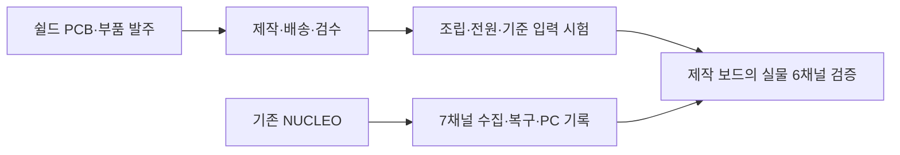

# TMR 마일스톤과 일정 현황

[프로젝트 전체 간트 차트](2026-11-27_TMR_Project_Gantt_ko.md)에서 착수 기록부터 최종 인수 목표까지 확인한다.

[일자별 작업·환경·산출물](2026-11-27_TMR_Daily_Plan_ko.md)에서 발주 준비부터 최종 인수까지 매일 할 일을 확인한다.

2026년 11월 27일 기준, **2027년 2월 12일 실물 Nav2 시연, 2월 19일 전체 인수·공개**를 목표로 잡는다. 주 30시간과 정기적인 집 작업, 12월 4일 발주, 12월 18일 PCB·핵심 부품 동시 입고를 가정했다. 2월 22~26일은 일반적인 수정·재시험 여유다. 큰 회로 변경이나 PCB 재제작이 필요하면 납기를 확인해 날짜를 다시 산정한다.

Gazebo의 Nav2 기준 주행과 실제 NUCLEO의 7채널 핀 대응에는 기존 근거를 사용한다. 실물 주행의 기본 구성은 Nav2이며 추가 PPO 실험은 선택 연구다. [세부 계획과 전체 완료 범위](2026-11-18_Detailed_Design_to_Final_Completion_Plan_ko.md) · [시뮬레이션 주행 결과](../verification/48_Simulation_Gate02_2026-11-24_ko.md) · [ADC 핀 대응 실측](../verification/50_ADC_DMA_7_Channel_Bench_2026-11-27_ko.md)

## 일정 현황을 읽는 법

**11/28 현재.** RevA 회로 부품 40개 풋프린트 지정·배치와 양면 배선, 필터 13개 부품 재배치, 아랫면 GND 면을 마쳤다. 최종 PCB의 DRC·미배선·회로도 대조 오류가 각각 0건이다. ChatGPT 검토 자료를 준비했고 답변 수신을 기다린다. 보호 분기 결정, 1:1 적층·하네스 확인과 제조 파일 대조가 발주 전에 남아 있다. **12/04 발주는 조건부다.** 11/30에 보호·기구 검토의 남은 작업량을 재산정한다. [11/27~28 마감](../progress/2026-11-28_progress.md)

두 표의 **기준일**은 11/27 계획에 잡은 날짜다. **예상·조건**은 현재 근거로 달성할 수 있는 날짜 또는 다시 산정할 시점이다. **완료일**은 주문 확인서·측정 로그·검사 결과 등 완료 근거를 확보했을 때 적는다. ‘—’는 실적 미기록이다.

## 발주 전 일주일

| 기준일 | 예상·조건 | 완료일 | 결정할 내용 | 확인할 산출물 |
|---|---|---|---|---|
| 11/27 금 | 완료 | 11/27 | 후보 BOM과 CAD·보유품 기록 대조 | 40행 대조. PCB 22개 배치, IC 2개 지정 후 미배치, 16개 미지정. [대조한 BOM](../../09_Electrical_Design/KiCAD/TMR_Monitor_Shield_RevA/bom_candidates.csv) |
| 11/28 토 | 실물 선행 확인과 현재 CAD 배선 완료 | 11/28 | 보유품 대조, 배치 및 양면 배선 | 40부품 풋프린트·배치, 필터 재배치, ERC/DRC 및 회로도 대조. PA 하네스·적층 대조는 후속이다. |
| 11/30 월 | 11/28 실측 후 판정 | — | 보호 저항·분기 퓨즈, 전원·필터, 커넥터 핀 배열과 풋프린트를 확정한다. | 회로도·BOM·기구가 같은 부품과 배선을 가리키고 ERC 결과를 검토했다. 핵심 부품이나 전원 보호가 미정이면 이 날 발주 가능일을 다시 판단한다. |
| 12/02 수 | 현재본 배선은 11/28 완료, 발주본 재검사 예정 | — | 발주본으로 검토 지적을 반영하고 완료 상태를 다시 확인한다. | 발주 후보 PCB의 DRC·미배선·회로도 대조와 기구 확인 기록. |
| 12/03 목 | 배선·검사 결과에 따름 | — | 제작파일과 구매목록을 최종 대조한다. | Gerber·드릴을 다시 열어 외곽·홀·층을 확인했다. 남은 DRC 항목과 실물에서 확인할 조건을 기록하고 주문할 품번·수량·보드 버전을 고정한다. |
| 12/04 금 | 12/04 조건부 · 11/30 재산정 | — | PCB와 확정 부품을 발주한다. | 주문 버전·수량·예상 입고일을 남긴다. 점검이 미완료면 PCB 발주는 순연하고 독립적으로 확정한 부품은 별도로 판단한다. |

발주 전에는 노트북 작업 시간을 KiCad·BOM에 먼저 배정한다. 집 작업 시간은 부품·기구 대조와 회로 선택에 영향을 주는 벤치 확인에 우선 사용한다. [현재 회로·PCB 검사 결과](../../09_Electrical_Design/KiCAD/TMR_Monitor_Shield_RevA/reports/README.md)

## 입고 준비부터 최종 공개까지

| 기준일 | 예상·조건 | 완료일 | 큰 목표 | 달성을 판단할 근거 |
|---|---|---|---|---|
| 12/17 목 | 기존 NUCLEO로 진행 가능 | — | 보드 도착 전 펌웨어와 시험 준비 | 12/11까지 기존 보드의 7채널 UART가 60초 이상 연속이고, TIM2 중단 시 무효 판정·재시작 후 복귀하는 원본을 확보한다. 12/17까지 유효 블록 10개로 온도 1초 평균을 확인하고, PC 기록·입고 시험 순서·하네스 표를 준비한다. 실물 LiDAR·상위 PC·장착·조달 계획과 기존 MVP 잔여 정지 시험의 선행 조건도 대조한다. |
| 12/18 금 | 12/18~25 · 12/04 발주 시 | — | PCB·핵심 부품 입고 | PCB와 조립 필수 부품 각각의 실제 도착일을 기록한다. 각 조립 단계는 그 단계에 필요한 마지막 부품의 검수 뒤 착수한다. |
| 12/23 수 | 12/18 입고 가정 | — | 첫 보드 조립과 전원 확인 | 보드 버전·부품을 확인하고 무전원 검사와 제한전원 시험을 거쳐 전원 레일·커넥터·ADC 기준 입력의 첫 측정을 남긴다. 결과에 따라 국소 수정 또는 재제작 여부를 판단한다. |
| 2027/01/08 금 | 첫 보드 시험 후 산정 | — | 실물 6채널 계측 완성 | 전류 2·온도 2·전압 2를 개별 기준 입력과 비교하고, 보정값·오차·이상 입력의 유효 표시를 PC 로그까지 추적한다. 적용되는 H04~H12 시험 결과를 검증표에 연결한다. |
| 01/15 금 | 실물 구동 진입 조건 확인 후 산정 | — | 실물 속도 제어·정지 기준선 확보 | 엔코더·IMU의 축과 방향을 대조하고, 좌우 속도 지령의 응답과 정지 결과를 기록한다. 감독하 주행에 필요한 기존 MVP 정지·복구 선행 조건과 허용 시험 범위를 확인한다. |
| 01/29 금 | 속도·정지 기준선 확보 후 산정 | — | STM32 임베디드 확장 검증 | FreeRTOS·CAN 전환과 선정한 한 경로의 HAL→LL 전환 전후를 비교한다. 주기·부하·명령 유실 정지·오류 복구를 기존 기준선과 대조한다. |
| 02/05 금 | 센서·주행 선행 충족 후 산정 | — | 실물 Nav2 시험에 들어갈지 판단 | 실제 LiDAR·IMU·odom·TF의 시각과 방향, ROS 명령 전달과 단절 시 정지를 확인한다. 감독하 저속 주행 로그와 다음 주 시험 조건을 확보한다. |
| 02/12 금 | 02/05 실물 준비 판정 때 갱신 | — | 실내에서 실제 로봇의 Nav2 주행 시연 | 감독하에 실제 목표 이동·취소·장애물·신호 유실 동작을 확인하고 영상과 ROS bag을 남긴다. |
| 02/19 금 | 필수 시험 잔여량에 따름 | — | 전체 인수 및 공개 | 계측·통신·주행의 동시 부하 결과와 기존 MVP 잔여 인수 항목을 검토한다. 적용 필수 항목이 통과하고 코드·도면·BOM·시험 원본·재현 절차가 같은 버전을 가리킬 때 완료로 판단한다. |

## 기다리는 동안 진행할 일

| 막힌 일 또는 새로 알게 된 사실 | 이어서 할 수 있는 일 | 다시 판단할 일정 |
|---|---|---|
| 보호 방식·소켓 치수·커넥터 중 보드에 영향을 주는 결정이 남음 | 노트북에서 보호 계산과 후보 도면을 대조한다. 집에서는 해당 실측을 먼저 한다. | 11/30에 회로 확정 여부를 판단한다. 남은 배치·배선·제조 검토 시간을 12/03까지 실제 확보한 시간과 대조해 12/04 발주 예상일을 갱신한다. |
| PCB 또는 핵심 부품의 출고·도착이 늦어짐 | 기존 NUCLEO에서 7채널 UART 연속 수집과 중단·복귀, 온도 평균을 진행한다. 노트북에서는 PC 로그를 재생한다. | 12/04 발주 후 2~3주면 12/18~25다. 12/25 도착이면 12/23 첫 보드 시험을 실제 검수·조립 가능일 뒤로 옮기고 01/08 계측 일정에 미치는 영향을 계산한다. |
| 첫 보드에서 국소 수정 또는 재제작이 필요함 | 기존 보드의 펌웨어와 하네스·로그 검토를 계속한다. | 12/23 시험에서 수정 범위·새 납기를 확인한다. 6채널 검증과 실물 구동 진입 조건 중 영향받은 항목부터 다시 잡는다. |
| 실물 LiDAR·상위 컴퓨터 확보 또는 장착이 늦어짐 | 펌웨어·CAN 단독 검증과 기존 시뮬레이션 로그 분석을 진행한다. | 11/30에 장기 납기 품목·확보 경로를 먼저 확인하고, 12/16에 실제 조달 상태를 다시 본다. 실물 센서 연결 예정일 02/01을 넘길 전망이면 02/05 준비 판정과 02/12 시연 예상일을 갱신한다. |

**주행 시연과 전체 인수의 선행 조건은 다르다.** 실물 Nav2 시험에는 실물 시험 진입 조건(G4), 속도·정지 기준선, 실제 센서·명령 연결, 시뮬레이션 기준선(G6)이 모여야 한다. 확인된 UART 경로로 먼저 ROS 통합을 시험할 수 있다. 전체 인수(G7)에는 실물 주행에 더해 6채널 계측, FreeRTOS·CAN·선택 LL 경로, 기존 정지 시험의 적용 항목까지 근거가 필요하다. [선행 관계와 완료 기준 §5](2026-11-18_Detailed_Design_to_Final_Completion_Plan_ko.md)

## 주간 점검과 변경 기록

주 마지막 작업 때 이번 주에 끝낸 결과의 **완료일·근거**를 위 표에 붙인다. 다음 주에 확보한 **집 작업 시간과 노트북 작업 시간**을 나누고 둘의 합을 주 30시간 가정과 대조한다. 가장 가까운 마감까지 남은 작업 시간을 배정한다. 납기 통보·시험 실패처럼 다음 작업을 바꾸는 사건은 그날 반영한다.

예상일을 바꿀 때는 아래에 이전 예상과 새 예상, 이유, 영향받는 다음 마감을 한 줄로 남긴다. 확정 근거가 부족하면 다음 판정 시점을 적는다. 2/22~26 예비 기간을 쓰게 되면 사용일과 남은 일수를 함께 적는다.

| 점검일 | 기준 또는 이전 예상 → 현재 판단 | 근거와 다음 확인 |
|---|---|---|
| 11/27 | 12/04 발주 목표 · 조건부 | BOM 대조 완료. 11/28 실물 선행 확인과 CAD 배선을 마쳤다. 11/30에 남은 보호·기구·제조 작업량을 대조한다. 이후 발주 여부는 사용자가 결정한다. |

오리건주립대 APDR 팀의 겨울 일정표에서 BOM·회로 검증, 발주, 납기 대기, 조립·시험을 따로 추적한 방식을 가져왔다. TMR은 한 사람이 작업하므로 납기 대기 중 확보한 시간을 기존 NUCLEO 시험에 배정한다. 궤도형 UGV 팀이 엔코더 주행과 LiDAR·Nav2 경유점 주행을 각각 실물에서 판정한 사례는 01/15 속도·정지와 02/05 실제 센서 통합의 완료 근거에 반영했다. [APDR 간트 차트 · PDF 12쪽 그림 3](https://projects.engineering.oregonstate.edu/downloaders/artifacts.php?id=yI1svKIDlig5kzlg#page=12) · [UGV 팀의 단계별 시험 결과](https://ryanhailey21.github.io/ME_Portfolio/projects/autonomous-ugv/)
