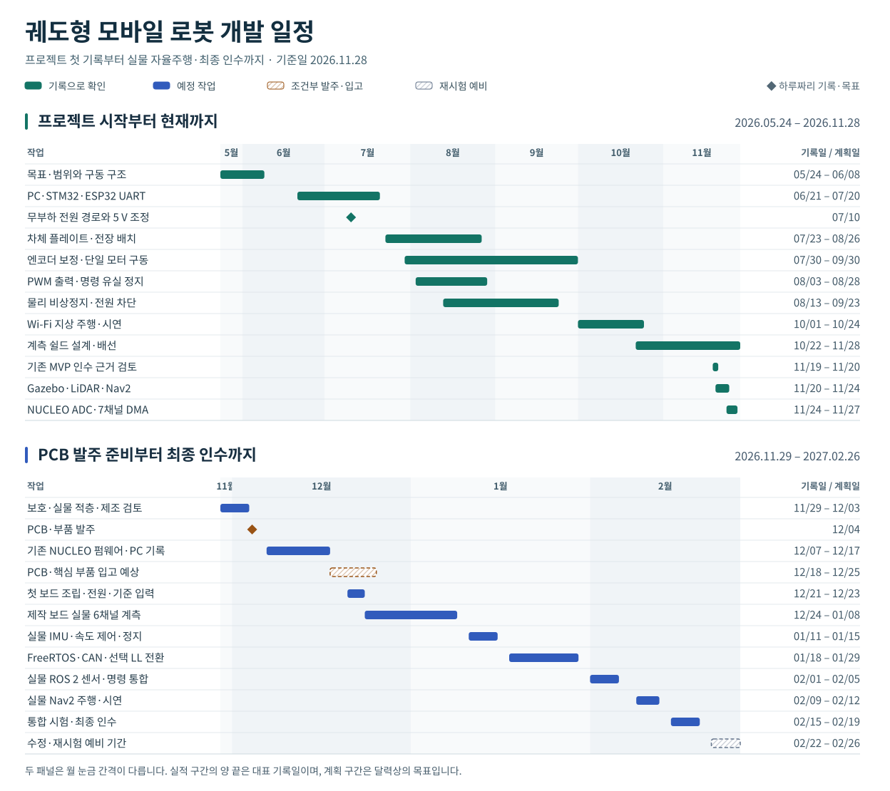

# TMR 전체 간트 차트

[차트를 원본 크기로 열기](../../assets/reports/progress/2026-11-27_project_gantt/tmr_gantt.svg) · [마일스톤별 예상·완료일](2026-11-27_TMR_Milestone_Deadlines_ko.md) · [일자별 작업 계획](2026-11-27_TMR_Daily_Plan_ko.md)



**시작점은 프로젝트 이름으로 목표·범위와 부품 목록을 저장한 2026년 5월 24일**로 잡았다. 날짜별 진행일지는 6월 8일부터 있다. 실적 막대의 양 끝은 해당 작업을 확인한 대표 기록일이다. 중간의 휴식일과 다른 작업일도 포함하므로 막대 길이로 투입 시간이나 완료율을 계산할 수는 없다. [5월 24일 원본](https://github.com/pr0ved99/TIL/blob/1352a6ec3bd82b81481df188741cc65c13e073e6/Projects/Tracked_Mobile_Robot/00_Project_Charter/01_Goal_and_Scope.md) · [6월 8일 첫 진행일지](../progress/2026-06-08_progress.md)

## 확인한 작업

| 작업 | 시작 | 끝 | 구분 | 결과와 근거 |
|---|---|---|---|---|
| 목표·범위와 구동 구조 | 2026-05-24 | 2026-06-08 | 실적 | STM32 하위 제어기와 궤도 플랫폼을 목표로 잡고 MDD10A를 첫 모터 드라이버로 정했다. [최초 범위](https://github.com/pr0ved99/TIL/blob/1352a6ec3bd82b81481df188741cc65c13e073e6/Projects/Tracked_Mobile_Robot/00_Project_Charter/01_Goal_and_Scope.md) · [구동 구조 결정](../progress/2026-06-08_progress.md) |
| PC·STM32·ESP32 UART | 2026-06-21 | 2026-07-20 | 실적 | PC 도구와 STM32 펌웨어에서 시작해 두 보드 간 명령·응답과 명령 중단 후 출력을 확인했다. [PC 도구](../progress/2026-06-21_progress.md) · [NUCLEO 검증](../progress/2026-07-09_progress.md) · [두 보드 연결](../progress/2026-07-20_progress.md) |
| 무부하 전원 경로와 5 V 조정 | 2026-07-10 | 2026-07-10 | 실적 | 배터리·퓨즈·주전원 경로를 무부하에서 확인하고 XL4015 두 개의 출력을 조정했다. [벤치 기록](../progress/2026-07-10_progress.md) |
| 차체 플레이트·전장 배치 | 2026-07-23 | 2026-08-26 | 실적 | Onshape 배치, RevA 도면과 RevB 후보를 만들었다. 8/26에 플레이트 도착을 확인했고 도면과 도착품의 동일성은 미확인이다. [배치 초안](../progress/2026-07-23_progress.md) · [도착 상태](../progress/2026-08-26_progress.md) |
| 엔코더 보정·단일 모터 구동 | 2026-07-30 | 2026-09-30 | 실적 | 수동 회전 환산, 영구 입력 배선, 좌우 방향 보정에서 단일 모터의 명령·정지·엔코더 대조까지 진행했다. [회전 보정](../progress/2026-07-30_progress.md) · [단일 모터 결과](../verification/32_Single_Motor_Run_DISARM_S0_and_Encoder_Evidence_2026-09-30_ko.md) |
| PWM 출력·명령 유실 정지 | 2026-08-03 | 2026-08-28 | 실적 | PWM·DIR 파형을 계측하고, 능동 DISARM과 500 ms 명령 유실 시의 정지·복구를 각각 보드에서 시험했다. [파형](../verification/07_STM32_Motor_Output_Waveform_and_Direction_Timing_Test_Report_2026-08-03_ko.md) · [명령 유실](../verification/21_REQ_SAFE_004_500ms_Command_Timeout_and_Recovery_Target_Runtime_Test_Report_2026-08-28_ko.md) |
| 물리 비상정지·전원 차단 | 2026-08-13 | 2026-09-23 | 실적 | 회로 배치부터 릴레이·래치·복구까지 시험했다. 9/23 전원 경로 시험은 모터를 분리한 조건이다. [회로 기록](../progress/2026-08-13_progress.md) · [모터 분리 시험](../verification/27_T_ESTOP_005A_Motor_Disconnected_Rail_and_Safe_Restore_Report_2026-09-23_ko.md) |
| Wi-Fi 지상 주행·시연 | 2026-10-01 | 2026-10-24 | 실적 | ESP32 접속과 웹 명령을 연결해 지상 주행, 통신 유실 정지, 1 m 거리 비교, 카펫 시연 영상을 남겼다. [접속 시험](../progress/2026-10-01_progress.md) · [10/24 시연 영상과 기록](../../assets/videos/wifi_mvp/2026-10-24/README.md) |
| 계측 쉴드 설계·배선 | 2026-10-22 | 2026-11-28 | 실적 | 40부품 풋프린트·배치, 전류·온도·전압 양면 배선 및 필터 재배치. DRC·미배선·회로도 대조 오류 0건. [11/27~28 마감](../progress/2026-11-28_progress.md) |
| 기존 MVP 인수 근거 검토 | 2026-11-19 | 2026-11-20 | 실적 | 상위 필수 요구 9개 통과·4개 부분 검증. 채택한 조건에서의 전원 차단과 남은 정량 정지 시험을 구분했다. [인수 검토](../verification/43_MVP_Closeout_Evidence_Review_2026-11-19_ko.md) · [11/20 판정](../verification/46_MVP_Nonphysical_Closeout_2026-11-20_ko.md) |
| Gazebo·LiDAR·Nav2 | 2026-11-20 | 2026-11-24 | 실적 | TMR 모델, 가상 LiDAR와 위치 추정을 연결했다. 벽 뒤 목표에서 Nav2는 오차 4.30 cm와 접촉 0회를 기록했다. [첫 모델](../progress/2026-11-20_progress.md) · [Nav2·PPO 비교](../verification/48_Simulation_Gate02_2026-11-24_ko.md) |
| NUCLEO ADC·7채널 DMA | 2026-11-24 | 2026-11-27 | 실적 | PA4 기준 입력에서 출발해 외부 여섯 핀과 내부 기준전압의 필드를 대조했다. 장시간 연속 수집과 복구는 다음 벤치 시험이다. [단일 채널](../progress/2026-11-24_progress.md) · [7채널 실측](../verification/50_ADC_DMA_7_Channel_Bench_2026-11-27_ko.md) |

## 앞으로의 계획

11월 27일 기준 계획이다. 12월 4일 발주와 12월 18일 입고를 가정해 후속 작업을 배치했다. 입고가 12월 25일이 되면 12월 23일 첫 보드 시험은 검수 뒤로 옮긴다. 기다리는 동안 기존 NUCLEO에서 수집·복구 시험을 진행할 수 있다. [발주 조건과 납기별 대응](2026-11-27_TMR_Milestone_Deadlines_ko.md#기다리는-동안-진행할-일)

| 작업 | 시작 | 끝 | 구분 | 목표와 조건 |
|---|---|---|---|---|
| 보호·실물 적층·제조 검토 | 2026-11-29 | 2026-12-03 | 계획 | 보호 분기와 실물 적층을 대조한다. 11/30 발주 가능성을 판단하고 최종 Gerber·드릴과 BOM을 확인한다. |
| PCB·부품 발주 | 2026-12-04 | 2026-12-04 | 조건부 | 11/30에 예상일을 다시 판단한다. PCB 제조 검토를 통과하면 사용자가 주문한다. |
| 기존 NUCLEO 펌웨어·PC 기록 | 2026-12-07 | 2026-12-17 | 계획 | 12/08부터 60초 연속 수신, 트리거 중단·복귀, 온도 평균과 PC 기록을 검증한다. |
| PCB·핵심 부품 입고 예상 | 2026-12-18 | 2026-12-25 | 조건부 | 12/04 발주 후 납기 2~3주를 적용한 도착 가능 구간이다. 각 품목의 실제 도착일을 기록한다. |
| 첫 보드 조립·전원·기준 입력 | 2026-12-21 | 2026-12-23 | 계획 | 12/18에 조립 필수품을 수령한다는 가정이다. 검수·조립 후 기준 입력을 MCU·PC와 대조한다. |
| 제작 보드 실물 6채널 계측 | 2026-12-24 | 2027-01-08 | 계획 | 전압·전류·온도 각 두 채널을 기준 입력과 비교하고 오차·이상 입력·복구를 확인한다. |
| 실물 IMU·속도 제어·정지 | 2027-01-11 | 2027-01-15 | 계획 | IMU 축·단위와 엔코더 방향, 저속 명령의 응답과 정지를 기록한다. |
| FreeRTOS·CAN·선택 LL 전환 | 2027-01-18 | 2027-01-29 | 계획 | 기존 펌웨어와 주기·부하·오류 복구를 비교한다. |
| 실물 ROS 2 센서·명령 통합 | 2027-02-01 | 2027-02-05 | 계획 | 실제 LiDAR·IMU·odom·TF와 명령 유실 정지를 확인한 뒤 Nav2 시험 진입을 판단한다. |
| 실물 Nav2 주행·시연 | 2027-02-09 | 2027-02-12 | 계획 | 실제 지도에서 목표 이동·취소·장애물을 시험하고 2/12 대표 회차 영상과 ROS bag을 남긴다. |
| 통합 시험·최종 인수 | 2027-02-15 | 2027-02-19 | 계획 | 동시 부하와 필수 시험의 결과를 대조하고 2/19 전체 인수·공개 여부를 판단한다. |
| 수정·재시험 예비 기간 | 2027-02-22 | 2027-02-26 | 예비 | 미결 항목이 있을 때 사용하는 평일 5일이다. |

날짜를 조정할 때는 [마일스톤 현황](2026-11-27_TMR_Milestone_Deadlines_ko.md)에서 변경 사유를 먼저 확인한다. 위 표를 수정한 뒤 저장소 루트에서 다음 명령으로 SVG를 갱신할 수 있다.

```bash
python3 Projects/Tracked_Mobile_Robot/assets/reports/progress/2026-11-27_project_gantt/build_gantt.py
```
