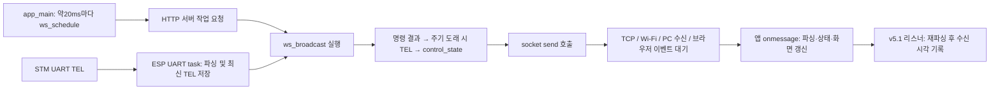

# ESP WS 전달 경로와 최소 관측 설계

- 날짜: 2026-10-23
- 범위: 보고서39의 `ACC-COM-01` — 실제 코드 경로 검토와 추가 관측 설계
- 당시 판정: **정적 검토 완료, 전달 지연 원인 OPEN, 새 관측기 미구현**
- 근거: [소스 identity·발췌·과거 두 사건 추출값](../../assets/logs/wifi_link/2026-10-23_ws_delivery_path_review/review.json), [오프라인 추출 스크립트](../../assets/logs/wifi_link/2026-10-23_ws_delivery_path_review/inspect.py)

**10/24 후속:** 브라우저 계측A는 v5.2 구현·PC17검사와 [실제 IDLE/속도0/전진 관측](../../assets/logs/wifi_link/2026-10-24_handler_timing_air_forward_run01/README.md)을 완료했다. 정상 표본이며 과거 지연 원인은OPEN이다. ESP 계측B는 미구현, 추가 관측 자동 반복 없음. 현재 재개점은 [운용 문서와 인수인계](../handoff/CURRENT_SESSION_CONTEXT.md)를 따른다.

## 1. 결론

과거 자동 정지 때 ESP가 약60ms 간격으로 만든 여러 TEL이 브라우저 기록에는 한꺼번에 나타났다. **TEL 생성 이후부터 브라우저 기록 시점까지의 전달 구간을 우선 조사할 근거가 있다.** ESP 작업 전체가 그 시간 내내 멈췄다는 설명만으로는 이 표본을 설명하기 어렵다. 그러나 이것만으로 Wi-Fi, TCP, PC 네트워크 처리, 브라우저 이벤트 전달 중 하나를 원인으로 확정할 수 없다.

현재 v5.1의 `TEL_RX` 시각은 앱 `onmessage` 처리 뒤 진단 리스너가 JSON을 다시 해석한 시점이다. 실제 패킷 도착이나 앱 처리 시작 시각이 아니다. 먼저 이 차이를 분리하는 브라우저 관측을 준비한다. ESP 쪽 대기와 송신 호출 시간은 별도 계측이 필요하다.

이번에는 로컬 소스와 보존 로그만 읽었다. MCU 코드·기록기·제한값을 수정하거나 빌드/플래시·추가 주행을 수행하지 않았다. 전체 MVP와 `ACC-COM-01`을 PASS로 변경하지 않는다.

## 2. 검토 대상과 버전

- 앱: [wifi_link_main.c](../../03_Firmware/esp32_wifi_link/main/wifi_link_main.c). 현재 파일 SHA256은 `cd32d2ed0fffb66df8f79c598c0e4b1fb50951390ad1b02458d1ed8534dbda40`다.
- 기록기: [console_encoder_observe_1m.js v5.1](../../assets/logs/wifi_link/2026-10-23_ground_distance_preparation/console_encoder_observe_1m.js).
- 이 프로젝트의 로컬 `build/project_description.json`은 **C:/esp/v6.0.2/esp-idf**를 가리킨다. 해당 SDK의 `git describe`는 `v6.0.2`, 생성된 config header도6.0.2다. 이전 PCB 문서에서 참고한5.4.4 문서를 이번 전송 구현의 근거로 대체 사용하지 않았다.
- 로컬 sdkconfig는 `CONFIG_FREERTOS_HZ=100`, HTTPD WS 활성, `HTTPD_QUEUE_WORK_BLOCKING` 비활성이다. 이 설정은 socket 송신이 항상 즉시 끝난다는 의미가 아니다.
- SDK 함수 발췌/해시는 review.json에 보존했다. 로컬 build metadata 확인이며 현재 보드 이미지 identity를 새로 읽어 검증한 것이 아니다.

## 3. 실제 데이터 경로

| 위치 | 실제 동작 | 지연 해석에 필요한 구분 |
| --- | --- | --- |
| `stm_uart_rx_task`, main2735–2777 / TEL publish2615–2638 | 별도 UART task가 완성된 TEL을 파싱하고 `rx_ms`를 기록한 뒤 잠금 안에서 최신 값·count를 갱신한다 | `rx_ms`는 ESP의 TEL 파싱 완료 쪽 시각이다. STM 샘플 시각/물리 UART 첫 byte 도착 시각과 다름 |
| `app_main`, main2909–2912 / `ws_schedule`,1326–1337 | 20ms delay 뒤 서버 잠금, pending이 없으면 `httpd_queue_work` 호출 | pending은 요청부터 callback 종료까지 true다. 그 사이 방송 요청은 추가 적재하지 않음. 수신 TEL 자체는 최신 값으로 계속 덮어씀 |
| SDK `httpd_main.c`142–172,224–230,298–314 | 제어 socket으로 넘긴 작업을 HTTP 서버 task에서 직접 실행한 뒤 준비된 세션 입력을 처리한다 | callback 실행 대기와 callback 내부 시간이 별개. 같은 서버의 긴 작업은 명령 수신도 늦출 수 있음 |
| `ws_broadcast`, main1287–1324 | 결과 큐를 먼저 최대4개 처리하고,50ms 이상 지났으면 TEL 하나 생성. 연결별 TEL→control 순으로 보냄 | control은 매 callback, TEL은 주기가 되었을 때만 생성. 약20ms callback에서50ms 조건을 검사하면 명목상60ms에 TEL이 생성될 수 있음. 정밀 주기 보장은 아님 |
| `status_json`, main816–892 | STM 잠금에서 복사한 뒤 `uptime_ms`/`stm_age_ms` 계산, JSON 생성 | `uptime_ms`는 socket 송신 직전/완료 시각이 아니다. 같은 TEL JSON을 연결들에 순서대로 보냄 |
| `wifi_control_snapshot`, main1094–1135 | STM 잠금 안에서 poll·ticket·JSON 처리. 연결별 snapshot | control에는 생성 시각/독립 프레임 번호가 없다. 단순 읽기만 하는 함수도 아니므로 진단을 위해 추가 호출하면 안 됨 |
| SDK `httpd_ws.c`403–460 / `httpd_txrx.c`788–799 | `httpd_ws_send_frame_async`가 header와 payload 각각 `send_fn`을 호출. 기본 함수는 socket `send()` | 이름의 async는 이 호출에서 별도 송신 task에 맡기고 즉시 반환함을 뜻하지 않는다. 호출이 기다릴 수 있고, 성공 반환도 브라우저 전달 완료가 아님 |
| main1361–1367 / SDK `httpd_main.c`81–96 | 송수신 timeout2초를 socket `SO_RCVTIMEO`/`SO_SNDTIMEO`에 적용 |200/250ms보다 긴 대기가 가능한 구조적 지점이다. 과거 사건에서 실제2초 대기가 발생했다는 증거는 없음. 프레임/전체 callback의 엄밀한 총 소요 상한도 아님 |
| 앱 `onmessage`, main772–795 | JSON 검증 후 control/notice/result 분기. TEL이면 `latestTelAt` 저장 후 JSON/DOM 갱신 | `latestTelAt`은 처리 중간 시각. 화면 그리기 전체 소요나 네트워크 도착 시각이 아님 |
| 기록기46–100 | 기존 `onmessage` 뒤에 등록한 message 리스너에서 재파싱 후 `performance.now()` 기록 | 현재 gap에는 앱 처리와 진단 재파싱 등의 시각 이동이 포함됨.40ms timer의 지연 기록만으로 브라우저 message 전달 지연 전체를 배제할 수 없음 |

명령 경로는 브라우저 CMD→`ws_receive`→admit/notice→UART task의 제어 처리→STM 응답→결과 큐→다음 방송이다. `command_result` RTT에는 이 경로 전체가 포함되므로 Wi-Fi 편도 지연이나 물리 정지 시간으로 해석하지 않는다. HTTP 서버와 UART task는 별도지만 STM 상태 잠금을 공유하므로 완전히 독립적인 지연 경로라고도 단정하지 않는다.

## 4. 과거 사건에서 좁힐 수 있는 범위

기존 두 로그에서 저장된 stop 직후 첫 TEL과 그로부터5ms 안의 TEL만 추출했다. 좌회전 원본에는 앞선 사건도 포함되므로 두 전체 로그의 통계를 독립 표본처럼 합산하지 않았다.

| 사건 | 직전 브라우저 수신 공백 | 몰려온 TEL 수 | ESP 생성 첫~끝 | 브라우저 기록 첫~끝 | 생성 간격 |
| --- | ---: | ---: | ---: | ---: | --- |
| 전진 |287.9ms|5개|239ms|4.5ms|59 /60 /61 /59ms|
| 좌회전 |219.2ms|4개|180ms|2.8ms|60 /59 /61ms|

이 표는 같은 프레임 집합에서 각각의 시계로 **간격**을 계산한 것이다. ESP uptime과 browser performance의 절대값을 빼 편도 지연을 계산하지 않는다. 시계 offset/전송 baseline이 없으므로239−4.5ms 역시 특정 한 프레임의 실제 편도 지연값이 아니다.

당시 생성이 이어졌다는 사실은 전체 HTTP 작업의 장시간 정지만을 단독 원인으로 삼는 설명을 약하게 한다. socket 호출이 빨리 반환한 뒤 TCP/수신 측에서 지연되는 경우 등은 남는다. `async` 호출 구조만으로 ESP 송신 blocking을 범인으로 정하거나, 긴 공백만으로 TCP 재전송/Nagle·전압 문제를 확정하지 않는다. SDK 송신 시각, 실제 packet capture, 해당 시점 browser handler 시작/종료가 아직 없다.

## 5. 최소 추가 관측: 먼저 브라우저, 필요하면 ESP

### A. 다음 구현 범위 — 브라우저 처리 시간을 분리

v5.1 원본을 보존하고 별도 후보에서 다음 값을 기록한다. 기존 ARM/DISARM/소켓/정지 이력은 유지한다.

| 값 | 기록 위치 | 알 수 있는 것 |
| --- | --- | --- |
| `handler_enter_ms`, `handler_exit_ms` | 현재 `ws.onmessage` 원본 함수 호출 전·후 | 앱의 동기 메시지 처리 시간. 렌더링 전체 시간/이벤트 전달 대기는 포함하지 않음 |
| `observer_enter_ms`, `observer_exit_ms` | 진단 리스너의 파싱 전과 기록 처리 후 | 진단 파싱·기록 소요. 지연을 관측기 자체가 만들었는지 살펴볼 근거 |
| 연결 ID·진단 RX 순번·종류·기존 ESP uptime | 동일 event와 짝을 이루는 행 | 재접속/메시지 혼동 방지, TEL 생성 간격과 handler 시작 간격 비교 |

설계 조건:

- 원본 `onmessage`의 `this`·인수·호출 횟수·반환/예외를 보존한다. 앞에는 시계 읽기만 두고 원본 실행 후 진단 기록을 한다. 진단 예외가 원본 오류를 가리거나 앱을 중단하지 않게 한다.
- 같은 event를 WeakMap으로 연결해 추가 JSON 파싱을 더 만들지 않는다. 기존 진단 파싱으로 얻은 종류/uptime을 사용한다. 새 소켓도 첫 비동기 message 전에 같은 방식으로 붙인다.
- 수신 시각 측정 외에는 `stopLocal`·명령 인수·주기·한계·ticket을 변경하지 않는다. `event.timeStamp`나 socket `bufferedAmount`를 실제 하향 패킷 도착/대기량으로 오해하지 않는다.
- 후보 용량: **8192행×8개 Float64=512KiB** 고정 숫자 ring.8개는 RX순번·연결ID·네 시각·종류코드·ESP uptime이다. 이 값은 추가 ring만의 용량이며 기존 history/객체/내보내기 JSON 메모리를 포함하지 않는다. 시간 창을 보장하지 않고 oldest/newest/overwrite 수를 함께 내보낸다.
- 매 프레임 console 출력, 전송, 디스크 쓰기, 새 동작 명령은 추가하지 않는다. export는 기존처럼 정지 후 수행한다. 기록기의 다음 판본은 **아직 작성/시험/설치하지 않았다.**

다음 구현의 PC 검증은 이 변경에 필요한 항목만 수행한다: 원본 호출·예외 보존, 진단 실패 격리, 동일 event 짝짓기, 재접속, ring 상한/overwrite, 원본과 같은 송신 명령열. 기존91검사를 무조건 전부 재실행하지 않는다. PC 검증은 보드/실제 브라우저 부하 증거와 구분한다.

### B. A로 남는 구간 — ESP 요청 대기·송신 호출 계측안

브라우저만으로 ESP socket 호출 시간을 복원할 수 없다. 추가 계측이 필요하면 다음 위치를 사용한다. MCU 수정은 사용자 입력·저장본 재검토·사용자 빌드/플래시 흐름을 따른다.

- `ws_schedule`: 서버 잠금 전/후, work 요청 전/반환, 성공/실패, pending 때문에 건너뛴 수. 요청 시각은 **queue_work 전에** 저장해야 다른 task의 빠른 callback 실행과 순서가 뒤집히지 않는다. pending 한 건과 같은 진단 work ID로 묶는다.
- `ws_broadcast`: 진입/종료, 기존 status/control snapshot의 잠금 대기·생성 시간. 결과·TEL·control·notice 송신은 각각 호출 직전/반환 시각·반환 코드·연결/session·종류를 기록한다. notice도 같은 HTTP task의 별도 경로이므로 빠뜨리지 않는다.
- `work 진입−요청`과 `송신 반환−호출 시작`을 ESP 단일 시계로 계산한다. work 요청 함수 소요도 별도 기록해 queue 대기와 요청 자체의 지연을 혼합하지 않는다. TEL은 boot+uptime으로 보존 로그와 대조할 수 있지만 control ticket은 반복될 수 있어 고유 프레임 번호로 쓰지 않는다. 정확한 control 프레임 짝짓기가 필요하면 별도 진단 sequence와 JSON 버퍼/호환성 검토가 추가로 필요하다.
- 후보 저장 예산: **512행×64B=32KiB** 고정 ring + 작은 메타데이터. 실제 struct 크기·생산 task별 동기화·최악 부하/heap·유효 보존 시간을 구현 전에 검증한다. 단일 연결 약150행/s를 가정해도 약3.4초뿐이며 다중 연결·별도 이벤트에서는 짧아진다. 이 값은 검증된 실행 예산이 아니다.
- 원래 정지 처리 이후 incident 보존/정지 상태 export를 설계한다. 평상시 무제한 UART 로그나 매번 WS 진단 프레임을 추가하지 않는다. 진단용으로 `wifi_control_snapshot`/executor poll을 재호출하지 않는다. 송신이 걸린 동안 HTTP export도 기다릴 수 있고 재부팅 시 RAM 기록은 사라지는 한계를 남긴다.
- 새 잠금으로 UART/정지 경로를 기다리게 하지 않도록 producer 소유권·고정 슬롯/읽기 일관성을 먼저 설계한다. 송신 지연값을 기존 control gate 계산에 넣거나200/250/300ms 제한을 완화하지 않는다.

ESP 호출이 빠르고 browser handler도 짧은데 메시지가 몰리는 경우, 그다음에야 TCP/Wi-Fi/PC 수신·이벤트 전달을 나누기 위한 패킷/브라우저 trace가 필요하다. 계측 하나로 모든 구간이 분리된다고 약속하지 않는다.

## 6. 이번 완료와 다음 한 작업

- 완료: 저장 소스/SDK 경로 대조, 과거 두 사건의 생성·수신 burst 구간 추출, 현재 기록기의 시각 한계 식별, 두 단계 관측안과 저장량/영향/검증 범위 정의.
- 다음: **A의 브라우저 처리 시간 관측기를 별도 후보로 구현하고 PC에서 원본 동작 보존을 확인한다.** 준비 완료 전 새 설치/ARM/주행을 지시하지 않는다. ESP 계측B는 필요성 판단을 위한 설계안이다.
- 기존 안전 정지·거리 기록·알람 완료, UI 미재현 이력, 기존 MUST 판정은 그대로다. 최신 물리 상태는 보고서39의 마지막 관측이며 이번 새 실물 관측은 없다.
- [보고서39](39_Home_Communication_Observation_and_MVP_Acceptance_Review_2026-10-23_ko.md)의 잔여 인수 대조를 유지한다. 그 검증 파일의 문서 해시는 당시 snapshot이며 이후 현재 포인터 변경까지 검증한 것으로 확대하지 않는다. 이번 파일 검증은 별도 validation.json에 남긴다.
- Git commit/push·Calendar·Notion 추가 게시 없음. 전체 마감 요청과 구분한다.
