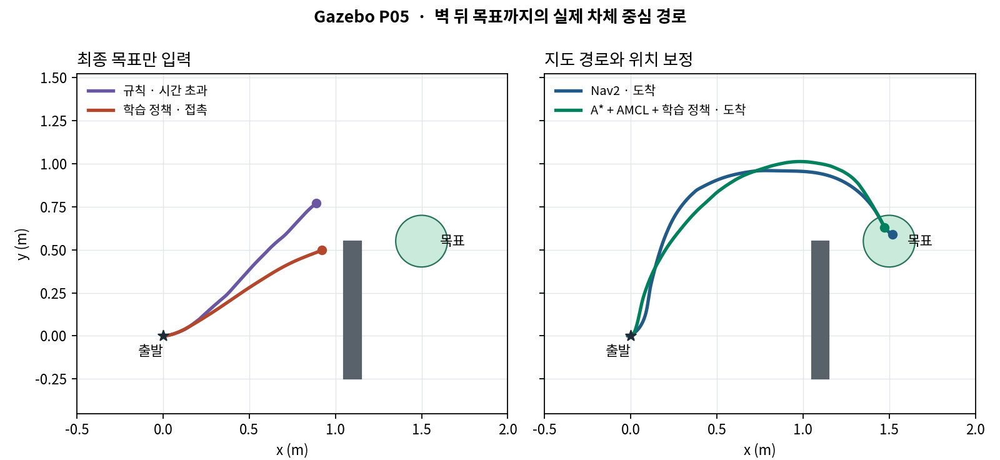

# GATE-02 · Gazebo에서 TMR이 벽 뒤 목표에 도착하는가

2026-11-24 노트북 시험. TMR은 Gazebo 방 B에서 원점에서 출발해 벽 뒤 목표 P05까지 주행하고 정지했다. **기본 주행 구성인 Nav2는 목표에서 4.30 cm 떨어진 곳에 정지했다.** 같은 방에서 A*로 우회 경로를 구하고 AMCL로 위치를 추정한 뒤 PPO로 속도를 결정한 구성은 두 차례 각각 **8.49 cm, 8.10 cm** 오차로 도착했다. 이 세 주행의 장애물 접촉은 모두 0회였다. 최종 목표만 받은 PPO는 정면 P01에 도착했고 P05에서는 벽과 접촉했다. [회차별 판정표](../../assets/logs/ros2/2026-11-24_tmr_rl05/results.csv)

## 주행과 판정 조건

- 매회 같은 방·차체를 새로 띄웠다. Gazebo 시드 4101, 출발 위치와 방향 (0, 0, 0), P01은 (0.60, 0.00) m, P05는 (1.50, 0.55) m다. 기존 NAV-03 시험의 SDF·지도·URDF 등을 실행 전에 해시로 대조한다. [고정 조건](../../assets/logs/ros2/2026-11-24_tmr_rl05/protocol.json) · [원본 목록](../../assets/logs/ros2/2026-11-23_tmr_nav03_evaluation/frozen_inputs.sha256)
- 제한은 시뮬레이션 시간 80초, 실제 모델 중심과 목표의 평면 거리 0.15 m 이내, 장애물 접촉 0회다. 정지 명령 후 안정화 0.60초를 두고 2초 이상 오도메트리의 선·각속도 여섯 성분이 각각 0.001 m/s 또는 rad/s 이내인지 확인했다. 같은 구간의 Gazebo 위치 변화 허용치는 0.002 m다. 접촉 센서의 지면 관측 공백 한도는 0.10초이며 이번 9회의 최대 공백은 각각 0.001초였다. [원본 재판정 코드](../../assets/logs/ros2/2026-11-24_tmr_rl05/verify_results.py)
- 학습 정책은 **XY 위치 도달**을 목표로 한다. P05의 마지막 방향은 두 회 모두 약 −63°였다. Nav2에는 목표 방향 0°도 지정했고 오차 2.80°, 액션 성공을 확인했다. Gazebo 모델의 월드 위치는 출발 조건과 최종 오차 검증에만 쓰고, 정책에 제공한 위치는 바퀴 오도메트리 또는 AMCL로 보정한 추정치다. [Nav2 원본 판정](../../assets/logs/ros2/2026-11-24_tmr_rl05/nav2_P05/result.json) · [PPO 반복 주행 원본](../../assets/logs/ros2/2026-11-24_tmr_rl05/guided_map_amcl_P05_repeat/result.json)

## 무엇을 바꿨고 왜 도착했는가

1. **2D에서 새 속도 정책을 학습했다.** 기존 RL-04 모델들은 미학습 기둥 배치에서 충돌이 잦았다. 새 모델은 단일 기둥 방에서 규칙 제어기가 내린 명령 59,090개를 우선 모방한 뒤 PPO로 16,384스텝 추가 학습했다. 시범 시드 51000~51255, 모방 36에폭, 학습 시드 5101, 소요 27.653초다. 미리 정한 Gazebo 투입 기준은 별도 시드 52000~52019에서 18/20 이상 도착·충돌 0회였고 결과는 20/20, 충돌 0회였다. 앞서 사용한 시드 24000~24019로 다시 보면 단일 기둥 20/20, 엇갈린 두 기둥 11/20·충돌 9회였다. 주행 중에는 학습 가중치를 고정한다. [학습 코드](../../05_ROS2_Integration/rl/train_guided.py) · [학습·판정 원본](../../assets/logs/ros2/2026-11-24_tmr_rl05/guided/run.json) · [다른 배치 평가](../../assets/logs/ros2/2026-11-24_tmr_rl05/guided/previous_holdout.csv)
2. **Gazebo의 스캔과 속도를 2D 정책에 연결했다.** `laser_frame`의 360개 거리 중 전방을 첫 값으로, 반시계 방향 15° 간격으로 24개를 읽는다. 정면은 원본의 180번이다. +∞는 최대 거리 8 m, −∞는 최소 거리 0.10 m로 넣고 선택된 빔이 NaN이면 정지한다. 24개 거리에 목표까지의 거리, 상대 방향의 cos·sin, 측정 전진·회전 속도를 더한 29개 값이 입력이다. 정책이 낸 두 값을 ±0.10 m/s와 ±0.39 rad/s 범위의 Twist로 변환한다. 스캔마다 약 10 Hz로 계산하고 오도메트리와의 시각 차이는 최대 75 ms다. 최신 입력이 0.30초 넘게 오래되거나 짝지은 입력을 0.40초 넘게 확보하지 못하면 정지한다. [ROS 연결 코드](../../05_ROS2_Integration/rl/gazebo_goal.py) · [공유 단위·제한](../../05_ROS2_Integration/rl/tmr_limits.py) · [ROS REP-117](https://github.com/ros-infrastructure/rep/blob/master/rep-0117.rst)
3. **정면 목표와 벽 우회를 나눠 시험했다.** P01에서는 학습 정책이 목표까지 10.10 cm를 남기고 정지했다. P05에서는 13.47초에 장애물에 한 번 접촉했고 규칙 제어도 80초 안에 도착하지 못했다. 이 결과를 보고 경로 계획을 추가했다. A*는 5 cm 지도에서 미확인·점유 영역을 막고 차체 반경과 9 cm 추가 여유를 고려한다. 정책에는 경로를 따라 약 45 cm 앞의 지점을 순차적으로 제공한다. 같은 가중치로도 벽을 우회했으나, 바퀴 오도메트리만 사용한 첫 주행은 실제 목표에서 20.55 cm 떨어져 실패했다. [경로 계획 코드](../../05_ROS2_Integration/rl/grid_route.py) · [오도메트리만 쓴 결과](../../assets/logs/ros2/2026-11-24_tmr_rl05/guided_map_P05/result.json)
4. **동일한 경로·가중치에 AMCL 위치 보정을 적용했다.** 알려진 출발 자세에서 AMCL을 초기화하고 라이다와 고정 지도로 얻은 `map → odom` 보정을 스캔 시각에 짝지은 바퀴 오도메트리에 합성했다. AMCL 이동 갱신 문턱은 0.05 m와 0.07 rad다. 여기서 A*는 중간 목표, AMCL은 위치, PPO는 전후진과 회전 속도를 결정한다. 목표 거리 0.10 m 이내라는 추정치에서 정지 명령을 보낸 뒤 독립적인 0.15 m 기준으로 채점했다. 경로 계획과 AMCL은 직접 주행 실패 후 순차적으로 추가한 실험이다. 방·시드·출발·최종 목표·채점 기준은 모든 비교에서 같았다. [실행 구성](../../05_ROS2_Integration/rl/run_gazebo_goal.py) · [실제로 사용한 중간 경로](../../assets/logs/ros2/2026-11-24_tmr_rl05/guided_map_amcl_P05_repeat/global_path.json)

## 9회 주행 결과

시간은 목표 판정·접촉·시간 초과까지의 시뮬레이션 시간이다. 오차는 각 주행의 최종 Gazebo 좌표에서 구했다. 정지 시간은 종료 후 실제로 관측한 구간이다.

| 목표 | 속도 제어 및 위치 추정 | 종료 원인 | 시간 (s) | XY 오차 (cm) | 장애물 접촉 | 정지 (s) | 판정 |
|---|---|---|---:|---:|---:|---:|---|
| P01 | Nav2 | 액션 성공 | 4.69 | 14.47 | 0 | 2.04 | 통과 |
| P01 | 규칙 · 바퀴 odom | 목표 | 5.10 | 9.28 | 0 | 2.07 | 통과 |
| P01 | PPO · 바퀴 odom | 목표 | 7.60 | 10.10 | 0 | 2.04 | 통과 |
| P05 | Nav2 | 액션 성공 | 30.19 | 4.30 | 0 | 2.04 | 통과 |
| P05 | 규칙 · 바퀴 odom | 시간 초과 | 80.00 | 64.83 | 0 | 2.07 | 실패 |
| P05 | PPO · 바퀴 odom | 접촉 | 13.47 | 58.07 | 1 | 2.07 | 실패 |
| P05 | A* + PPO · 바퀴 odom | 추정 위치에서 정지 | 33.00 | 20.55 | 0 | 2.07 | 실패 |
| P05 | A* + PPO · AMCL | 목표 | 31.90 | 8.49 | 0 | 2.07 | 통과 |
| P05 | A* + PPO · AMCL · 새로 실행 | 목표 | 31.90 | 8.10 | 0 | 2.07 | 통과 |

P05의 두 성공 회차에서 Gazebo 최종 (x, y)는 각각 (1.4730, 0.6305) m, (1.4835, 0.6293) m였고, 주행 거리는 2.187 m와 2.195 m였다. 두 번 모두 정지 구간은 2.074초로 오도메트리 속도 여섯 성분과 월드 좌표 변위가 모두 0이었다. 같은 시드·같은 지도이므로 다른 방이나 출발 위치의 성공률은 별도 시험이 필요하다. [주행별 원본과 제외 사유](../../assets/logs/ros2/2026-11-24_tmr_rl05/README.md)



## 재현과 증거

Ubuntu 24.04.5 LTS, ROS 2 Jazzy, Gazebo Sim 8.15.0, ros_gz_bridge 1.0.25, Nav2 AMCL·MPPI 1.3.14에서 실행했다. 2D 학습은 별도 가상환경의 Gymnasium 1.2.3, NumPy 2.2.6, PyTorch 2.9.1+cpu, Stable-Baselines3 2.7.1을 사용했다. Gazebo 주행에서는 시스템 Python 3.12.3과 NumPy 1.26.4로 같은 가중치를 읽었고, 지도 여유 거리 계산에는 SciPy 1.11.4를 사용했다. 다섯 PPO 시험에서 관측과 발행한 명령 1,179쌍을 원래 SB3 모델로 재계산했으며 정규화한 행동의 최대 절댓값 차이는 4.77×10⁻⁷ 이내였다. [모델](../../assets/logs/ros2/2026-11-24_tmr_rl05/guided/ppo.zip) · [추론 가중치](../../assets/logs/ros2/2026-11-24_tmr_rl05/guided/actor.npz) · [명령 대조](../../assets/logs/ros2/2026-11-24_tmr_rl05/guided/command_replay.json)

같은 노트북에서 아래 명령으로 새 Gazebo를 창 없이 띄우고 P05를 다시 주행할 수 있다. 셸에 적용한 ROS 환경에서 실행하며 출력은 새 임시 폴더에 저장한다. 두 실행을 비교할 때는 순차로 실행한다.

```bash
cd ~/workspace/github-repos/TIL/Projects/Tracked_Mobile_Robot/05_ROS2_Integration
source /opt/ros/jazzy/setup.bash
source install/setup.bash
cd rl
trial_dir=$(mktemp -d)
/usr/bin/python3 -B run_gazebo_goal.py guided_map_amcl P05 "$trial_dir/ppo" --bag
/usr/bin/python3 -B run_gazebo_goal.py nav2 P05 "$trial_dir/nav2"
```

저장된 원본만 다시 판정하려면 위 `rl` 디렉터리에서 아래를 실행한다. Gazebo 접촉과 월드 위치는 압축 JSON에서 검사한다. 별도로 ROS bag의 7개 토픽 39,114개 메시지를 역직렬화했다. 실제 주행 명령 319개가 정책 CSV와 일치했고 뒤의 29개는 모두 정지 명령이었다. [ROS bag](../../assets/logs/ros2/2026-11-24_tmr_rl05/guided_map_amcl_P05_repeat/bag/bag_0.mcap) · [bag 검산](../../assets/logs/ros2/2026-11-24_tmr_rl05/guided_map_amcl_P05_repeat/bag_check.json)

```bash
evidence=../../assets/logs/ros2/2026-11-24_tmr_rl05
/usr/bin/python3 -B "$evidence/verify_results.py"
/usr/bin/python3 -B "$evidence/check_bag.py"
```

## GATE-02 결정과 이어서 할 작업

**TMR의 기본 자율주행은 Nav2를 유지한다.** 기존의 다섯 경로·네 시드 Nav2 검증과 이번 P05 도착·방향·정지 근거가 있다. 학습 정책은 지도와 위치 보정이 있는 제한된 경로에서 속도 제어기로 동작했다. 독립적인 장애물 회피와 최종 방향 제어는 추가 검증 대상이다. 실제 궤도의 미끄럼 특성·센서 오차·제동 거리는 실물에서 확인해야 한다. [Nav2 20회 기준선](../../assets/logs/ros2/2026-11-23_tmr_nav03_evaluation/README.md) · [단계별 계획](../plans/2026-11-17_Ubuntu_Nav2_Simulation_and_RL_Roadmap_ko.md)

첫 실물 자율주행도 Nav2로 시작한다. 강화학습을 다시 연구할 때의 질문은 같은 경로·위치 추정에서 PPO가 MPPI에 비해 좁은 회전이나 궤도 미끄럼에서 경로 오차·접촉을 줄이는지다. 이 비교는 아직 수행하지 않았다.

| 환경 | 다음 작업 | 완료 판단에 필요한 근거 |
|---|---|---|
| 노트북 · PCB | ELEC-01에서 보호 저항 Rp·분기 퓨즈·정상 환산비와 온도계수 오차를 검토 | 채택 근거와 미정 조건을 기록. 승인된 변경부터 회로도·ERC·기본 PDF에 반영한 뒤 풋프린트·배치·배선·DRC·제작 검토 |
| 집 · 전압 계측 | 단일 채널 G1 결과를 바탕으로 E07/M01의 PA4·VREFINT 읽기 순서, 원시값·환산 로그 설계 | 두 채널을 구분한 로그와 멀티미터 대조. 마지막 보고는 배터리·외부 전원 두 2핀·USB 모두 분리 |
| 향후 실물 주행 | 실제 IMU·LiDAR의 프레임·시각, 엔코더와 궤도 미끄럼, 속도 추종, 통신 유실과 STM32 최종 정지 확인 | 실측과 정지 근거 확보 후 감독하 저속 주행. 이번 실행은 노트북에서 마침 |
